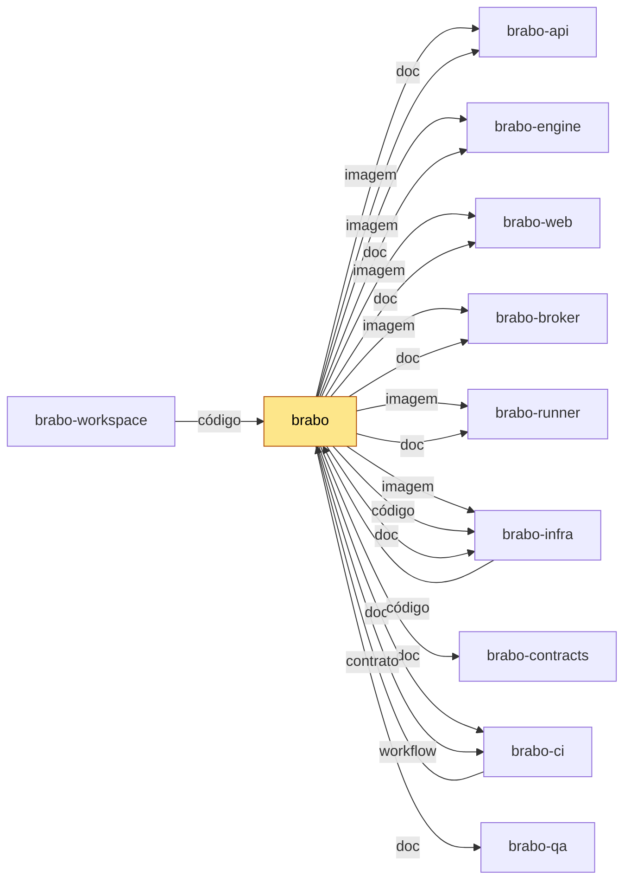

<div align="center">

[Português](README.md) · **English** · [Русский](README.ru.md) · [简体中文](README.zh-Hans.md)

<picture>
  <source media="(prefers-color-scheme: dark)" srcset="docs/assets/logo.svg" />
  <source media="(prefers-color-scheme: light)" srcset="docs/assets/logo.svg" />
  
</picture>

<h1>Brabo</h1>

**A team of AI agents takes your application from brief to deploy.
Final authority stays yours — by construction, not by convention.**

[](https://github.com/viralabs-dev/brabo/actions/workflows/docs-check.yml)
[](https://github.com/viralabs-dev/brabo/actions/workflows/release.yml)
[](LICENSE)
[](https://github.com/viralabs-dev/brabo/releases/latest)
[](https://viralabs-dev.github.io/brabo/prd/en/)
[](https://ko-fi.com/daneiel)

[Documentation](https://viralabs-dev.github.io/brabo/prd/en/) · [From zero to a deliverable](https://viralabs-dev.github.io/brabo/prd/en/tutorials/from-zero-to-deliverable) · [CHANGELOG](CHANGELOG.md) · [Security](SECURITY.md) · [Contributing](CONTRIBUTING.md)


<sub>The idea becomes rules, and what is missing becomes a question — the Creative hands the doubts back in the chat.</sub>

[Highlights](#highlights) · [Features](#features) · [Why it exists](#why-it-exists) · [How it is used](#how-it-is-used) · [How to develop](#how-to-develop) · [Documentation](#documentation) · [License](#license)

</div>

> The Portuguese [README.md](README.md) is the source and the one that is
> checked: it carries the current version and the count of business rules. This translation leaves the numbers out on purpose.

---

## Highlights

<table>
  <tr>
    <td width="25%" valign="top">🛑 <b>Nothing leaves without approval</b><br />Every external effect is born as a <code>proposed_action</code> and goes through the project's policy; merging into a protected branch is always yours.</td>
    <td width="25%" valign="top">🧱 <b>The agent is untrusted by construction</b><br />Ceilings on iterations, corrections and budget, in code. A prompt is not a guarantee; code is.</td>
    <td width="25%" valign="top">📜 <b>Everything recorded and immutable</b><br />An append-only event log with dense numbering per session: auditable cost and verifiable backup.</td>
    <td width="25%" valign="top">👥 <b>One team from brief to deliverable</b><br />Creative, PO, Architect, Dev Lead, devs per module, Infra, QA and SecOps over a real git repository.</td>
  </tr>
</table>

## Features

### The idea becomes rules, and what is missing becomes a question


The Creative hands the doubts back in the chat, with a suggestion and the
rules each one affects. You answer right there, and the answers become
business rules.

### The Architect decides in writing


The architecture decision is born as a pull request, and the architecture only moves on with
your confirmation.

### The devs work inside the container


Every command goes through the project's policy, and what the dev agent does
stays in the session thread.

### The merge is always yours


Pull requests that pass the gates arrive in the chat, and one click on Approve
confirms.

**From zero to a deliverable, in a real run:** [the walkthrough with the recordings](https://viralabs-dev.github.io/brabo/prd/en/tutorials/from-zero-to-deliverable) — 8 of 8 tasks, 102/102 tests, US$ 1.07.

---

<!-- vitrine:fim -->

## Why it exists

Building software with AI agents usually means trusting prompts. Brabo orchestrates a team of agents (Creative, PO,
Architect, Dev Lead, module devs, Infra, QA and SecOps) over a real git repository, and anything with an external effect
(command, commit, PR, token spend) is born as a proposal and goes through the project's policy. Merging into a
protected branch and changing an agent's instruction are not even released by the policy: they are the owner's.

This repository is the front door: it holds the documentation, the site, the installer and the release. The code lives
in the sibling repositories, split by layer ([why](https://viralabs-dev.github.io/brabo/prd/en/adr/0252-o-brabo-vira-um-conjunto-de-repositorios)).

## Where it fits

`brabo` is the center of the documentation: the site joins the siblings' `docs/` folders into one tree. For the product,
it pins the version of each component in `componentes.json`. If it changes, the installation and the site change.
The stack: NestJS and PostgreSQL with pgvector (api), Elixir, Phoenix and Oban (engine), React 19 (web), the `brabo-runner`
CLI on the user's machine, Docker Compose and Kubernetes (infra); Ollama and Neo4j are optional, and there is no Redis (queues live in Postgres).

<!-- mapa:inicio -->
<!-- Gerado do repos.yml do brabo por brabo-ci:scripts/ci/mapa-dos-repos.ts. Não edite à mão. -->

**brabo** — Porta de entrada do produto — documentação agregada, site, instalador e release. Quem instala usa o `install.sh` e as imagens e o binário das tags de `componentes.json`; o brabo-infra o clona nas aferições cruzadas.

| repo | propósito | como é usado | depende de | é usado por |
|---|---|---|---|---|
| **brabo** | Porta de entrada do produto — documentação agregada, site, instalador e release. | Quem instala usa o `install.sh` e as imagens e o binário das tags de `componentes.json`; o brabo-infra o clona nas aferições cruzadas. | brabo-api (imagem, doc), brabo-engine (imagem, doc), brabo-web (imagem, doc), brabo-broker (imagem, doc), brabo-runner (imagem, doc), brabo-infra (imagem, código, doc), brabo-contracts (doc), brabo-ci (doc, workflow), brabo-qa (doc) | brabo-ci (contrato), brabo-infra (código), brabo-workspace (código) |
| brabo-api | API do produto (NestJS, Drizzle, PostgreSQL/pgvector) — schema, RBAC, LLM, metering e gates. | Imagem publicada por tag e consumida pelo brabo e pelo brabo-infra; o brabo-web, o brabo-engine e o brabo-qa leem o código ou o `openapi.json` dele. | brabo-contracts (contrato), brabo-infra (código), brabo-qa (workflow), brabo-ci (workflow) | brabo (imagem, doc), brabo-engine (código), brabo-web (contrato), brabo-contracts (contrato), brabo-infra (código), brabo-qa (código), brabo-workspace (código) |
| brabo-engine | Engine (Elixir/OTP, Phoenix, Oban) — agentes, sessões, gates e roteamento de runners. | Imagem publicada por tag, usada pelo brabo e pelo brabo-infra. | brabo-contracts (contrato), brabo-api (código), brabo-runner (código), brabo-qa (workflow), brabo-ci (workflow) | brabo (imagem, doc), brabo-infra (código), brabo-qa (código), brabo-workspace (código) |
| brabo-web | Interface web (React 19, Vite) — telas, i18n e design system. | Imagem publicada por tag, usada pelo brabo e pelo brabo-infra. | brabo-contracts (contrato), brabo-api (contrato), brabo-qa (workflow), brabo-ci (workflow) | brabo (imagem, doc), brabo-infra (código), brabo-qa (código), brabo-workspace (código) |
| brabo-runner | CLI `brabo-runner` na máquina do usuário — PTY, container local e espelho. | Binário publicado por tag, instalado pelo brabo; o brabo-engine e o brabo-qa leem o código dele nos testes. | brabo-contracts (contrato), brabo-ci (workflow) | brabo (imagem, doc), brabo-engine (código), brabo-infra (código), brabo-qa (código), brabo-workspace (código) |
| brabo-broker | Único processo com o socket do Docker do servidor. | Imagem publicada por tag, usada pelo brabo e pelo brabo-infra. | brabo-contracts (contrato), brabo-qa (workflow), brabo-ci (workflow) | brabo (imagem, doc), brabo-infra (código), brabo-qa (código), brabo-workspace (código) |
| brabo-contracts | Contratos compartilhados — os pacotes `shared` e `docker-port`, `areas.json` e `fluxo.yml`. | Consumido por TAG (pacote no GitHub Packages ou arquivo baixado por raw na mesma tag); uma tag nova pede bump em api, web, runner, broker, engine, qa e infra. | brabo-api (contrato), brabo-ci (workflow) | brabo (doc), brabo-api (contrato), brabo-engine (contrato), brabo-web (contrato), brabo-runner (contrato), brabo-broker (contrato), brabo-infra (código), brabo-qa (contrato), brabo-workspace (código) |
| brabo-ci | Workflows reutilizáveis e a política de PR, escada de aprovação, promoção, tag e Dependabot. | Cada repo chama `uses: viralabs-dev/brabo-ci/...@<sha>`, fixado por SHA. | brabo-qa (contrato, workflow), brabo (contrato) | brabo (doc, workflow), brabo-api (workflow), brabo-engine (workflow), brabo-web (workflow), brabo-runner (workflow), brabo-broker (workflow), brabo-contracts (workflow), brabo-infra (workflow), brabo-qa (workflow), brabo-workspace (código, workflow) |
| brabo-infra | Composes, Dockerfiles de integração, `deploy/k8s`, scripts de dev, release e cadeia de suprimentos. | O brabo clona o brabo-infra no ref de `componentes.json` para subir a instalação; o brabo-api e o brabo-qa o clonam no CI. | brabo-api (código), brabo-engine (código), brabo-web (código), brabo-broker (código), brabo-runner (código), brabo-contracts (código), brabo (código), brabo-qa (workflow), brabo-ci (workflow) | brabo (imagem, código, doc), brabo-api (código), brabo-qa (código), brabo-workspace (código) |
| brabo-qa | E2E de navegador (Playwright), golden-sets e catálogo de funcionalidades — o portão da `main`. | O brabo-ci dispara o `e2e-pr` dele e lê o `funcionalidades.yml`; api, engine, web, broker e infra o chamam como portão. | brabo-api (código), brabo-engine (código), brabo-web (código), brabo-runner (código), brabo-broker (código), brabo-infra (código), brabo-contracts (contrato), brabo-ci (workflow) | brabo (doc), brabo-api (workflow), brabo-engine (workflow), brabo-web (workflow), brabo-broker (workflow), brabo-ci (contrato, workflow), brabo-infra (workflow), brabo-workspace (código) |
| brabo-workspace | Pasta-mãe `~/dev/brabo/` com os clones lado a lado e o `clonar-tudo.sh`. | Quem desenvolve roda `clonar-tudo.sh` uma vez; as sessões do Claude abrem nela. | brabo (código), brabo-api (código), brabo-engine (código), brabo-web (código), brabo-runner (código), brabo-broker (código), brabo-contracts (código), brabo-ci (código, workflow), brabo-infra (código), brabo-qa (código) | — |


<!-- mapa:fim -->

## How it is used

Install the release (the installer is a bash script: download it and run it with `bash`, never `curl | sh`). It checks the
signature of `checksums.txt`, brings the stack up with images pinned by digest, creates the first account and connects the runner:

```bash
curl -fsSLO https://github.com/viralabs-dev/brabo/releases/latest/download/install.sh && bash install.sh
```

`bash install.sh --print-plan` shows what it would do without running anything. The walkthrough is in
[Getting started](https://viralabs-dev.github.io/brabo/prd/en/getting-started).

## How to develop

The code lives in sibling repositories, cloned side by side by
[`brabo-workspace`](https://github.com/viralabs-dev/brabo-workspace); the dev environment is brought up by
[`brabo-infra`](https://github.com/viralabs-dev/brabo-infra):

```bash
git clone https://github.com/viralabs-dev/brabo-workspace.git ~/dev/brabo
cd ~/dev/brabo && ./clonar-tudo.sh && cd brabo-infra && make dev
```

To work on this repo's docs: `pnpm install`, `bash scripts/docs/montar-layout.sh` (brings the siblings at the SHA in
`irmaos.lock`; `BRABO_REF=dev` brings today's `dev`), `pnpm docs:check` and `pnpm docs:build`.
Conventions and flow: [CONTRIBUTING.md](CONTRIBUTING.md).

## What the CI guarantees

- **`docs-check`**: links, counts (RNs, ADRs, version) and the parity of the four languages match the siblings' code.
- **`politica` and `escada`** (required): branch name, PR body and the approval ladder.
- **`ci`** (chain): actionlint and `brabo-ci` pins. **`readme-esqueleto` and `mapa-alinhado`**: informational.
- **Release** (`release.yml`, from a `vX.Y.Z` tag): `componentes.json` pins each component, Trivy scans each image by
  digest and `checksums.txt` is signed with cosign. Without a tag it is only a rehearsal.
  Details in [Product release](https://viralabs-dev.github.io/brabo/prd/en/explanation/release-do-produto).

## Documentation

The site **[viralabs-dev.github.io/brabo](https://viralabs-dev.github.io/brabo/prd/en/)** is searchable and in four languages; `/prd/` comes from `main` and
[`/dev/`](https://viralabs-dev.github.io/brabo/dev/en/) from `dev`. The current version and the count of business rules are in the [Portuguese README](README.md).

| document | for |
|---|---|
| [Getting started](https://viralabs-dev.github.io/brabo/prd/en/getting-started) | from the installation to the first agent turn |
| [Architecture](https://viralabs-dev.github.io/brabo/prd/en/architecture) | code map, boundaries, invariants, technical debt |
| [Business rules](https://viralabs-dev.github.io/brabo/prd/en/business-rules) | the RNs, each with `file:line` and the test that covers it |
| [Runbook](https://viralabs-dev.github.io/brabo/prd/en/runbook) | deploy, rollout, restore, key rotation, cost incident |
| [Configuration](https://viralabs-dev.github.io/brabo/prd/en/reference/configuration) | every environment variable |
| [Git providers](https://viralabs-dev.github.io/brabo/prd/en/reference/git-providers) | the operation contract and the capabilities |
| [Artifacts](https://viralabs-dev.github.io/brabo/prd/en/reference/artifacts) | the schemas and who may emit each one |

More: [Security](SECURITY.md) · [Governance](GOVERNANCE.md) · [Support](SUPPORT.md) · [Code of conduct](CODE_OF_CONDUCT.md).

## How to replicate in your project

What serves another product: the signed `install.sh` (bash 3.2, no Node), the release pattern with `componentes.json`
and a per-digest `imagem.json`, and the site generator that joins the `docs/` of several repos through the `irmaos.lock` pin.
To adopt the PR policy, the approval ladder and the reusable workflows, follow the guide
[`brabo-ci:scripts/ci/docs/tutorials/adotar.md`](https://github.com/viralabs-dev/brabo-ci/blob/dev/scripts/ci/docs/tutorials/adotar.md).

## Support

If the project helps you, you can [buy me a coffee on Ko-fi](https://ko-fi.com/daneiel).

## License

[MIT](LICENSE) © 2026 Daniel Souza. The engine image bundles third-party tools, some under the GPL, and the web image
bundles OFL 1.1 fonts: versions and licenses in [THIRD_PARTY_NOTICES.md](THIRD_PARTY_NOTICES.md).
