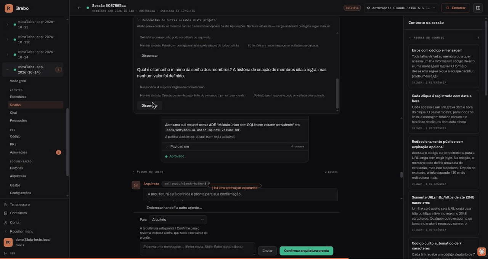
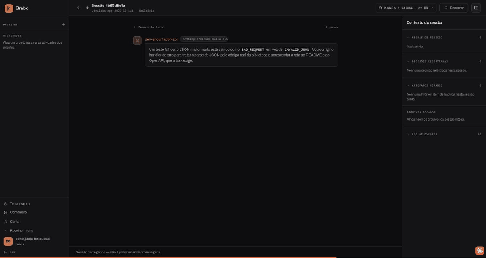
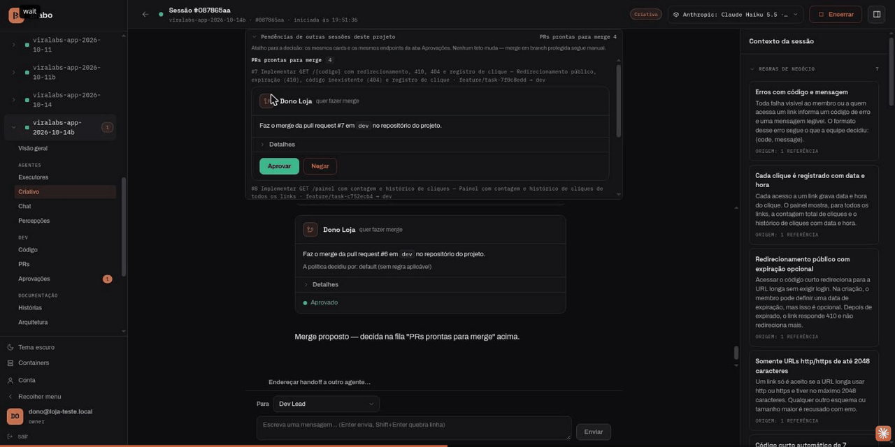

<div align="center">

[Português](README.md) · **English** · [Русский](README.ru.md) · [简体中文](README.zh-Hans.md)

<picture>
  <source media="(prefers-color-scheme: dark)" srcset="docs/assets/logo.svg" />
  <source media="(prefers-color-scheme: light)" srcset="docs/assets/logo.svg" />
  
</picture>

<h1>Brabo</h1>

**A team of AI agents takes your application from brief to deploy.
Final authority stays yours — by construction, not by convention.**

[](https://github.com/viralabs-dev/brabo/actions/workflows/docs-check.yml)
[](https://github.com/viralabs-dev/brabo/actions/workflows/release.yml)
[](LICENSE)
[](https://github.com/viralabs-dev/brabo/releases/latest)
[](https://viralabs-dev.github.io/brabo/prd/en/)
[](https://ko-fi.com/daneiel)

[Documentation](https://viralabs-dev.github.io/brabo/prd/en/) · [From zero to a deliverable](https://viralabs-dev.github.io/brabo/prd/en/tutorials/from-zero-to-deliverable) · [CHANGELOG](CHANGELOG.md) · [Security](SECURITY.md) · [Contributing](CONTRIBUTING.md)


<sub>The idea becomes rules, and what is missing becomes a question — the Creative hands the doubts back in the chat.</sub>

[Highlights](#highlights) · [Features](#features) · [What it is](#what-it-is) · [Get started](#get-started) · [Repositories](#brabo-repositories) · [Release](#how-the-release-is-built) · [Documentation](#documentation) · [License](#license)

</div>

> The Portuguese [README.md](README.md) is the source and the one that is
> checked: it carries the current version and the count of business rules. This translation leaves the numbers out on purpose.

---

## Highlights

<table>
  <tr>
    <td width="25%" valign="top">🛑 <b>Nothing leaves without approval</b><br />Every external effect is born as a <code>proposed_action</code> and goes through the project's policy; merging into a protected branch is always yours.</td>
    <td width="25%" valign="top">🧱 <b>The agent is untrusted by construction</b><br />Ceilings on iterations, corrections and budget, in code. A prompt is not a guarantee; code is.</td>
    <td width="25%" valign="top">📜 <b>Everything recorded and immutable</b><br />An append-only event log with dense numbering per session: auditable cost and verifiable backup.</td>
    <td width="25%" valign="top">👥 <b>One team from brief to deliverable</b><br />Creative, PO, Architect, Dev Lead, devs per module, Infra, QA and SecOps over a real git repository.</td>
  </tr>
</table>

## Features

### The idea becomes rules, and what is missing becomes a question


The Creative hands the doubts back in the chat, with a suggestion and the
rules each one affects. You answer right there, and the answers become
business rules.

### The Architect decides in writing



The architecture decision is born as a pull request, and the architecture only moves on with
your confirmation.

### The devs work inside the container



Every command goes through the project's policy, and what the dev agent does
stays in the session thread.

### The merge is always yours



Pull requests that pass the gates arrive in the chat, and one click on Approve
confirms.

**From zero to a deliverable, in a real run:** [the walkthrough with the recordings](https://viralabs-dev.github.io/brabo/prd/en/tutorials/from-zero-to-deliverable) — 8 of 8 tasks, 102/102 tests, US$ 1.07.

---

## What it is

Brabo orchestrates specialized agents — Creative, PO, Architect, Dev Lead and
devs per module, Infra, QA, SecOps, Psychologist and Anamnesis — working over a
real git repository, with Gitflow provisioned automatically.

Areas (dev, QA, Infra) have a **lead** as their only external address: whoever
sends a handoff talks to the lead, and delegation to the subagents is the
area's internal business.

What sets it apart from a coding assistant:

**Nothing with an external effect happens on its own.** Terminal command,
commit, push, PR, merge, token spend — everything is born as a
`proposed_action`, goes through the project's policy (`deny` always beats
`allow`) and only then executes. Two cases not even the policy can release:
**merging into a protected branch** and **changing an agent's instruction**.
They are ceilings applied after the whole policy, not defaults.

**The agent is untrusted by construction, and the system assumes it.** An
iteration ceiling, a ceiling on corrections per task, a budget that refuses the
call, a closed catalog of what Anamnesis may profile. A prompt is not a
guarantee; code is.

**Everything is recorded and immutable.** The event log is append-only with
dense numbering per session. That is what makes the Psychologist's evidence
traceable, the cost auditable and the backup verifiable.

**The team improves, with you in the loop.** The Psychologist proposes
hypotheses anchored in real events; Anamnesis derives your proficiency profile
and proposes versioned instruction patches. Every patch needs your sign-off,
and reverting creates a new version instead of erasing history.

## Get started

### Install Brabo

```bash
curl -fsSLO https://github.com/viralabs-dev/brabo/releases/latest/download/install.sh && bash install.sh
```

The installer is a bash script: download the file and run it with `bash`, never
`curl | sh`. It checks the signature of the Release's `checksums.txt` before
using any file, brings the stack up with images pinned by digest, creates the
first account and turns on the runner on this machine. Each step says what it
did, and whatever went wrong is named at the end. `bash install.sh --print-plan`
shows what it would do without running anything. The walkthrough is in
[Getting started](https://viralabs-dev.github.io/brabo/prd/en/getting-started).

### Develop Brabo

The code lives in sibling repositories, cloned side by side by
[`brabo-workspace`](https://github.com/viralabs-dev/brabo-workspace). The dev environment is brought up by
[`brabo-infra`](https://github.com/viralabs-dev/brabo-infra), which builds each service from those clones:

```bash
git clone https://github.com/viralabs-dev/brabo-workspace.git ~/dev/brabo
cd ~/dev/brabo && ./clonar-tudo.sh
cd brabo-infra && make dev
```

`make dev` checks that the siblings are in place and brings Docker Compose up.
The menu of everyday commands (Docker, Kubernetes, database and tests) also
lives in `brabo-infra`: `bash scripts/dev/bootstrap.sh`. The details are in its
README.

This repository holds the documentation, the installer and the release. To work
on the docs: `pnpm install`, `bash scripts/docs/montar-layout.sh` (brings in the
siblings' docs), `pnpm docs:check` and `pnpm docs:build`.

## Brabo repositories

Brabo is split into repositories by layer ([ADR 0252](https://viralabs-dev.github.io/brabo/prd/en/adr/0252-o-brabo-vira-um-conjunto-de-repositorios)).
`brabo` is the center of the documentation: the site at <https://viralabs-dev.github.io/brabo/prd/en/> joins the
siblings' `docs/` folders into a single tree.

| repo | role | depends on | used by |
|---|---|---|---|
| [brabo](https://github.com/viralabs-dev/brabo) | product: documentation, installer, release | all | infra, workspace |
| [brabo-api](https://github.com/viralabs-dev/brabo-api) | API (NestJS, Drizzle, PostgreSQL/pgvector) | contracts, ci, infra | brabo, infra, qa, web, contracts |
| [brabo-engine](https://github.com/viralabs-dev/brabo-engine) | engine (Elixir/OTP, Phoenix, Oban) | contracts, ci | brabo, infra, qa |
| [brabo-web](https://github.com/viralabs-dev/brabo-web) | web interface (React 19, Vite) | contracts, ci, api | brabo, infra |
| [brabo-runner](https://github.com/viralabs-dev/brabo-runner) | CLI on the user's machine | contracts, ci | brabo, infra |
| [brabo-broker](https://github.com/viralabs-dev/brabo-broker) | container broker | contracts, ci | brabo, infra, qa |
| [brabo-contracts](https://github.com/viralabs-dev/brabo-contracts) | shared contracts | ci (receives the api's areas.json) | api, broker, runner, web, engine, infra, brabo |
| [brabo-infra](https://github.com/viralabs-dev/brabo-infra) | composes, k8s, backup | ci, api, engine, web, runner, broker, contracts, brabo | brabo, qa, api |
| [brabo-ci](https://github.com/viralabs-dev/brabo-ci) | reusable workflows for policy, ladder and stamp | — | all |
| [brabo-qa](https://github.com/viralabs-dev/brabo-qa) | E2E, golden sets, instruments | ci, api, engine, broker, infra | brabo |
| [brabo-workspace](https://github.com/viralabs-dev/brabo-workspace) | parent folder with the clones side by side | ci | — |

## How the release is built

The product release is born here, from a `vX.Y.Z` tag, by the
[`release.yml`](.github/workflows/release.yml) workflow:

1. **[`componentes.json`](componentes.json)** pins the version of each
   component: the `brabo-infra` ref, the `brabo-runner` tag and the tag of each
   image (api, engine, web, broker and backup).
2. **Each repo's `imagem.json`.** The Release of each app tag carries an
   `imagem.json` with `imagem`, `tag` and `digest`. The workflow downloads the
   five and builds the product's `images.json`, with the images pinned by digest.
3. **Trivy by digest.** Each image is scanned by its digest, and a HIGH or
   CRITICAL vulnerability with a fix fails the release before signing.
4. **Signed `checksums.txt`.** `install.sh`, the `brabo-install-*` assets and
   `images.json` go into one `checksums.txt`, signed with cosign keyless by the
   workflow's identity. That signature is what `install.sh` verifies.

A `workflow_dispatch` without a tag is the dry run: it builds, scans and checks
everything, but neither signs nor publishes.

## Documentation

**📖 [viralabs-dev.github.io/brabo](https://viralabs-dev.github.io/brabo/prd/en/)** — the documentation, browsable and
searchable, in four languages. The site joins this repo's `docs/` folder with
the siblings' and publishes two environments: [`/prd/`](https://viralabs-dev.github.io/brabo/prd/en/) from `main` and
[`/dev/`](https://viralabs-dev.github.io/brabo/dev/en//) from `dev`. For the latest state, use `/dev/`.

| document | for |
|---|---|
| [Introduction](https://viralabs-dev.github.io/brabo/prd/en/) | the overview |
| [Getting started](https://viralabs-dev.github.io/brabo/prd/en/getting-started) | from the installation to the first agent turn |
| [Architecture](https://viralabs-dev.github.io/brabo/prd/en/architecture) | code map, boundaries, invariants, technical debt |
| [Business rules](https://viralabs-dev.github.io/brabo/prd/en/business-rules) | the RNs, each with `file:line` and the test that covers it (count in the [Portuguese README](README.md)) |
| [Runbook](https://viralabs-dev.github.io/brabo/prd/en/runbook) | deploy, rollout, restore, key rotation, cost incident |
| [Glossary](https://viralabs-dev.github.io/brabo/prd/en/glossary) | harness, gate, handoff, DEK, outbox, cycle K |
| [Observability](https://viralabs-dev.github.io/brabo/prd/en/explanation/observability) | how to follow an action across the three processes: trace, log and the path across layers |
| [Configuration](https://viralabs-dev.github.io/brabo/prd/en/reference/configuration) | every environment variable |
| [Scripts](https://viralabs-dev.github.io/brabo/prd/en/reference/scripts) | every `pnpm` command and `Makefile` target, extracted from the source |
| [Events](https://viralabs-dev.github.io/brabo/prd/en/reference/events) | the event log types, broadcasts and spans |
| [Permissions](https://viralabs-dev.github.io/brabo/prd/en/reference/permissions) | the `permissions.json` format and the decision order |
| [Artifacts](https://viralabs-dev.github.io/brabo/prd/en/reference/artifacts) | the schemas and who may emit each one |
| [Git providers](https://viralabs-dev.github.io/brabo/prd/en/reference/git-providers) | the operation contract and the capabilities |
| [Internal API](https://viralabs-dev.github.io/brabo/prd/en/reference/internal-api) | the api ↔ engine contract |
| [Security](SECURITY.md) | how to report a vulnerability |
| [Contributing](CONTRIBUTING.md) | flow, Definition of Done, what is accepted |
| [Governance](GOVERNANCE.md) | today's model (single maintainer), the three roles of the `community` mode and who gets into each |
| [Where to get help](SUPPORT.md) | which channel for each kind of subject |
| [Code of conduct](CODE_OF_CONDUCT.md) | Contributor Covenant 2.1 |

## Stack

- **api** — NestJS, Drizzle, PostgreSQL 16 with pgvector
- **engine** — Elixir/OTP, Phoenix and Oban (queues in Postgres)
- **web** — React 19, Vite and TanStack
- **runner** — the `brabo-runner` CLI on the user's machine, which runs the approved commands
- **broker** — the only process with the Docker socket, which brings up the projects' containers
- **Ollama** — local models, served by a container of their own
- **Neo4j** — optional: the knowledge graph, memory derived from the event log
- **deploy** — Docker Compose (dev, production and installation) and Kubernetes with Kustomize, in `brabo-infra`

No Redis: queues live in Postgres via Oban, and the rate limit is a sliding
window in SQL.

## License

[MIT](LICENSE) © 2026 Daniel Souza — the official text, with no additional
clauses.

The engine image bundles third-party tools the gates depend on (gitleaks,
hadolint, semgrep, yamllint), **some under the GPL**. Running them as a
separate process contaminates nothing, but **publishing the image** to a
registry creates an obligation to make the source available. It's all listed,
with each one's version and license, in
[THIRD_PARTY_NOTICES.md](THIRD_PARTY_NOTICES.md).

The web image bundles the design system's three fonts, all **OFL 1.1** — a
permissive license, but one that requires distributing the copyright notice
with the binary. It lives in [`brabo-web`](https://github.com/viralabs-dev/brabo-web), at
`public/fonts/LICENSE.txt`, served with the rest of the static files, and the
obligation is recorded in the same notices file.
