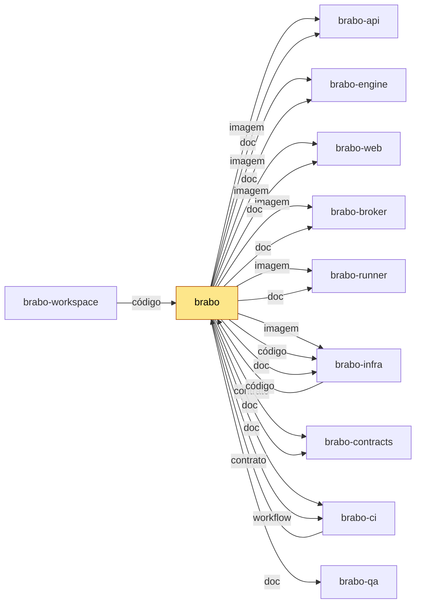

<div align="center">

**Português** · [English](README.en.md) · [Русский](README.ru.md) · [简体中文](README.zh-Hans.md)

<picture>
  <source media="(prefers-color-scheme: dark)" srcset="docs/assets/logo.svg" />
  
</picture>

<h1>Brabo</h1>

**Um time de agentes de IA conduz sua aplicação do brief ao deploy.
A autoridade final continua sendo sua — por construção, não por convenção.**

[](https://github.com/viralabs-dev/brabo/actions/workflows/docs-check.yml)
[](https://github.com/viralabs-dev/brabo/actions/workflows/ci.yml?query=branch%3Adev)
[](https://github.com/viralabs-dev/brabo/actions/workflows/ci.yml?query=branch%3Amain)
[](https://github.com/viralabs-dev/brabo/actions/workflows/release.yml)
[](LICENSE)
[](https://github.com/viralabs-dev/brabo/tags)
[](https://github.com/viralabs-dev/brabo/releases/latest)
[](https://viralabs-dev.github.io/brabo/prd/)
[](https://ko-fi.com/daneiel)

[Documentação](https://viralabs-dev.github.io/brabo/prd/) · [Do zero ao entregável](https://viralabs-dev.github.io/brabo/prd/tutorials/from-zero-to-deliverable) · [CHANGELOG](CHANGELOG.md) · [Segurança](SECURITY.md) · [Contribuir](CONTRIBUTING.md)

<picture>
  <source media="(prefers-color-scheme: dark)" srcset="docs/assets/capturas/perguntas-abertas-escuro.png" />
  
</picture>

<sub>A ideia vira regras, e o que falta vira pergunta — o Criativo devolve as dúvidas no chat.</sub>

[Diferenciais](#diferenciais) · [Recursos](#recursos) · [Para que existe](#para-que-existe) · [Como é usado](#como-é-usado) · [Como desenvolver](#como-desenvolver) · [Documentação](#documentação) · [Licença](#licença)

</div>

---

## Diferenciais

<table>
  <tr>
    <td width="25%" valign="top">🛑 <b>Nada sai sem aprovação</b><br />Todo efeito externo nasce como <code>proposed_action</code> e passa pela política do projeto; merge em branch protegida é sempre seu.</td>
    <td width="25%" valign="top">🧱 <b>Agente não confiável por construção</b><br />Tetos de iteração, de correção e de orçamento no código. Prompt não é garantia; código é.</td>
    <td width="25%" valign="top">📜 <b>Tudo registrado e imutável</b><br />Event log append-only com numeração densa por sessão: custo auditável e backup verificável.</td>
    <td width="25%" valign="top">👥 <b>Um time do brief ao entregável</b><br />Criativo, PO, Arquiteto, Dev Lead, devs por módulo, Infra, QA e SecOps sobre um repositório git real.</td>
  </tr>
</table>

## Recursos

### A ideia vira regras, e o que falta vira pergunta

<picture>
  <source media="(prefers-color-scheme: dark)" srcset="docs/assets/capturas/perguntas-abertas-escuro.png" />
  
</picture>

O Criativo devolve as dúvidas no chat, com sugestão e as regras que cada uma
afeta. Você responde ali mesmo, e as respostas viram regras de negócio.

### O Arquiteto decide por escrito

<picture>
  <source media="(prefers-color-scheme: dark)" srcset="docs/assets/capturas/arquitetura-escuro.png" />
  
</picture>

A decisão de arquitetura nasce como pull request, e a arquitetura só segue com a sua confirmação.

### Os devs trabalham dentro do container

<picture>
  <source media="(prefers-color-scheme: dark)" srcset="docs/assets/capturas/dev-agent-escuro.png" />
  
</picture>

Cada comando passa pela política do projeto, e o que o dev agent faz fica no fio
da sessão.

### O merge é sempre seu

<picture>
  <source media="(prefers-color-scheme: dark)" srcset="docs/assets/capturas/merges-no-chat-escuro.png" />
  
</picture>

As PRs que passam pelos gates chegam ao chat, e um clique em Aprovar confirma.

**Do zero ao entregável, numa execução real:** [o passo a passo com as gravações](https://viralabs-dev.github.io/brabo/prd/tutorials/from-zero-to-deliverable) — 8 de 8 tarefas, 102/102 testes, US$ 1,07.

---

<!-- vitrine:fim -->

## Para que existe

Montar um software com agentes de IA costuma significar confiar em prompts. O Brabo orquestra um time de agentes
(Criativo, PO, Arquiteto, Dev Lead, devs por módulo, Infra, QA e SecOps) sobre um repositório git real, e o que
tem efeito externo (comando, commit, PR, gasto de token) nasce como proposta e passa pela política do projeto.
Merge em branch protegida e mudança na instrução de um agente nem a política libera: são do dono.

Este repositório é a porta de entrada: guarda a documentação, o site, o instalador e a release. O código mora
nos irmãos, divididos por camada ([por quê](https://viralabs-dev.github.io/brabo/prd/adr/0252-o-brabo-vira-um-conjunto-de-repositorios)).

## Onde se encaixa

O `brabo` é o centro da documentação: o site junta a pasta `docs/` dos irmãos numa árvore só. Para o produto,
ele fixa a versão de cada componente em `componentes.json`. Se ele mudar, a instalação e o site mudam.
A stack: NestJS e PostgreSQL com pgvector (api), Elixir, Phoenix e Oban (engine), React 19 (web), CLI `brabo-runner`
na máquina do usuário, Docker Compose e Kubernetes (infra); Ollama e Neo4j são opcionais, e não há Redis (filas no Postgres).

<!-- mapa:inicio -->
<!-- Gerado do repos.yml do brabo por brabo-ci:scripts/ci/mapa-dos-repos.ts. Não edite à mão. -->

**brabo** — Porta de entrada do produto — documentação agregada, site, instalador e release. Quem instala usa o `install.sh` e as imagens e o binário das tags de `componentes.json`; o brabo-infra o clona nas aferições cruzadas.

| repo | propósito | como é usado | depende de | é usado por |
|---|---|---|---|---|
| **brabo** | Porta de entrada do produto — documentação agregada, site, instalador e release. | Quem instala usa o `install.sh` e as imagens e o binário das tags de `componentes.json`; o brabo-infra o clona nas aferições cruzadas. | brabo-api (imagem, doc), brabo-engine (imagem, doc), brabo-web (imagem, doc), brabo-broker (imagem, doc), brabo-runner (imagem, doc), brabo-infra (imagem, código, doc), brabo-contracts (contrato, doc), brabo-ci (doc, workflow), brabo-qa (doc) | brabo-ci (contrato), brabo-infra (código), brabo-workspace (código) |
| [brabo-api](https://github.com/viralabs-dev/brabo-api) | API do produto (NestJS, Drizzle, PostgreSQL/pgvector) — schema, RBAC, LLM, metering e gates. | Imagem publicada por tag e consumida pelo brabo e pelo brabo-infra; o brabo-web, o brabo-engine e o brabo-qa leem o código ou o `openapi.json` dele. | brabo-contracts (contrato), brabo-infra (código), brabo-qa (workflow), brabo-ci (workflow) | brabo (imagem, doc), brabo-engine (código), brabo-web (contrato), brabo-contracts (contrato), brabo-infra (código), brabo-qa (código), brabo-workspace (código) |
| [brabo-engine](https://github.com/viralabs-dev/brabo-engine) | Engine (Elixir/OTP, Phoenix, Oban) — agentes, sessões, gates e roteamento de runners. | Imagem publicada por tag, usada pelo brabo e pelo brabo-infra. | brabo-contracts (contrato), brabo-api (código), brabo-runner (código), brabo-qa (workflow), brabo-ci (workflow) | brabo (imagem, doc), brabo-infra (código), brabo-qa (código), brabo-workspace (código) |
| [brabo-web](https://github.com/viralabs-dev/brabo-web) | Interface web (React 19, Vite) — telas, i18n e design system. | Imagem publicada por tag, usada pelo brabo e pelo brabo-infra. | brabo-contracts (contrato), brabo-api (contrato), brabo-qa (workflow), brabo-ci (workflow) | brabo (imagem, doc), brabo-infra (código), brabo-qa (código), brabo-workspace (código) |
| [brabo-runner](https://github.com/viralabs-dev/brabo-runner) | CLI `brabo-runner` na máquina do usuário — PTY, container local e espelho. | Binário publicado por tag, instalado pelo brabo; o brabo-engine e o brabo-qa leem o código dele nos testes. | brabo-contracts (contrato), brabo-ci (workflow) | brabo (imagem, doc), brabo-engine (código), brabo-infra (código), brabo-qa (código), brabo-workspace (código) |
| [brabo-broker](https://github.com/viralabs-dev/brabo-broker) | Único processo com o socket do Docker do servidor. | Imagem publicada por tag, usada pelo brabo e pelo brabo-infra. | brabo-contracts (contrato), brabo-qa (workflow), brabo-ci (workflow) | brabo (imagem, doc), brabo-infra (código), brabo-qa (código), brabo-workspace (código) |
| [brabo-contracts](https://github.com/viralabs-dev/brabo-contracts) | Contratos compartilhados — os pacotes `shared` e `docker-port`, `areas.json` e `fluxo.yml`. | Consumido por TAG (pacote no GitHub Packages ou arquivo baixado por raw na mesma tag); uma tag nova pede bump em api, web, runner, broker, engine, qa e infra. | brabo-api (contrato), brabo-ci (workflow) | brabo (contrato, doc), brabo-api (contrato), brabo-engine (contrato), brabo-web (contrato), brabo-runner (contrato), brabo-broker (contrato), brabo-infra (código), brabo-qa (contrato), brabo-workspace (código) |
| [brabo-ci](https://github.com/viralabs-dev/brabo-ci) | Workflows reutilizáveis e a política de PR, escada de aprovação, promoção, tag e Dependabot. | Cada repo chama `uses: viralabs-dev/brabo-ci/...@<sha>`, fixado por SHA. | brabo-qa (contrato, workflow), brabo (contrato) | brabo (doc, workflow), brabo-api (workflow), brabo-engine (workflow), brabo-web (workflow), brabo-runner (workflow), brabo-broker (workflow), brabo-contracts (workflow), brabo-infra (workflow), brabo-qa (workflow), brabo-workspace (código, workflow) |
| [brabo-infra](https://github.com/viralabs-dev/brabo-infra) | Composes, Dockerfiles de integração, `deploy/k8s`, scripts de dev, release e cadeia de suprimentos. | O brabo clona o brabo-infra no ref de `componentes.json` para subir a instalação; o brabo-api e o brabo-qa o clonam no CI. | brabo-api (código), brabo-engine (código), brabo-web (código), brabo-broker (código), brabo-runner (código), brabo-contracts (código), brabo (código), brabo-qa (workflow), brabo-ci (workflow) | brabo (imagem, código, doc), brabo-api (código), brabo-qa (código), brabo-workspace (código) |
| [brabo-qa](https://github.com/viralabs-dev/brabo-qa) | E2E de navegador (Playwright), golden-sets e catálogo de funcionalidades — o portão da `main`. | O brabo-ci dispara o `e2e-pr` dele e lê o `funcionalidades.yml`; api, engine, web, broker e infra o chamam como portão. | brabo-api (código), brabo-engine (código), brabo-web (código), brabo-runner (código), brabo-broker (código), brabo-infra (código), brabo-contracts (contrato), brabo-ci (workflow) | brabo (doc), brabo-api (workflow), brabo-engine (workflow), brabo-web (workflow), brabo-broker (workflow), brabo-ci (contrato, workflow), brabo-infra (workflow), brabo-workspace (código) |
| [brabo-workspace](https://github.com/viralabs-dev/brabo-workspace) | Pasta-mãe `~/dev/brabo/` com os clones lado a lado e o `clonar-tudo.sh`. | Quem desenvolve roda `clonar-tudo.sh` uma vez; as sessões do Claude abrem nela. | brabo (código), brabo-api (código), brabo-engine (código), brabo-web (código), brabo-runner (código), brabo-broker (código), brabo-contracts (código), brabo-ci (código, workflow), brabo-infra (código), brabo-qa (código) | — |


<!-- mapa:fim -->

## Como é usado

Instale a release (o instalador é um script de bash: baixe e rode com `bash`, sem `curl | sh`). Ele confere a
assinatura do `checksums.txt`, sobe a stack com imagens fixadas por digest, cria a primeira conta e liga o runner:

```bash
curl -fsSLO https://github.com/viralabs-dev/brabo/releases/latest/download/install.sh && bash install.sh
```

`bash install.sh --print-plan` mostra o que ele faria sem executar nada. O passo a passo está em
[Primeiros passos](https://viralabs-dev.github.io/brabo/prd/getting-started).

## Como desenvolver

O código mora em repositórios irmãos, clonados lado a lado pelo
[`brabo-workspace`](https://github.com/viralabs-dev/brabo-workspace); quem sobe o dev é o
[`brabo-infra`](https://github.com/viralabs-dev/brabo-infra):

```bash
git clone https://github.com/viralabs-dev/brabo-workspace.git ~/dev/brabo
cd ~/dev/brabo && ./clonar-tudo.sh && cd brabo-infra && make dev
```

Para mexer na doc deste repo: `pnpm install`, `bash scripts/docs/montar-layout.sh` (traz os irmãos pelo SHA de
`irmaos.lock`; `BRABO_REF=dev` traz a `dev` de agora), `pnpm docs:check` e `pnpm docs:build`.
Convenções e fluxo: [CONTRIBUTING.md](CONTRIBUTING.md).

## O que o CI garante

- **`docs-check`**: os links, as contagens (RNs, ADRs, versão) e a paridade das quatro línguas batem com o código dos irmãos.
- **`politica` e `escada`** (obrigatórios): nome do branch, corpo da PR e a escada de aprovação.
- **`ci`** (cadeia): actionlint e pins do `brabo-ci`. **`readme-esqueleto` e `mapa-alinhado`**: informativos.
- **Release** (`release.yml`, a partir de uma tag `vX.Y.Z`): `componentes.json` fixa cada componente, o Trivy
  varre cada imagem por digest e o `checksums.txt` sai assinado com cosign. Sem tag é só ensaio.
  Detalhe em [Release do produto](https://viralabs-dev.github.io/brabo/prd/explanation/release-do-produto).

## Documentação

Versão atual: versão **v2.0.0** ([CHANGELOG](CHANGELOG.md)). O site
**[viralabs-dev.github.io/brabo](https://viralabs-dev.github.io/brabo/prd/)** tem busca e quatro idiomas;
`/prd/` vem da `main` e [`/dev/`](https://viralabs-dev.github.io/brabo/dev/) da `dev`.

| documento | para |
|---|---|
| [Primeiros passos](https://viralabs-dev.github.io/brabo/prd/getting-started) | da instalação ao primeiro turno de agente |
| [Arquitetura](https://viralabs-dev.github.io/brabo/prd/architecture) | code map, fronteiras, invariantes, dívida técnica |
| [Regras de negócio](https://viralabs-dev.github.io/brabo/prd/business-rules) | as 895 RNs, cada uma com `arquivo:linha` e o teste que a cobre |
| [Runbook](https://viralabs-dev.github.io/brabo/prd/runbook) | deploy, rollout, restore, rotação de chave, incidente de custo |
| [Configuração](https://viralabs-dev.github.io/brabo/prd/reference/configuration) | todas as variáveis de ambiente |
| [Providers de git](https://viralabs-dev.github.io/brabo/prd/reference/git-providers) | o contrato de quinze operações e as capabilities |
| [Artefatos](https://viralabs-dev.github.io/brabo/prd/reference/artifacts) | os doze schemas e quem pode emitir cada um |

Mais: [Segurança](SECURITY.md) · [Governança](GOVERNANCE.md) · [Suporte](SUPPORT.md) · [Conduta](CODE_OF_CONDUCT.md).

## Como replicar no seu projeto

Servem a outro produto: o `install.sh` assinado (bash 3.2, sem Node), o padrão de release com `componentes.json`
e `imagem.json` por digest, e o gerador do site que junta a `docs/` de vários repos pela trava `irmaos.lock`.
Para adotar a política de PR, a escada e os workflows reutilizáveis, siga o guia
[`brabo-ci:scripts/ci/docs/tutorials/adotar.md`](https://github.com/viralabs-dev/brabo-ci/blob/dev/scripts/ci/docs/tutorials/adotar.md).

## Apoie

Se o projeto te ajuda, você pode [pagar um café no Ko-fi](https://ko-fi.com/daneiel).

## Licença

[MIT](LICENSE) © 2026 Daniel Souza. A imagem do engine embute ferramentas de terceiros, algumas sob GPL, e a do
web, fontes OFL 1.1: versões e licenças em [THIRD_PARTY_NOTICES.md](THIRD_PARTY_NOTICES.md).
