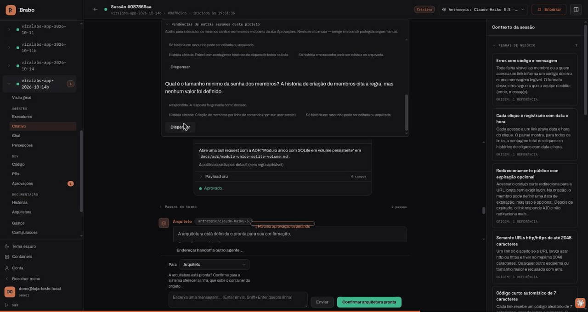
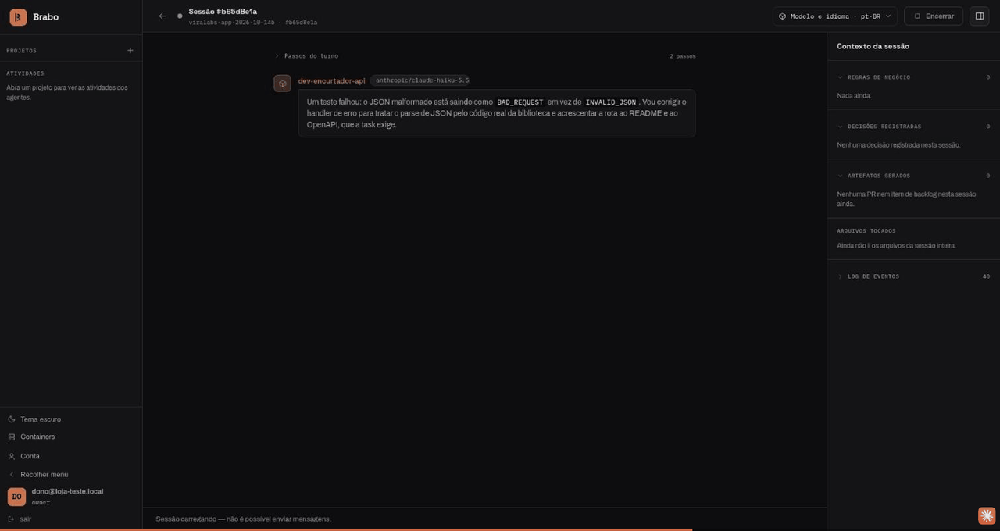
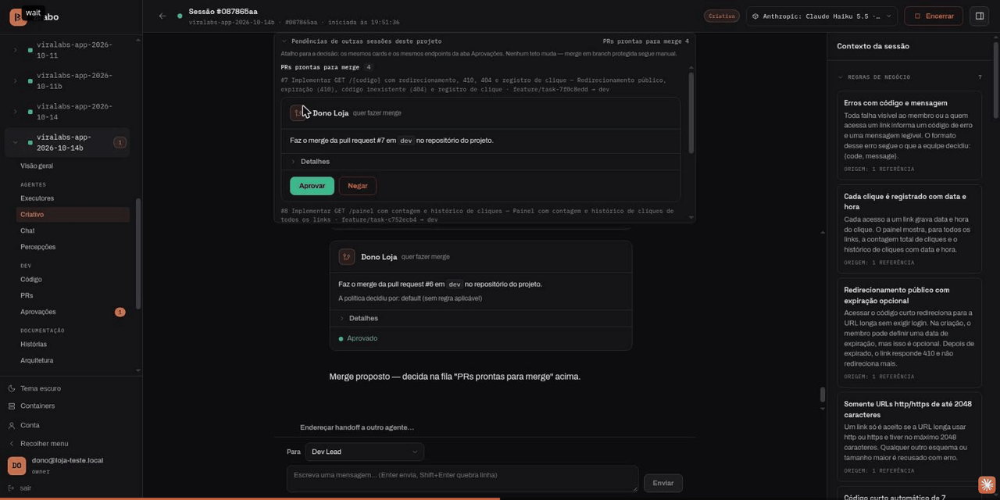
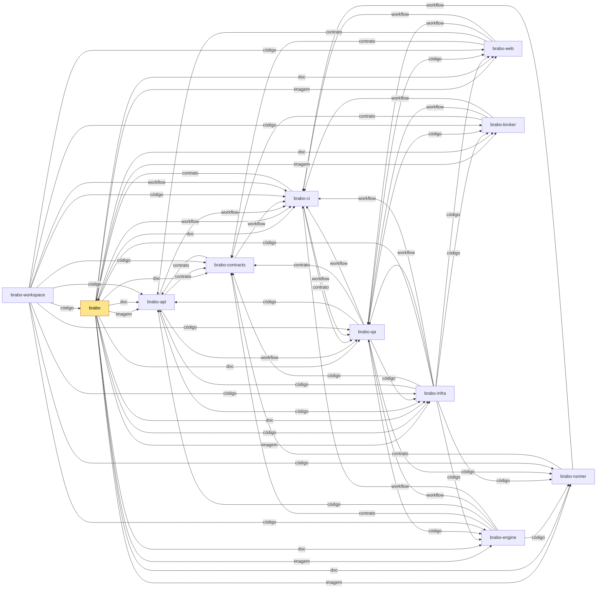

<div align="center">

**Português** · [English](README.en.md) · [Русский](README.ru.md) · [简体中文](README.zh-Hans.md)

<picture>
  <source media="(prefers-color-scheme: dark)" srcset="docs/assets/logo.svg" />
  <source media="(prefers-color-scheme: light)" srcset="docs/assets/logo.svg" />
  
</picture>

<h1>Brabo</h1>

**Um time de agentes de IA conduz sua aplicação do brief ao deploy.
A autoridade final continua sendo sua — por construção, não por convenção.**

[](https://github.com/viralabs-dev/brabo/actions/workflows/docs-check.yml)
[](https://github.com/viralabs-dev/brabo/actions/workflows/release.yml)
[](LICENSE)
[](https://github.com/viralabs-dev/brabo/releases/latest)
[](https://viralabs-dev.github.io/brabo/prd/)
[](https://ko-fi.com/daneiel)

[Documentação](https://viralabs-dev.github.io/brabo/prd/) · [Do zero ao entregável](https://viralabs-dev.github.io/brabo/prd/tutorials/from-zero-to-deliverable) · [CHANGELOG](CHANGELOG.md) · [Segurança](SECURITY.md) · [Contribuir](CONTRIBUTING.md)


<sub>A ideia vira regras, e o que falta vira pergunta — o Criativo devolve as dúvidas no chat.</sub>

[Diferenciais](#diferenciais) · [Recursos](#recursos) · [O que é](#o-que-é) · [Começar](#começar) · [Repositórios](#repositórios-do-brabo) · [Release](#como-a-release-é-montada) · [Documentação](#documentação) · [Licença](#licença)

</div>

---

## Diferenciais

<table>
  <tr>
    <td width="25%" valign="top">🛑 <b>Nada sai sem aprovação</b><br />Todo efeito externo nasce como <code>proposed_action</code> e passa pela política do projeto; merge em branch protegida é sempre seu.</td>
    <td width="25%" valign="top">🧱 <b>Agente não confiável por construção</b><br />Tetos de iteração, de correção e de orçamento no código. Prompt não é garantia; código é.</td>
    <td width="25%" valign="top">📜 <b>Tudo registrado e imutável</b><br />Event log append-only com numeração densa por sessão: custo auditável e backup verificável.</td>
    <td width="25%" valign="top">👥 <b>Um time do brief ao entregável</b><br />Criativo, PO, Arquiteto, Dev Lead, devs por módulo, Infra, QA e SecOps sobre um repositório git real.</td>
  </tr>
</table>

## Recursos

### A ideia vira regras, e o que falta vira pergunta


O Criativo devolve as dúvidas no chat, com sugestão e as regras que cada uma
afeta. Você responde ali mesmo, e as respostas viram regras de negócio.

### O Arquiteto decide por escrito



A decisão de arquitetura nasce como pull request, e a arquitetura só segue com a sua confirmação.

### Os devs trabalham dentro do container



Cada comando passa pela política do projeto, e o que o dev agent faz fica no fio
da sessão.

### O merge é sempre seu



As PRs que passam pelos gates chegam ao chat, e um clique em Aprovar confirma.

**Do zero ao entregável, numa execução real:** [o passo a passo com as gravações](https://viralabs-dev.github.io/brabo/prd/tutorials/from-zero-to-deliverable) — 8 de 8 tarefas, 102/102 testes, US$ 1,07.

---

## O que é

O Brabo orquestra agentes especializados — Criativo, PO, Arquiteto, Dev Lead e
devs por módulo, Infra, QA, SecOps, Psicólogo e Anamnese — trabalhando sobre um
repositório git real, com Gitflow provisionado automaticamente.

Áreas (dev, QA, Infra) têm um **lead** como único endereço externo: quem manda um
handoff fala com o lead, e a delegação para os subagentes é assunto interno da
área.

O que o separa de um assistente de código:

**Nada com efeito externo acontece sozinho.** Comando de terminal, commit,
push, PR, merge, gasto de token — tudo nasce como `proposed_action`, passa pela
política do projeto (`deny` sempre vence `allow`) e só então executa. Dois casos
nem a política consegue liberar: **merge em branch protegida** e **mudança na
instrução de um agente**. São tetos aplicados depois de toda a política, não
defaults.

**O agente não é confiável por construção, e o sistema assume isso.** Teto de
iterações, teto de correções por task, orçamento que recusa a chamada, catálogo
fechado do que a Anamnese pode perfilar. Prompt não é garantia; código é.

**Tudo é registrado e imutável.** O event log é append-only com numeração densa
por sessão. É o que torna a evidência do Psicólogo rastreável, o custo auditável
e o backup verificável.

**O time melhora, com você no circuito.** O Psicólogo propõe hipóteses ancoradas
em eventos reais; a Anamnese deriva seu perfil de proficiência e propõe patches
de instrução versionados. Cada patch precisa do seu aval, e reverter cria versão
nova em vez de apagar histórico.

## Começar

### Instalar o Brabo

```bash
curl -fsSLO https://github.com/viralabs-dev/brabo/releases/latest/download/install.sh && bash install.sh
```

O instalador é um script de bash: baixe o arquivo e rode com `bash`, sem
`curl | sh`. Ele confere a assinatura do `checksums.txt` da Release antes de
usar qualquer arquivo, sobe a stack com as imagens fixadas por digest, cria a
primeira conta e liga o runner nesta máquina. Cada passo diz o que fez, e o que
não deu certo aparece nomeado no fim. `bash install.sh --print-plan` mostra o
que ele faria sem executar nada. O passo a passo está em
[Primeiros passos](https://viralabs-dev.github.io/brabo/prd/getting-started).

### Desenvolver o Brabo

O código mora em repositórios irmãos, clonados lado a lado pelo
[`brabo-workspace`](https://github.com/viralabs-dev/brabo-workspace). Quem sobe o ambiente de dev é o
[`brabo-infra`](https://github.com/viralabs-dev/brabo-infra), construindo cada serviço a partir desses
clones:

```bash
git clone https://github.com/viralabs-dev/brabo-workspace.git ~/dev/brabo
cd ~/dev/brabo && ./clonar-tudo.sh
cd brabo-infra && make dev
```

O `make dev` confere que os irmãos estão no lugar e sobe o Docker Compose. O
menu de comandos do dia a dia (Docker, Kubernetes, banco e testes) também mora
no `brabo-infra`: `bash scripts/dev/bootstrap.sh`. Os detalhes estão no README
dele.

Este repositório guarda a documentação, o instalador e a release. Para mexer
na doc: `pnpm install`, `bash scripts/docs/montar-layout.sh` (traz os
irmãos pelo SHA de `irmaos.lock`; `BRABO_REF=dev` traz a `dev` de agora), `pnpm docs:check` e `pnpm docs:build`.

## Repositórios do Brabo

O Brabo é dividido em repositórios por camada ([ADR 0252](https://viralabs-dev.github.io/brabo/prd/adr/0252-o-brabo-vira-um-conjunto-de-repositorios)).
O `brabo` é o centro da documentação: o site em
<https://viralabs-dev.github.io/brabo/prd/> junta as pastas `docs/` dos irmãos numa árvore só.

<!-- mapa:inicio -->
<!-- Gerado do repos.yml do brabo por brabo-ci:scripts/ci/mapa-dos-repos.ts. Não edite à mão. -->
### Onde se encaixa

**brabo** — Porta de entrada do produto — documentação agregada, site, instalador e release. Quem instala usa o `install.sh` e as imagens e o binário das tags de `componentes.json`; o brabo-infra o clona nas aferições cruzadas.

| repo | propósito | como é usado | depende de | é usado por |
|---|---|---|---|---|
| **brabo** | Porta de entrada do produto — documentação agregada, site, instalador e release. | Quem instala usa o `install.sh` e as imagens e o binário das tags de `componentes.json`; o brabo-infra o clona nas aferições cruzadas. | brabo-api (imagem, doc), brabo-engine (imagem, doc), brabo-web (imagem, doc), brabo-broker (imagem, doc), brabo-runner (imagem, doc), brabo-infra (imagem, código, doc), brabo-contracts (doc), brabo-ci (doc, workflow), brabo-qa (doc) | brabo-ci (contrato), brabo-infra (código), brabo-workspace (código) |
| brabo-api | API do produto (NestJS, Drizzle, PostgreSQL/pgvector) — schema, RBAC, LLM, metering e gates. | Imagem publicada por tag e consumida pelo brabo e pelo brabo-infra; o brabo-web, o brabo-engine e o brabo-qa leem o código ou o `openapi.json` dele. | brabo-contracts (contrato), brabo-infra (código), brabo-qa (workflow), brabo-ci (workflow) | brabo (imagem, doc), brabo-engine (código), brabo-web (contrato), brabo-contracts (contrato), brabo-infra (código), brabo-qa (código), brabo-workspace (código) |
| brabo-engine | Engine (Elixir/OTP, Phoenix, Oban) — agentes, sessões, gates e roteamento de runners. | Imagem publicada por tag, usada pelo brabo e pelo brabo-infra. | brabo-contracts (contrato), brabo-api (código), brabo-runner (código), brabo-qa (workflow), brabo-ci (workflow) | brabo (imagem, doc), brabo-infra (código), brabo-qa (código), brabo-workspace (código) |
| brabo-web | Interface web (React 19, Vite) — telas, i18n e design system. | Imagem publicada por tag, usada pelo brabo e pelo brabo-infra. | brabo-contracts (contrato), brabo-api (contrato), brabo-qa (workflow), brabo-ci (workflow) | brabo (imagem, doc), brabo-infra (código), brabo-qa (código), brabo-workspace (código) |
| brabo-runner | CLI `brabo-runner` na máquina do usuário — PTY, container local e espelho. | Binário publicado por tag, instalado pelo brabo; o brabo-engine e o brabo-qa leem o código dele nos testes. | brabo-contracts (contrato), brabo-ci (workflow) | brabo (imagem, doc), brabo-engine (código), brabo-infra (código), brabo-qa (código), brabo-workspace (código) |
| brabo-broker | Único processo com o socket do Docker do servidor. | Imagem publicada por tag, usada pelo brabo e pelo brabo-infra. | brabo-contracts (contrato), brabo-qa (workflow), brabo-ci (workflow) | brabo (imagem, doc), brabo-infra (código), brabo-qa (código), brabo-workspace (código) |
| brabo-contracts | Contratos compartilhados — os pacotes `shared` e `docker-port`, `areas.json` e `fluxo.yml`. | Consumido por TAG (pacote no GitHub Packages ou arquivo baixado por raw na mesma tag); uma tag nova pede bump em api, web, runner, broker, engine, qa e infra. | brabo-api (contrato), brabo-ci (workflow) | brabo (doc), brabo-api (contrato), brabo-engine (contrato), brabo-web (contrato), brabo-runner (contrato), brabo-broker (contrato), brabo-infra (código), brabo-qa (contrato), brabo-workspace (código) |
| brabo-ci | Workflows reutilizáveis e a política de PR, escada de aprovação, promoção, tag e Dependabot. | Cada repo chama `uses: viralabs-dev/brabo-ci/...@<sha>`, fixado por SHA. | brabo-qa (contrato, workflow), brabo (contrato) | brabo (doc, workflow), brabo-api (workflow), brabo-engine (workflow), brabo-web (workflow), brabo-runner (workflow), brabo-broker (workflow), brabo-contracts (workflow), brabo-infra (workflow), brabo-qa (workflow), brabo-workspace (código, workflow) |
| brabo-infra | Composes, Dockerfiles de integração, `deploy/k8s`, scripts de dev, release e cadeia de suprimentos. | O brabo clona o brabo-infra no ref de `componentes.json` para subir a instalação; o brabo-api e o brabo-qa o clonam no CI. | brabo-api (código), brabo-engine (código), brabo-web (código), brabo-broker (código), brabo-runner (código), brabo-contracts (código), brabo (código), brabo-qa (workflow), brabo-ci (workflow) | brabo (imagem, código, doc), brabo-api (código), brabo-qa (código), brabo-workspace (código) |
| brabo-qa | E2E de navegador (Playwright), golden-sets e catálogo de funcionalidades — o portão da `main`. | O brabo-ci dispara o `e2e-pr` dele e lê o `funcionalidades.yml`; api, engine, web, broker e infra o chamam como portão. | brabo-api (código), brabo-engine (código), brabo-web (código), brabo-runner (código), brabo-broker (código), brabo-infra (código), brabo-contracts (contrato), brabo-ci (workflow) | brabo (doc), brabo-api (workflow), brabo-engine (workflow), brabo-web (workflow), brabo-broker (workflow), brabo-ci (contrato, workflow), brabo-infra (workflow), brabo-workspace (código) |
| brabo-workspace | Pasta-mãe `~/dev/brabo/` com os clones lado a lado e o `clonar-tudo.sh`. | Quem desenvolve roda `clonar-tudo.sh` uma vez; as sessões do Claude abrem nela. | brabo (código), brabo-api (código), brabo-engine (código), brabo-web (código), brabo-runner (código), brabo-broker (código), brabo-contracts (código), brabo-ci (código, workflow), brabo-infra (código), brabo-qa (código) | — |


<!-- mapa:fim -->

## Como a release é montada

A release do produto nasce aqui, pelo workflow
[`release.yml`](.github/workflows/release.yml), a partir de uma tag `vX.Y.Z`:

1. **[`componentes.json`](componentes.json)** fixa a versão de cada componente:
   a ref do `brabo-infra`, a tag do `brabo-runner` e a tag de cada imagem
   (api, engine, web, broker e backup).
2. **O `imagem.json` de cada repo.** A Release de cada tag de app traz um
   `imagem.json` com `imagem`, `tag` e `digest`. O workflow baixa os cinco e
   monta o `images.json` do produto, com as imagens fixadas por digest.
3. **Trivy por digest.** Cada imagem é escaneada pelo digest, e vulnerabilidade
   HIGH ou CRITICAL com correção reprova antes de assinar.
4. **`checksums.txt` assinado.** O `install.sh`, os assets `brabo-install-*` e o
   `images.json` entram num `checksums.txt`, assinado com cosign keyless pela
   identidade do workflow. É essa assinatura que o `install.sh` confere.

Um `workflow_dispatch` sem tag é o ensaio: monta, escaneia e confere tudo, mas
não assina nem publica.

## Documentação

Versão atual: versão **v2.0.0** ([CHANGELOG](CHANGELOG.md)).

**📖 [viralabs-dev.github.io/brabo](https://viralabs-dev.github.io/brabo/prd/)** — a documentação navegável e com
busca, em quatro idiomas. O site junta a pasta `docs/` deste repo e as dos
irmãos e publica dois ambientes: [`/prd/`](https://viralabs-dev.github.io/brabo/prd/) a partir da `main` e
[`/dev/`](https://viralabs-dev.github.io/brabo/dev/) a partir da `dev`. Para o
estado mais recente, use o `/dev/`.

| documento | para |
|---|---|
| [Introdução](https://viralabs-dev.github.io/brabo/prd/) | o panorama |
| [Primeiros passos](https://viralabs-dev.github.io/brabo/prd/getting-started) | da instalação ao primeiro turno de agente |
| [Arquitetura](https://viralabs-dev.github.io/brabo/prd/architecture) | code map, fronteiras, invariantes, dívida técnica |
| [Regras de negócio](https://viralabs-dev.github.io/brabo/prd/business-rules) | as 887 RNs, cada uma com `arquivo:linha` e o teste que a cobre |
| [Runbook](https://viralabs-dev.github.io/brabo/prd/runbook) | deploy, rollout, restore, rotação de chave, incidente de custo |
| [Glossário](https://viralabs-dev.github.io/brabo/prd/glossary) | harness, gate, handoff, DEK, outbox, ciclo K |
| [Observabilidade](https://viralabs-dev.github.io/brabo/prd/explanation/observability) | como se segue uma ação pelos três processos: trace, log e o caminho entre camadas |
| [Configuração](https://viralabs-dev.github.io/brabo/prd/reference/configuration) | todas as variáveis de ambiente |
| [Scripts](https://viralabs-dev.github.io/brabo/prd/reference/scripts) | todo comando `pnpm` e alvo do `Makefile`, extraídos da fonte |
| [Eventos](https://viralabs-dev.github.io/brabo/prd/reference/events) | os tipos do event log, broadcasts e spans |
| [Permissões](https://viralabs-dev.github.io/brabo/prd/reference/permissions) | o formato do `permissions.json` e a ordem da decisão |
| [Artefatos](https://viralabs-dev.github.io/brabo/prd/reference/artifacts) | os doze schemas e quem pode emitir cada um |
| [Providers de git](https://viralabs-dev.github.io/brabo/prd/reference/git-providers) | o contrato de quinze operações e as capabilities |
| [API interna](https://viralabs-dev.github.io/brabo/prd/reference/internal-api) | o contrato api ↔ engine |
| [Segurança](SECURITY.md) | como reportar uma vulnerabilidade |
| [Como contribuir](CONTRIBUTING.md) | fluxo, Definition of Done, o que é aceito |
| [Governança](GOVERNANCE.md) | modelo hoje (mantenedor único), os três papéis do modo `community` e o critério de quem entra em cada um |
| [Onde pedir ajuda](SUPPORT.md) | qual canal para cada tipo de assunto |
| [Código de conduta](CODE_OF_CONDUCT.md) | Contributor Covenant 2.1 |

## Stack

- **api** — NestJS, Drizzle, PostgreSQL 16 com pgvector
- **engine** — Elixir/OTP, Phoenix e Oban (filas no Postgres)
- **web** — React 19, Vite e TanStack
- **runner** — CLI `brabo-runner` na máquina do usuário, que executa os comandos aprovados
- **broker** — o único processo com o socket do Docker, que sobe os containers dos projetos
- **Ollama** — modelos locais, servidos por um container próprio
- **Neo4j** — opcional: o grafo de conhecimento, memória derivada do event log
- **deploy** — Docker Compose (dev, produção e instalação) e Kubernetes com Kustomize, no `brabo-infra`

Sem Redis: as filas moram no Postgres via Oban, e o rate limit é uma janela
deslizante em SQL.

## Licença

[MIT](LICENSE) © 2026 Daniel Souza — texto oficial, sem cláusulas adicionais.

A imagem do engine embute ferramentas de terceiros de que os gates dependem
(gitleaks, hadolint, semgrep, yamllint), **algumas sob GPL**. Executá-las como
processo separado não contamina nada, mas **publicar a imagem** num registry
cria obrigação de disponibilizar fonte. Está tudo levantado, com versão e
licença de cada uma, em [THIRD_PARTY_NOTICES.md](THIRD_PARTY_NOTICES.md).

A imagem do web embute as três fontes do design system, todas **OFL 1.1** — uma
licença permissiva, mas que exige distribuir o aviso de copyright junto do
binário. Ele mora no [`brabo-web`](https://github.com/viralabs-dev/brabo-web), em
`public/fonts/LICENSE.txt`, servido com o resto do estático, e a obrigação está
registrada no mesmo arquivo de avisos.
