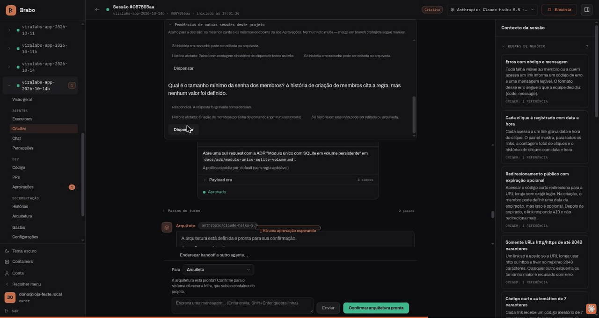
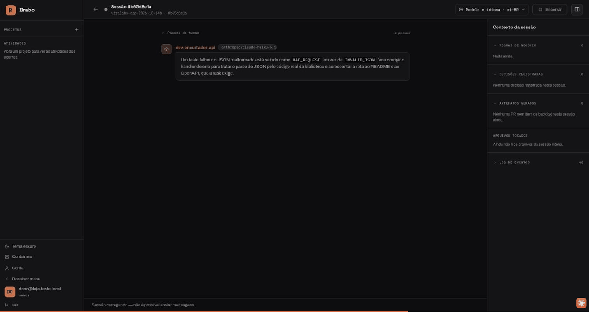
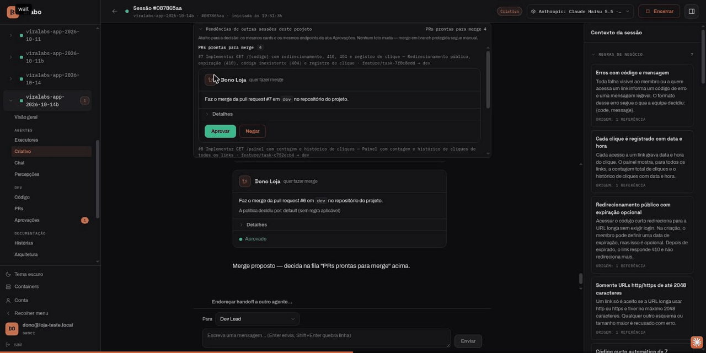

<div align="center">

[Português](README.md) · [English](README.en.md) · **Русский** · [简体中文](README.zh-Hans.md)

<picture>
  <source media="(prefers-color-scheme: dark)" srcset="docs/assets/logo.svg" />
  <source media="(prefers-color-scheme: light)" srcset="docs/assets/logo.svg" />
  
</picture>

<h1>Brabo</h1>

**Команда ИИ-агентов ведёт ваше приложение от брифа до деплоя.
Последнее слово остаётся за вами — по устройству системы, а не по договорённости.**

[](https://github.com/viralabs-dev/brabo/actions/workflows/docs-check.yml)
[](https://github.com/viralabs-dev/brabo/actions/workflows/release.yml)
[](LICENSE)
[](https://github.com/viralabs-dev/brabo/releases/latest)
[](https://viralabs-dev.github.io/brabo/prd/ru/)
[](https://ko-fi.com/daneiel)

[Документация](https://viralabs-dev.github.io/brabo/prd/ru/) · [С нуля до результата](https://viralabs-dev.github.io/brabo/prd/ru/tutorials/from-zero-to-deliverable) · [CHANGELOG](CHANGELOG.md) · [Безопасность](SECURITY.md) · [Участие](CONTRIBUTING.md)


<sub>Идея превращается в правила, а то, чего не хватает, — в вопрос: Креатив возвращает сомнения в чат.</sub>

[Отличия](#отличия) · [Возможности](#возможности) · [Что это](#что-это) · [Начало](#начало) · [Репозитории](#репозитории-brabo) · [Релиз](#как-собирается-релиз) · [Документация](#документация) · [Лицензия](#лицензия)

</div>

> Источник и проверяемая версия — [README.md](README.md) на португальском: в нём
> указаны текущая версия и количество бизнес-правил. Этот
> перевод намеренно опускает числа.

---

## Отличия

<table>
  <tr>
    <td width="25%" valign="top">🛑 <b>Ничего без одобрения</b><br />Любой внешний эффект рождается как <code>proposed_action</code> и проходит политику проекта; merge в защищённую ветку — всегда ваше решение.</td>
    <td width="25%" valign="top">🧱 <b>Агенту не доверяют по устройству</b><br />Потолки итераций, исправлений и бюджета — в коде. Промпт не гарантия; код — гарантия.</td>
    <td width="25%" valign="top">📜 <b>Всё записано и неизменяемо</b><br />Журнал событий только на добавление, с плотной нумерацией в каждой сессии: проверяемая стоимость и проверяемый бэкап.</td>
    <td width="25%" valign="top">👥 <b>Одна команда от брифа до результата</b><br />Креатив, PO, Архитектор, Dev Lead, разработчики по модулям, Infra, QA и SecOps над настоящим git-репозиторием.</td>
  </tr>
</table>

## Возможности

### Идея превращается в правила, а то, чего не хватает, — в вопрос


Креатив возвращает сомнения в чат, с предложенным ответом и правилами, которые
затрагивает каждый вопрос. Вы отвечаете прямо там, и ответы становятся
бизнес-правилами.

### Архитектор решает письменно



Архитектурное решение рождается как pull request, а архитектура идёт дальше только после вашего
подтверждения.

### Разработчики работают внутри контейнера



Каждая команда проходит политику проекта, а то, что делает dev-агент,
остаётся в ленте сессии.

### Merge всегда за вами



Pull request, прошедшие гейты, приходят в чат, и один клик на «Одобрить»
подтверждает merge.

**С нуля до результата, в реальном прогоне:** [пошаговый разбор с записями](https://viralabs-dev.github.io/brabo/prd/ru/tutorials/from-zero-to-deliverable) — 8 из 8 задач, 102/102 тестов, US$ 1,07.

---

## Что это

Brabo оркестрирует специализированных агентов — Креатив, PO, Архитектор,
Dev Lead и разработчики по модулям, Infra, QA, SecOps, Психолог и Анамнез —
работающих над настоящим git-репозиторием с автоматически настроенным Gitflow.

У областей (dev, QA, Infra) есть **lead** — единственный внешний адрес: кто
передаёт handoff, говорит с lead, а делегирование субагентам — внутреннее дело
области.

Чем он отличается от ассистента для кода:

**Ничто с внешним эффектом не происходит само.** Команда терминала, commit,
push, PR, merge, расход токенов — всё рождается как `proposed_action`, проходит
политику проекта (`deny` всегда сильнее `allow`) и только потом выполняется.
Два случая не может разрешить даже политика: **merge в защищённую ветку** и
**изменение инструкции агента**. Это потолки, применяемые после всей политики,
а не значения по умолчанию.

**Агенту не доверяют по устройству, и система это учитывает.** Потолок
итераций, потолок исправлений на задачу, бюджет, отклоняющий вызов, закрытый
каталог того, что может профилировать Анамнез. Промпт не гарантия; код —
гарантия.

**Всё записано и неизменяемо.** Журнал событий — только на добавление, с
плотной нумерацией в каждой сессии. Именно это делает доказательства Психолога
отслеживаемыми, стоимость — проверяемой, а бэкап — проверяемым.

**Команда становится лучше, а вы остаётесь в контуре.** Психолог предлагает
гипотезы, опирающиеся на реальные события; Анамнез выводит ваш профиль
квалификации и предлагает версионированные патчи инструкций. Каждый патч
требует вашего согласия, а откат создаёт новую версию вместо удаления истории.

## Начало

### Установить Brabo

```bash
curl -fsSLO https://github.com/viralabs-dev/brabo/releases/latest/download/install.sh && bash install.sh
```

Установщик — это скрипт на bash: скачайте файл и запустите его через `bash`,
никогда не через `curl | sh`. Прежде чем использовать любой файл, он проверяет
подпись `checksums.txt` релиза, поднимает стек с образами, закреплёнными по
digest, создаёт первую учётную запись и включает runner на этой машине. Каждый
шаг сообщает, что сделал, а то, что не удалось, названо в конце.
`bash install.sh --print-plan` показывает, что он сделал бы, ничего не выполняя.
Пошаговое описание — в [Первых шагах](https://viralabs-dev.github.io/brabo/prd/ru/getting-started).

### Разрабатывать Brabo

Код живёт в соседних репозиториях, которые
[`brabo-workspace`](https://github.com/viralabs-dev/brabo-workspace) клонирует рядом друг с другом. Среду
разработки поднимает [`brabo-infra`](https://github.com/viralabs-dev/brabo-infra), собирая каждый сервис
из этих клонов:

```bash
git clone https://github.com/viralabs-dev/brabo-workspace.git ~/dev/brabo
cd ~/dev/brabo && ./clonar-tudo.sh
cd brabo-infra && make dev
```

`make dev` проверяет, что соседние репозитории на месте, и поднимает Docker
Compose. Меню повседневных команд (Docker, Kubernetes, база данных и тесты)
тоже живёт в `brabo-infra`: `bash scripts/dev/bootstrap.sh`. Подробности — в
его README.

Этот репозиторий хранит документацию, установщик и релиз. Чтобы работать с
документацией: `pnpm install`, `bash scripts/docs/montar-layout.sh` (подтягивает
документацию соседних репозиториев), `pnpm docs:check` и `pnpm docs:build`.

## Репозитории Brabo

Brabo разделён на репозитории по слоям ([ADR 0252](https://viralabs-dev.github.io/brabo/prd/ru/adr/0252-o-brabo-vira-um-conjunto-de-repositorios)).
`brabo` — центр документации: сайт <https://viralabs-dev.github.io/brabo/prd/ru/> объединяет папки `docs/` соседних
репозиториев в одно дерево.

| репозиторий | роль | зависит от | используется в |
|---|---|---|---|
| [brabo](https://github.com/viralabs-dev/brabo) | продукт: документация, установщик, релиз | все | infra, workspace |
| [brabo-api](https://github.com/viralabs-dev/brabo-api) | API (NestJS, Drizzle, PostgreSQL/pgvector) | contracts, ci, infra | brabo, infra, qa, web, contracts |
| [brabo-engine](https://github.com/viralabs-dev/brabo-engine) | engine (Elixir/OTP, Phoenix, Oban) | contracts, ci | brabo, infra, qa |
| [brabo-web](https://github.com/viralabs-dev/brabo-web) | веб-интерфейс (React 19, Vite) | contracts, ci, api | brabo, infra |
| [brabo-runner](https://github.com/viralabs-dev/brabo-runner) | CLI на машине пользователя | contracts, ci | brabo, infra |
| [brabo-broker](https://github.com/viralabs-dev/brabo-broker) | брокер контейнеров | contracts, ci | brabo, infra, qa |
| [brabo-contracts](https://github.com/viralabs-dev/brabo-contracts) | общие контракты | ci (получает areas.json от api) | api, broker, runner, web, engine, infra, brabo |
| [brabo-infra](https://github.com/viralabs-dev/brabo-infra) | composes, k8s, резервное копирование | ci, api, engine, web, runner, broker, contracts, brabo | brabo, qa, api |
| [brabo-ci](https://github.com/viralabs-dev/brabo-ci) | переиспользуемые workflows политики, лестницы и штампа | — | все |
| [brabo-qa](https://github.com/viralabs-dev/brabo-qa) | E2E, golden-наборы, инструменты | ci, api, engine, broker, infra | brabo |
| [brabo-workspace](https://github.com/viralabs-dev/brabo-workspace) | родительская папка с клонами рядом друг с другом | ci | — |

## Как собирается релиз

Релиз продукта рождается здесь, из тега `vX.Y.Z`, в workflow
[`release.yml`](.github/workflows/release.yml):

1. **[`componentes.json`](componentes.json)** закрепляет версию каждого
   компонента: ref `brabo-infra`, тег `brabo-runner` и тег каждого образа
   (api, engine, web, broker и backup).
2. **`imagem.json` каждого репозитория.** Релиз каждого тега приложения несёт
   `imagem.json` с `imagem`, `tag` и `digest`. Workflow скачивает все пять и
   собирает `images.json` продукта с образами, закреплёнными по digest.
3. **Trivy по digest.** Каждый образ сканируется по digest, и уязвимость HIGH
   или CRITICAL, у которой есть исправление, проваливает релиз до подписи.
4. **Подписанный `checksums.txt`.** `install.sh`, ассеты `brabo-install-*` и
   `images.json` попадают в один `checksums.txt`, подписанный cosign keyless
   идентичностью workflow. Именно эту подпись проверяет `install.sh`.

`workflow_dispatch` без тега — это репетиция: он собирает, сканирует и
проверяет всё, но не подписывает и не публикует.

## Документация

**📖 [viralabs-dev.github.io/brabo](https://viralabs-dev.github.io/brabo/prd/ru/)** — документация с навигацией и
поиском, на четырёх языках. Сайт объединяет папку `docs/` этого репозитория с
папками соседних и публикует два окружения: [`/prd/`](https://viralabs-dev.github.io/brabo/prd/ru/) из `main` и
[`/dev/`](https://viralabs-dev.github.io/brabo/dev/ru//) из `dev`. Для самого свежего состояния используйте `/dev/`.

| документ | для чего |
|---|---|
| [Введение](https://viralabs-dev.github.io/brabo/prd/ru/) | общая картина |
| [Первые шаги](https://viralabs-dev.github.io/brabo/prd/ru/getting-started) | от установки до первого хода агента |
| [Архитектура](https://viralabs-dev.github.io/brabo/prd/ru/architecture) | карта кода, границы, инварианты, технический долг |
| [Бизнес-правила](https://viralabs-dev.github.io/brabo/prd/ru/business-rules) | RN, каждое с `файл:строка` и тестом, который его покрывает (количество — в [португальском README](README.md)) |
| [Runbook](https://viralabs-dev.github.io/brabo/prd/ru/runbook) | deploy, rollout, восстановление, ротация ключа, инцидент расходов |
| [Глоссарий](https://viralabs-dev.github.io/brabo/prd/ru/glossary) | harness, gate, handoff, DEK, outbox, цикл K |
| [Наблюдаемость](https://viralabs-dev.github.io/brabo/prd/ru/explanation/observability) | как проследить действие через три процесса: trace, log и путь между слоями |
| [Конфигурация](https://viralabs-dev.github.io/brabo/prd/ru/reference/configuration) | все переменные окружения |
| [Скрипты](https://viralabs-dev.github.io/brabo/prd/ru/reference/scripts) | каждая команда `pnpm` и цель `Makefile`, извлечённые из исходников |
| [События](https://viralabs-dev.github.io/brabo/prd/ru/reference/events) | типы event log, broadcasts и spans |
| [Права](https://viralabs-dev.github.io/brabo/prd/ru/reference/permissions) | формат `permissions.json` и порядок принятия решения |
| [Артефакты](https://viralabs-dev.github.io/brabo/prd/ru/reference/artifacts) | схемы и кто может выпускать каждую |
| [Git-провайдеры](https://viralabs-dev.github.io/brabo/prd/ru/reference/git-providers) | контракт операций и capabilities |
| [Внутренний API](https://viralabs-dev.github.io/brabo/prd/ru/reference/internal-api) | контракт api ↔ engine |
| [Безопасность](SECURITY.md) | как сообщить об уязвимости |
| [Участие](CONTRIBUTING.md) | процесс, Definition of Done, что принимается |
| [Управление](GOVERNANCE.md) | модель сегодня (единственный мейнтейнер), три роли режима `community` и кто попадает в каждую |
| [Где получить помощь](SUPPORT.md) | какой канал для какой темы |
| [Кодекс поведения](CODE_OF_CONDUCT.md) | Contributor Covenant 2.1 |

## Стек

- **api** — NestJS, Drizzle, PostgreSQL 16 с pgvector
- **engine** — Elixir/OTP, Phoenix и Oban (очереди в Postgres)
- **web** — React 19, Vite и TanStack
- **runner** — CLI `brabo-runner` на машине пользователя, который выполняет одобренные команды
- **broker** — единственный процесс с сокетом Docker, который поднимает контейнеры проектов
- **Ollama** — локальные модели в собственном контейнере
- **Neo4j** — необязательно: граф знаний, память, производная от event log
- **deploy** — Docker Compose (разработка, production и установка) и Kubernetes с Kustomize, в `brabo-infra`

Без Redis: очереди живут в Postgres через Oban, а rate limit — это скользящее
окно в SQL.

## Лицензия

[MIT](LICENSE) © 2026 Daniel Souza — официальный текст, без дополнительных
условий.

Образ engine включает сторонние инструменты, от которых зависят gates
(gitleaks, hadolint, semgrep, yamllint), **некоторые под GPL**. Запуск их
отдельным процессом ничего не «заражает», но **публикация образа** в registry
создаёт обязанность предоставить исходный код. Всё перечислено, с версией и
лицензией каждого, в [THIRD_PARTY_NOTICES.md](THIRD_PARTY_NOTICES.md).

Образ web включает три шрифта дизайн-системы, все под **OFL 1.1** — разрешающей
лицензией, которая всё же требует распространять уведомление об авторских
правах вместе с бинарником. Оно лежит в [`brabo-web`](https://github.com/viralabs-dev/brabo-web), в
`public/fonts/LICENSE.txt`, отдаётся вместе с остальной статикой, а
обязанность записана в том же файле уведомлений.
