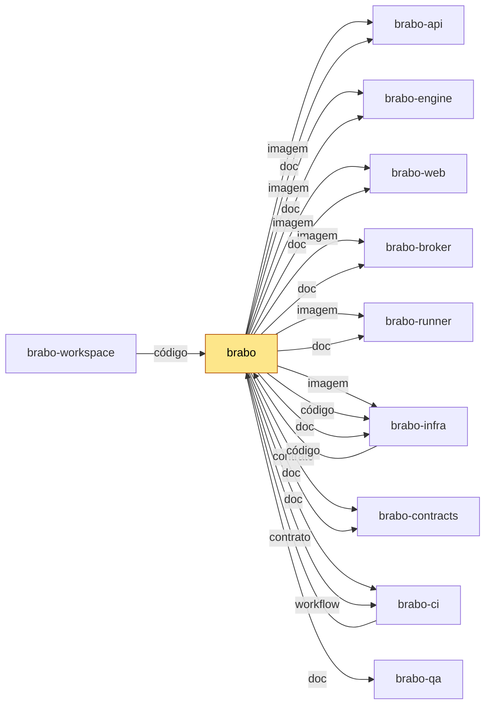

<div align="center">

[Português](README.md) · [English](README.en.md) · **Русский** · [简体中文](README.zh-Hans.md)

<picture>
  <source media="(prefers-color-scheme: dark)" srcset="docs/assets/logo.svg" />
  <source media="(prefers-color-scheme: light)" srcset="docs/assets/logo.svg" />
  
</picture>

<h1>Brabo</h1>

**Команда ИИ-агентов ведёт ваше приложение от брифа до деплоя.
Последнее слово остаётся за вами — по устройству системы, а не по договорённости.**

[](https://github.com/viralabs-dev/brabo/actions/workflows/docs-check.yml)
[](https://github.com/viralabs-dev/brabo/actions/workflows/ci.yml?query=branch%3Adev)
[](https://github.com/viralabs-dev/brabo/actions/workflows/ci.yml?query=branch%3Amain)
[](https://github.com/viralabs-dev/brabo/actions/workflows/release.yml)
[](LICENSE)
[](https://github.com/viralabs-dev/brabo/tags)
[](https://github.com/viralabs-dev/brabo/releases/latest)
[](https://viralabs-dev.github.io/brabo/prd/ru/)
[](https://ko-fi.com/daneiel)

[Документация](https://viralabs-dev.github.io/brabo/prd/ru/) · [С нуля до результата](https://viralabs-dev.github.io/brabo/prd/ru/tutorials/from-zero-to-deliverable) · [CHANGELOG](CHANGELOG.md) · [Безопасность](SECURITY.md) · [Участие](CONTRIBUTING.md)


<sub>Идея превращается в правила, а то, чего не хватает, — в вопрос: Креатив возвращает сомнения в чат.</sub>

[Отличия](#отличия) · [Возможности](#возможности) · [Для чего он нужен](#для-чего-он-нужен) · [Как использовать](#как-использовать) · [Как разрабатывать](#как-разрабатывать) · [Документация](#документация) · [Лицензия](#лицензия)

</div>

> Источник и проверяемая версия — [README.md](README.md) на португальском: в нём
> указаны текущая версия и количество бизнес-правил. Этот
> перевод намеренно опускает числа.

---

## Отличия

<table>
  <tr>
    <td width="25%" valign="top">🛑 <b>Ничего без одобрения</b><br />Любой внешний эффект рождается как <code>proposed_action</code> и проходит политику проекта; merge в защищённую ветку — всегда ваше решение.</td>
    <td width="25%" valign="top">🧱 <b>Агенту не доверяют по устройству</b><br />Потолки итераций, исправлений и бюджета — в коде. Промпт не гарантия; код — гарантия.</td>
    <td width="25%" valign="top">📜 <b>Всё записано и неизменяемо</b><br />Журнал событий только на добавление, с плотной нумерацией в каждой сессии: проверяемая стоимость и проверяемый бэкап.</td>
    <td width="25%" valign="top">👥 <b>Одна команда от брифа до результата</b><br />Креатив, PO, Архитектор, Dev Lead, разработчики по модулям, Infra, QA и SecOps над настоящим git-репозиторием.</td>
  </tr>
</table>

## Возможности

### Идея превращается в правила, а то, чего не хватает, — в вопрос


Креатив возвращает сомнения в чат, с предложенным ответом и правилами, которые
затрагивает каждый вопрос. Вы отвечаете прямо там, и ответы становятся
бизнес-правилами.

### Архитектор решает письменно


Архитектурное решение рождается как pull request, а архитектура идёт дальше только после вашего
подтверждения.

### Разработчики работают внутри контейнера


Каждая команда проходит политику проекта, а то, что делает dev-агент,
остаётся в ленте сессии.

### Merge всегда за вами


Pull request, прошедшие гейты, приходят в чат, и один клик на «Одобрить»
подтверждает merge.

**С нуля до результата, в реальном прогоне:** [пошаговый разбор с записями](https://viralabs-dev.github.io/brabo/prd/ru/tutorials/from-zero-to-deliverable) — 8 из 8 задач, 102/102 тестов, US$ 1,07.

---

<!-- vitrine:fim -->

## Для чего он нужен

Создание ПО с ИИ-агентами обычно означает доверие промптам. Brabo оркестрирует команду агентов (Креативный, PO,
Архитектор, Dev Lead, разработчики модулей, Infra, QA и SecOps) над настоящим git-репозиторием, а всё, что имеет внешний
эффект (команда, коммит, PR, расход токенов), рождается как предложение и проходит политику проекта. Слияние в защищённую
ветку и изменение инструкции агента политика не разрешает вовсе: это решение владельца.

Этот репозиторий — входная дверь: здесь документация, сайт, установщик и релиз. Код живёт в соседних репозиториях,
разделённых по слоям ([почему](https://viralabs-dev.github.io/brabo/prd/ru/adr/0252-o-brabo-vira-um-conjunto-de-repositorios)).

## Где он вписывается

`brabo` — центр документации: сайт собирает папки `docs/` соседей в одно дерево. Для продукта он фиксирует версию каждого
компонента в `componentes.json`. Если он меняется, меняются установка и сайт.
Стек: NestJS и PostgreSQL с pgvector (api), Elixir, Phoenix и Oban (engine), React 19 (web), CLI `brabo-runner` на машине
пользователя, Docker Compose и Kubernetes (infra); Ollama и Neo4j необязательны, Redis нет (очереди в Postgres).

<!-- mapa:inicio -->
<!-- Gerado do repos.yml do brabo por brabo-ci:scripts/ci/mapa-dos-repos.ts. Não edite à mão. -->

**brabo** — Porta de entrada do produto — documentação agregada, site, instalador e release. Quem instala usa o `install.sh` e as imagens e o binário das tags de `componentes.json`; o brabo-infra o clona nas aferições cruzadas.

| repo | propósito | como é usado | depende de | é usado por |
|---|---|---|---|---|
| **brabo** | Porta de entrada do produto — documentação agregada, site, instalador e release. | Quem instala usa o `install.sh` e as imagens e o binário das tags de `componentes.json`; o brabo-infra o clona nas aferições cruzadas. | brabo-api (imagem, doc), brabo-engine (imagem, doc), brabo-web (imagem, doc), brabo-broker (imagem, doc), brabo-runner (imagem, doc), brabo-infra (imagem, código, doc), brabo-contracts (contrato, doc), brabo-ci (doc, workflow), brabo-qa (doc) | brabo-ci (contrato), brabo-infra (código), brabo-workspace (código) |
| brabo-api | API do produto (NestJS, Drizzle, PostgreSQL/pgvector) — schema, RBAC, LLM, metering e gates. | Imagem publicada por tag e consumida pelo brabo e pelo brabo-infra; o brabo-web, o brabo-engine e o brabo-qa leem o código ou o `openapi.json` dele. | brabo-contracts (contrato), brabo-infra (código), brabo-qa (workflow), brabo-ci (workflow) | brabo (imagem, doc), brabo-engine (código), brabo-web (contrato), brabo-contracts (contrato), brabo-infra (código), brabo-qa (código), brabo-workspace (código) |
| brabo-engine | Engine (Elixir/OTP, Phoenix, Oban) — agentes, sessões, gates e roteamento de runners. | Imagem publicada por tag, usada pelo brabo e pelo brabo-infra. | brabo-contracts (contrato), brabo-api (código), brabo-runner (código), brabo-qa (workflow), brabo-ci (workflow) | brabo (imagem, doc), brabo-infra (código), brabo-qa (código), brabo-workspace (código) |
| brabo-web | Interface web (React 19, Vite) — telas, i18n e design system. | Imagem publicada por tag, usada pelo brabo e pelo brabo-infra. | brabo-contracts (contrato), brabo-api (contrato), brabo-qa (workflow), brabo-ci (workflow) | brabo (imagem, doc), brabo-infra (código), brabo-qa (código), brabo-workspace (código) |
| brabo-runner | CLI `brabo-runner` na máquina do usuário — PTY, container local e espelho. | Binário publicado por tag, instalado pelo brabo; o brabo-engine e o brabo-qa leem o código dele nos testes. | brabo-contracts (contrato), brabo-ci (workflow) | brabo (imagem, doc), brabo-engine (código), brabo-infra (código), brabo-qa (código), brabo-workspace (código) |
| brabo-broker | Único processo com o socket do Docker do servidor. | Imagem publicada por tag, usada pelo brabo e pelo brabo-infra. | brabo-contracts (contrato), brabo-qa (workflow), brabo-ci (workflow) | brabo (imagem, doc), brabo-infra (código), brabo-qa (código), brabo-workspace (código) |
| brabo-contracts | Contratos compartilhados — os pacotes `shared` e `docker-port`, `areas.json` e `fluxo.yml`. | Consumido por TAG (pacote no GitHub Packages ou arquivo baixado por raw na mesma tag); uma tag nova pede bump em api, web, runner, broker, engine, qa e infra. | brabo-api (contrato), brabo-ci (workflow) | brabo (contrato, doc), brabo-api (contrato), brabo-engine (contrato), brabo-web (contrato), brabo-runner (contrato), brabo-broker (contrato), brabo-infra (código), brabo-qa (contrato), brabo-workspace (código) |
| brabo-ci | Workflows reutilizáveis e a política de PR, escada de aprovação, promoção, tag e Dependabot. | Cada repo chama `uses: viralabs-dev/brabo-ci/...@<sha>`, fixado por SHA. | brabo-qa (contrato, workflow), brabo (contrato) | brabo (doc, workflow), brabo-api (workflow), brabo-engine (workflow), brabo-web (workflow), brabo-runner (workflow), brabo-broker (workflow), brabo-contracts (workflow), brabo-infra (workflow), brabo-qa (workflow), brabo-workspace (código, workflow) |
| brabo-infra | Composes, Dockerfiles de integração, `deploy/k8s`, scripts de dev, release e cadeia de suprimentos. | O brabo clona o brabo-infra no ref de `componentes.json` para subir a instalação; o brabo-api e o brabo-qa o clonam no CI. | brabo-api (código), brabo-engine (código), brabo-web (código), brabo-broker (código), brabo-runner (código), brabo-contracts (código), brabo (código), brabo-qa (workflow), brabo-ci (workflow) | brabo (imagem, código, doc), brabo-api (código), brabo-qa (código), brabo-workspace (código) |
| brabo-qa | E2E de navegador (Playwright), golden-sets e catálogo de funcionalidades — o portão da `main`. | O brabo-ci dispara o `e2e-pr` dele e lê o `funcionalidades.yml`; api, engine, web, broker e infra o chamam como portão. | brabo-api (código), brabo-engine (código), brabo-web (código), brabo-runner (código), brabo-broker (código), brabo-infra (código), brabo-contracts (contrato), brabo-ci (workflow) | brabo (doc), brabo-api (workflow), brabo-engine (workflow), brabo-web (workflow), brabo-broker (workflow), brabo-ci (contrato, workflow), brabo-infra (workflow), brabo-workspace (código) |
| brabo-workspace | Pasta-mãe `~/dev/brabo/` com os clones lado a lado e o `clonar-tudo.sh`. | Quem desenvolve roda `clonar-tudo.sh` uma vez; as sessões do Claude abrem nela. | brabo (código), brabo-api (código), brabo-engine (código), brabo-web (código), brabo-runner (código), brabo-broker (código), brabo-contracts (código), brabo-ci (código, workflow), brabo-infra (código), brabo-qa (código) | — |


<!-- mapa:fim -->

## Как использовать

Установите релиз (установщик — bash-скрипт: скачайте и запустите через `bash`, без `curl | sh`). Он проверяет подпись
`checksums.txt`, поднимает стек с образами, закреплёнными по digest, создаёт первую учётную запись и подключает раннер:

```bash
curl -fsSLO https://github.com/viralabs-dev/brabo/releases/latest/download/install.sh && bash install.sh
```

`bash install.sh --print-plan` показывает, что он сделал бы, ничего не выполняя. Пошаговое описание — в
[Первых шагах](https://viralabs-dev.github.io/brabo/prd/ru/getting-started).

## Как разрабатывать

Код живёт в соседних репозиториях, клонируемых рядом через
[`brabo-workspace`](https://github.com/viralabs-dev/brabo-workspace); dev-среду поднимает
[`brabo-infra`](https://github.com/viralabs-dev/brabo-infra):

```bash
git clone https://github.com/viralabs-dev/brabo-workspace.git ~/dev/brabo
cd ~/dev/brabo && ./clonar-tudo.sh && cd brabo-infra && make dev
```

Чтобы править документацию этого репозитория: `pnpm install`, `bash scripts/docs/montar-layout.sh` (подтягивает соседей
по SHA из `irmaos.lock`; `BRABO_REF=dev` берёт актуальную `dev`), `pnpm docs:check` и `pnpm docs:build`.
Соглашения и процесс: [CONTRIBUTING.md](CONTRIBUTING.md).

## Что гарантирует CI

- **`docs-check`**: ссылки, счётчики (RN, ADR, версия) и паритет четырёх языков совпадают с кодом соседей.
- **`politica` и `escada`** (обязательные): имя ветки, тело PR и лестница одобрения.
- **`ci`** (цепочка): actionlint и pin'ы `brabo-ci`. **`readme-esqueleto` и `mapa-alinhado`**: информационные.
- **Релиз** (`release.yml`, по тегу `vX.Y.Z`): `componentes.json` фиксирует каждый компонент, Trivy сканирует каждый образ
  по digest, а `checksums.txt` подписывается cosign. Без тега это лишь репетиция.
  Подробности: [Релиз продукта](https://viralabs-dev.github.io/brabo/prd/ru/explanation/release-do-produto).

## Документация

Сайт **[viralabs-dev.github.io/brabo](https://viralabs-dev.github.io/brabo/prd/ru/)** с поиском и на четырёх языках; `/prd/` собирается из `main`, а
[`/dev/`](https://viralabs-dev.github.io/brabo/dev/ru/) — из `dev`. Текущая версия и число бизнес-правил указаны в [португальском README](README.md).

| документ | для чего |
|---|---|
| [Первые шаги](https://viralabs-dev.github.io/brabo/prd/ru/getting-started) | от установки до первого хода агента |
| [Архитектура](https://viralabs-dev.github.io/brabo/prd/ru/architecture) | карта кода, границы, инварианты, технический долг |
| [Бизнес-правила](https://viralabs-dev.github.io/brabo/prd/ru/business-rules) | RN, каждое с `файл:строка` и покрывающим тестом |
| [Runbook](https://viralabs-dev.github.io/brabo/prd/ru/runbook) | деплой, раскатка, восстановление, ротация ключа, инцидент затрат |
| [Конфигурация](https://viralabs-dev.github.io/brabo/prd/ru/reference/configuration) | все переменные окружения |
| [Git-провайдеры](https://viralabs-dev.github.io/brabo/prd/ru/reference/git-providers) | контракт операций и capabilities |
| [Артефакты](https://viralabs-dev.github.io/brabo/prd/ru/reference/artifacts) | схемы и кто может выпускать каждую |

Ещё: [Безопасность](SECURITY.md) · [Управление](GOVERNANCE.md) · [Поддержка](SUPPORT.md) · [Кодекс поведения](CODE_OF_CONDUCT.md).

## Как повторить в своём проекте

Что пригодится другому продукту: подписанный `install.sh` (bash 3.2, без Node), схема релиза с `componentes.json` и
`imagem.json` по digest, а также генератор сайта, собирающий `docs/` нескольких репозиториев по фиксации `irmaos.lock`.
Чтобы перенять политику PR, лестницу одобрения и переиспользуемые workflow, следуйте руководству
[`brabo-ci:scripts/ci/docs/tutorials/adotar.md`](https://github.com/viralabs-dev/brabo-ci/blob/dev/scripts/ci/docs/tutorials/adotar.md).

## Поддержка проекта

Если проект вам помогает, можно [угостить кофе на Ko-fi](https://ko-fi.com/daneiel).

## Лицензия

[MIT](LICENSE) © 2026 Daniel Souza. Образ engine включает сторонние инструменты, часть под GPL, а образ web — шрифты
OFL 1.1: версии и лицензии — в [THIRD_PARTY_NOTICES.md](THIRD_PARTY_NOTICES.md).
