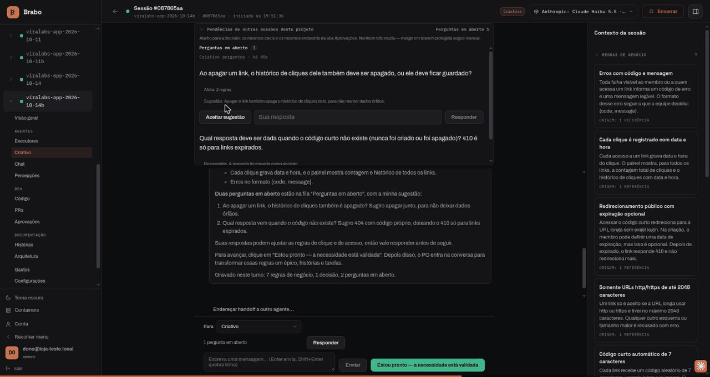
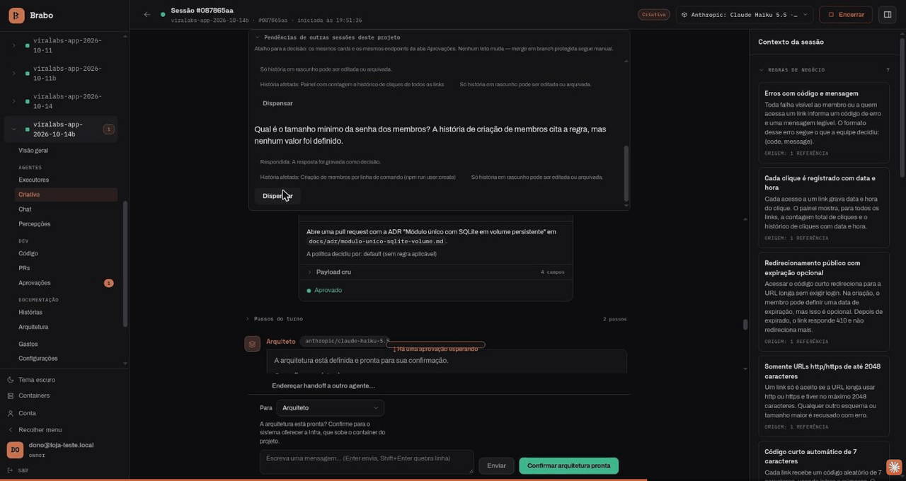
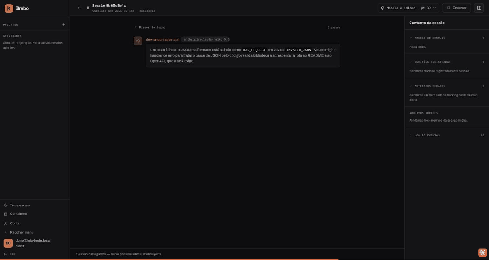
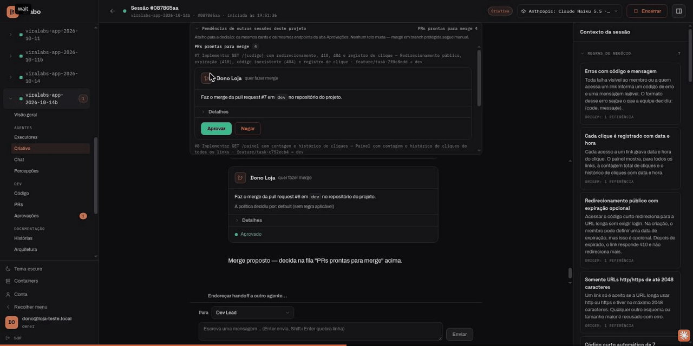
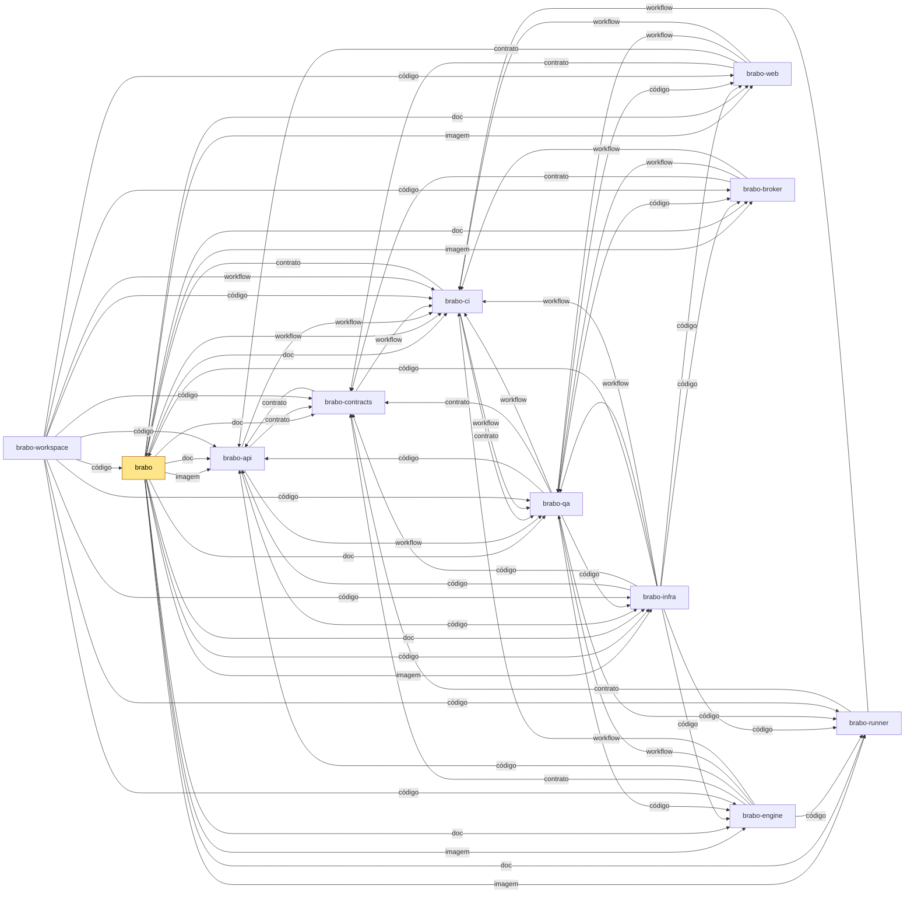

<div align="center">

[Português](README.md) · [English](README.en.md) · [Русский](README.ru.md) · **简体中文**

<picture>
  <source media="(prefers-color-scheme: dark)" srcset="docs/assets/logo.svg" />
  <source media="(prefers-color-scheme: light)" srcset="docs/assets/logo.svg" />
  
</picture>

<h1>Brabo</h1>

**一支 AI 智能体团队把你的应用从需求简报带到部署。
最终决定权始终在你手里——靠设计保证，而不是靠约定。**

[](https://github.com/viralabs-dev/brabo/actions/workflows/docs-check.yml)
[](https://github.com/viralabs-dev/brabo/actions/workflows/release.yml)
[](LICENSE)
[](https://github.com/viralabs-dev/brabo/releases/latest)
[](https://viralabs-dev.github.io/brabo/prd/zh-Hans/)
[](https://ko-fi.com/daneiel)

[文档](https://viralabs-dev.github.io/brabo/prd/zh-Hans/) · [从零到交付物](https://viralabs-dev.github.io/brabo/prd/zh-Hans/tutorials/from-zero-to-deliverable) · [CHANGELOG](CHANGELOG.md) · [安全](SECURITY.md) · [参与贡献](CONTRIBUTING.md)



<sub>想法变成规则，缺少的部分变成问题——创意智能体在聊天中把疑问交还给你。</sub>

[亮点](#亮点) · [功能](#功能) · [它是什么](#它是什么) · [开始](#开始) · [仓库](#brabo-的仓库) · [发布](#发布如何组装) · [文档](#文档) · [许可证](#许可证)

</div>

> 源文本和受校验的版本是葡萄牙语的 [README.md](README.md)：其中写有当前版本和业务规则的数量。本译文有意不写这些数字。

---

## 亮点

<table>
  <tr>
    <td width="25%" valign="top">🛑 <b>未经批准，什么都不会发生</b><br />每个外部效果都以 <code>proposed_action</code> 的形式产生，并经过项目策略；合并到受保护分支永远由你决定。</td>
    <td width="25%" valign="top">🧱 <b>智能体在设计上不被信任</b><br />迭代、修正和预算的上限都写在代码里。提示词不是保证，代码才是。</td>
    <td width="25%" valign="top">📜 <b>一切都被记录且不可变</b><br />只追加的事件日志，每个会话内编号连续：成本可审计，备份可验证。</td>
    <td width="25%" valign="top">👥 <b>一支团队，从简报到交付物</b><br />创意、PO、架构师、Dev Lead、按模块划分的开发者、Infra、QA 和 SecOps，工作在真实的 git 仓库上。</td>
  </tr>
</table>

## 功能

### 想法变成规则，缺少的部分变成问题


创意智能体在聊天中交还疑问，附上建议答案以及每个问题影响的规则。你就在那里回答，答案会变成业务规则。

### 架构师以书面方式做决定



架构决策以 pull request 的形式产生，架构只有在你确认后才继续推进。

### 开发者在容器内工作



每条命令都经过项目策略，开发智能体做的事情都留在会话记录中。

### 合并永远由你决定



通过各道关卡的 pull request 会出现在聊天中，点一下「批准」即可确认。

**从零到交付物，一次真实运行：** [带录屏的分步讲解](https://viralabs-dev.github.io/brabo/prd/zh-Hans/tutorials/from-zero-to-deliverable)——8/8 个任务，102/102 个测试，US$ 1.07。

---

## 它是什么

Brabo 编排一组专业智能体——创意、PO、架构师、Dev Lead 与按模块划分的开发者、Infra、QA、SecOps、心理学家和 Anamnese（画像）——在真实的 git 仓库上工作，Gitflow 自动配置。

各个领域（dev、QA、Infra）都有一个 **lead** 作为唯一的对外地址：发起 handoff 的一方只与 lead 对话，而向子智能体委派是领域内部的事。

它与编程助手的区别：

**任何有外部效果的事情都不会自己发生。** 终端命令、commit、push、PR、合并、token 花费——一切都以 `proposed_action` 产生，经过项目策略（`deny` 永远压过 `allow`），然后才执行。有两种情况连策略也无法放行：**合并到受保护分支**和**修改智能体的指令**。它们是在整个策略之后施加的上限，而不是默认值。

**智能体在设计上不被信任，系统也按此假设。** 迭代上限、每个任务的修正上限、会拒绝调用的预算、Anamnese 可画像内容的封闭目录。提示词不是保证，代码才是。

**一切都被记录且不可变。** 事件日志只追加，每个会话内编号连续。正是这一点让心理学家的证据可追溯、成本可审计、备份可验证。

**团队在进步，而你始终在环路中。** 心理学家提出基于真实事件的假设；Anamnese 推导出你的熟练度画像，并提出带版本的指令补丁。每个补丁都需要你的同意，回滚会创建新版本，而不是抹掉历史。

## 开始

### 安装 Brabo

```bash
curl -fsSLO https://github.com/viralabs-dev/brabo/releases/latest/download/install.sh && bash install.sh
```

安装程序是一个 bash 脚本：下载文件后用 `bash` 运行，不要用 `curl | sh`。它在使用任何文件之前先校验 Release 中 `checksums.txt` 的签名，用按 digest 固定的镜像启动整套服务，创建第一个账户，并在本机启用 runner。每一步都会说明做了什么，没成功的部分会在最后点名列出。`bash install.sh --print-plan` 只显示它将做什么，不执行任何操作。分步说明见[快速开始](https://viralabs-dev.github.io/brabo/prd/zh-Hans/getting-started)。

### 开发 Brabo

代码位于各个兄弟仓库中，由 [`brabo-workspace`](https://github.com/viralabs-dev/brabo-workspace) 并排克隆。开发环境由 [`brabo-infra`](https://github.com/viralabs-dev/brabo-infra) 启动，它从这些克隆构建每个服务：

```bash
git clone https://github.com/viralabs-dev/brabo-workspace.git ~/dev/brabo
cd ~/dev/brabo && ./clonar-tudo.sh
cd brabo-infra && make dev
```

`make dev` 会检查兄弟仓库是否就位，然后启动 Docker Compose。日常命令菜单（Docker、Kubernetes、数据库和测试）也在 `brabo-infra` 中：`bash scripts/dev/bootstrap.sh`。详情见它的 README。

本仓库保存文档、安装程序和发布。要修改文档：`pnpm install`、`bash scripts/docs/montar-layout.sh`（拉取兄弟仓库的文档）、`pnpm docs:check` 和 `pnpm docs:build`。

## Brabo 的仓库

Brabo 按层拆分为多个仓库（[ADR 0252](https://viralabs-dev.github.io/brabo/prd/zh-Hans/adr/0252-o-brabo-vira-um-conjunto-de-repositorios)）。`brabo` 是文档的中心：<https://viralabs-dev.github.io/brabo/prd/zh-Hans/> 上的网站把各兄弟仓库的 `docs/` 目录合并成一棵树。

<!-- mapa:inicio -->
<!-- Gerado do repos.yml do brabo por brabo-ci:scripts/ci/mapa-dos-repos.ts. Não edite à mão. -->
### Onde se encaixa

**brabo** — Porta de entrada do produto — documentação agregada, site, instalador e release. Quem instala usa o `install.sh` e as imagens e o binário das tags de `componentes.json`; o brabo-infra o clona nas aferições cruzadas.

| repo | propósito | como é usado | depende de | é usado por |
|---|---|---|---|---|
| **brabo** | Porta de entrada do produto — documentação agregada, site, instalador e release. | Quem instala usa o `install.sh` e as imagens e o binário das tags de `componentes.json`; o brabo-infra o clona nas aferições cruzadas. | brabo-api (imagem, doc), brabo-engine (imagem, doc), brabo-web (imagem, doc), brabo-broker (imagem, doc), brabo-runner (imagem, doc), brabo-infra (imagem, código, doc), brabo-contracts (doc), brabo-ci (doc, workflow), brabo-qa (doc) | brabo-ci (contrato), brabo-infra (código), brabo-workspace (código) |
| brabo-api | API do produto (NestJS, Drizzle, PostgreSQL/pgvector) — schema, RBAC, LLM, metering e gates. | Imagem publicada por tag e consumida pelo brabo e pelo brabo-infra; o brabo-web, o brabo-engine e o brabo-qa leem o código ou o `openapi.json` dele. | brabo-contracts (contrato), brabo-infra (código), brabo-qa (workflow), brabo-ci (workflow) | brabo (imagem, doc), brabo-engine (código), brabo-web (contrato), brabo-contracts (contrato), brabo-infra (código), brabo-qa (código), brabo-workspace (código) |
| brabo-engine | Engine (Elixir/OTP, Phoenix, Oban) — agentes, sessões, gates e roteamento de runners. | Imagem publicada por tag, usada pelo brabo e pelo brabo-infra. | brabo-contracts (contrato), brabo-api (código), brabo-runner (código), brabo-qa (workflow), brabo-ci (workflow) | brabo (imagem, doc), brabo-infra (código), brabo-qa (código), brabo-workspace (código) |
| brabo-web | Interface web (React 19, Vite) — telas, i18n e design system. | Imagem publicada por tag, usada pelo brabo e pelo brabo-infra. | brabo-contracts (contrato), brabo-api (contrato), brabo-qa (workflow), brabo-ci (workflow) | brabo (imagem, doc), brabo-infra (código), brabo-qa (código), brabo-workspace (código) |
| brabo-runner | CLI `brabo-runner` na máquina do usuário — PTY, container local e espelho. | Binário publicado por tag, instalado pelo brabo; o brabo-engine e o brabo-qa leem o código dele nos testes. | brabo-contracts (contrato), brabo-ci (workflow) | brabo (imagem, doc), brabo-engine (código), brabo-infra (código), brabo-qa (código), brabo-workspace (código) |
| brabo-broker | Único processo com o socket do Docker do servidor. | Imagem publicada por tag, usada pelo brabo e pelo brabo-infra. | brabo-contracts (contrato), brabo-qa (workflow), brabo-ci (workflow) | brabo (imagem, doc), brabo-infra (código), brabo-qa (código), brabo-workspace (código) |
| brabo-contracts | Contratos compartilhados — os pacotes `shared` e `docker-port`, `areas.json` e `fluxo.yml`. | Consumido por TAG (pacote no GitHub Packages ou arquivo baixado por raw na mesma tag); uma tag nova pede bump em api, web, runner, broker, engine, qa e infra. | brabo-api (contrato), brabo-ci (workflow) | brabo (doc), brabo-api (contrato), brabo-engine (contrato), brabo-web (contrato), brabo-runner (contrato), brabo-broker (contrato), brabo-infra (código), brabo-qa (contrato), brabo-workspace (código) |
| brabo-ci | Workflows reutilizáveis e a política de PR, escada de aprovação, promoção, tag e Dependabot. | Cada repo chama `uses: viralabs-dev/brabo-ci/...@<sha>`, fixado por SHA. | brabo-qa (contrato, workflow), brabo (contrato) | brabo (doc, workflow), brabo-api (workflow), brabo-engine (workflow), brabo-web (workflow), brabo-runner (workflow), brabo-broker (workflow), brabo-contracts (workflow), brabo-infra (workflow), brabo-qa (workflow), brabo-workspace (código, workflow) |
| brabo-infra | Composes, Dockerfiles de integração, `deploy/k8s`, scripts de dev, release e cadeia de suprimentos. | O brabo clona o brabo-infra no ref de `componentes.json` para subir a instalação; o brabo-api e o brabo-qa o clonam no CI. | brabo-api (código), brabo-engine (código), brabo-web (código), brabo-broker (código), brabo-runner (código), brabo-contracts (código), brabo (código), brabo-qa (workflow), brabo-ci (workflow) | brabo (imagem, código, doc), brabo-api (código), brabo-qa (código), brabo-workspace (código) |
| brabo-qa | E2E de navegador (Playwright), golden-sets e catálogo de funcionalidades — o portão da `main`. | O brabo-ci dispara o `e2e-pr` dele e lê o `funcionalidades.yml`; api, engine, web, broker e infra o chamam como portão. | brabo-api (código), brabo-engine (código), brabo-web (código), brabo-runner (código), brabo-broker (código), brabo-infra (código), brabo-contracts (contrato), brabo-ci (workflow) | brabo (doc), brabo-api (workflow), brabo-engine (workflow), brabo-web (workflow), brabo-broker (workflow), brabo-ci (contrato, workflow), brabo-infra (workflow), brabo-workspace (código) |
| brabo-workspace | Pasta-mãe `~/dev/brabo/` com os clones lado a lado e o `clonar-tudo.sh`. | Quem desenvolve roda `clonar-tudo.sh` uma vez; as sessões do Claude abrem nela. | brabo (código), brabo-api (código), brabo-engine (código), brabo-web (código), brabo-runner (código), brabo-broker (código), brabo-contracts (código), brabo-ci (código, workflow), brabo-infra (código), brabo-qa (código) | — |


<!-- mapa:fim -->

## 发布如何组装

产品发布在这里诞生，由 `vX.Y.Z` 标签触发 [`release.yml`](.github/workflows/release.yml) workflow：

1. **[`componentes.json`](componentes.json)** 固定每个组件的版本：`brabo-infra` 的 ref、`brabo-runner` 的标签，以及每个镜像（api、engine、web、broker 和 backup）的标签。
2. **每个仓库的 `imagem.json`。** 每个应用标签的 Release 都附带一个 `imagem.json`，包含 `imagem`、`tag` 和 `digest`。workflow 下载这五个文件，组装出产品的 `images.json`，镜像按 digest 固定。
3. **按 digest 运行 Trivy。** 每个镜像按 digest 扫描，存在可修复的 HIGH 或 CRITICAL 漏洞时，在签名之前就判定失败。
4. **签名的 `checksums.txt`。** `install.sh`、`brabo-install-*` 资产和 `images.json` 写入同一个 `checksums.txt`，由 workflow 的身份用 cosign keyless 签名。`install.sh` 校验的正是这个签名。

不带标签的 `workflow_dispatch` 是演练：组装、扫描并检查一切，但既不签名也不发布。

## 文档

**📖 [viralabs-dev.github.io/brabo](https://viralabs-dev.github.io/brabo/prd/zh-Hans/)**——可浏览、可搜索的文档，提供四种语言。网站把本仓库的 `docs/` 目录与兄弟仓库的合并，并发布两个环境：来自 `main` 的 [`/prd/`](https://viralabs-dev.github.io/brabo/prd/zh-Hans/) 和来自 `dev` 的 [`/dev/`](https://viralabs-dev.github.io/brabo/dev/zh-Hans//)。要看最新状态，请用 `/dev/`。

| 文档 | 用途 |
|---|---|
| [简介](https://viralabs-dev.github.io/brabo/prd/zh-Hans/) | 全景 |
| [快速开始](https://viralabs-dev.github.io/brabo/prd/zh-Hans/getting-started) | 从安装到智能体的第一轮 |
| [架构](https://viralabs-dev.github.io/brabo/prd/zh-Hans/architecture) | 代码地图、边界、不变式、技术债 |
| [业务规则](https://viralabs-dev.github.io/brabo/prd/zh-Hans/business-rules) | 各条 RN，每条都带 `文件:行号` 和覆盖它的测试（数量见[葡萄牙语 README](README.md)） |
| [运维手册](https://viralabs-dev.github.io/brabo/prd/zh-Hans/runbook) | 部署、rollout、恢复、密钥轮换、成本事故 |
| [术语表](https://viralabs-dev.github.io/brabo/prd/zh-Hans/glossary) | harness、gate、handoff、DEK、outbox、K 循环 |
| [可观测性](https://viralabs-dev.github.io/brabo/prd/zh-Hans/explanation/observability) | 如何跨三个进程追踪一个动作：trace、log 以及跨层路径 |
| [配置](https://viralabs-dev.github.io/brabo/prd/zh-Hans/reference/configuration) | 所有环境变量 |
| [脚本](https://viralabs-dev.github.io/brabo/prd/zh-Hans/reference/scripts) | 每个 `pnpm` 命令和 `Makefile` 目标，从源码提取 |
| [事件](https://viralabs-dev.github.io/brabo/prd/zh-Hans/reference/events) | event log 的类型、broadcasts 和 spans |
| [权限](https://viralabs-dev.github.io/brabo/prd/zh-Hans/reference/permissions) | `permissions.json` 的格式和决策顺序 |
| [工件](https://viralabs-dev.github.io/brabo/prd/zh-Hans/reference/artifacts) | 各个 schema 以及谁可以发出每一种 |
| [Git 提供方](https://viralabs-dev.github.io/brabo/prd/zh-Hans/reference/git-providers) | 操作契约和 capabilities |
| [内部 API](https://viralabs-dev.github.io/brabo/prd/zh-Hans/reference/internal-api) | api ↔ engine 契约 |
| [安全](SECURITY.md) | 如何报告漏洞 |
| [参与贡献](CONTRIBUTING.md) | 流程、Definition of Done、接受什么 |
| [治理](GOVERNANCE.md) | 当前模式（单一维护者）、`community` 模式的三种角色以及谁进入每种角色 |
| [获取帮助](SUPPORT.md) | 每类问题用哪个渠道 |
| [行为准则](CODE_OF_CONDUCT.md) | Contributor Covenant 2.1 |

## 技术栈

- **api**——NestJS、Drizzle、带 pgvector 的 PostgreSQL 16
- **engine**——Elixir/OTP、Phoenix 和 Oban（队列在 Postgres 中）
- **web**——React 19、Vite 和 TanStack
- **runner**——用户机器上的 `brabo-runner` CLI，执行已批准的命令
- **broker**——唯一持有 Docker 套接字的进程，负责启动项目的容器
- **Ollama**——本地模型，由独立容器提供
- **Neo4j**——可选：知识图谱，是从 event log 派生的记忆
- **deploy**——Docker Compose（开发、生产和安装）以及带 Kustomize 的 Kubernetes，位于 `brabo-infra`

没有 Redis：队列通过 Oban 存在 Postgres 中，限流是 SQL 中的滑动窗口。

## 许可证

[MIT](LICENSE) © 2026 Daniel Souza——官方文本，无附加条款。

engine 镜像内置了 gates 依赖的第三方工具（gitleaks、hadolint、semgrep、yamllint），**其中一些采用 GPL**。作为独立进程运行它们不会“传染”任何东西，但**把镜像发布**到 registry 会产生提供源码的义务。每个工具的版本和许可证都列在 [THIRD_PARTY_NOTICES.md](THIRD_PARTY_NOTICES.md) 中。

web 镜像内置了设计系统的三种字体，均为 **OFL 1.1**——一种宽松的许可证，但要求随二进制文件一起分发版权声明。它位于 [`brabo-web`](https://github.com/viralabs-dev/brabo-web) 的 `public/fonts/LICENSE.txt`，与其余静态文件一起提供，该义务记录在同一个声明文件中。
