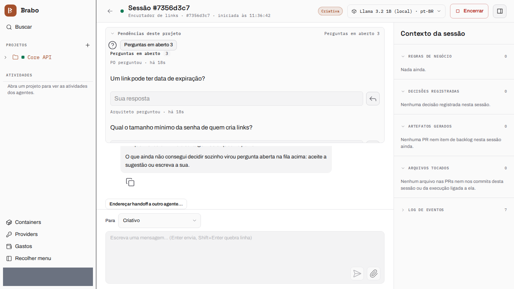
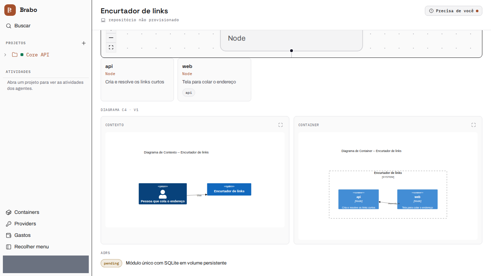
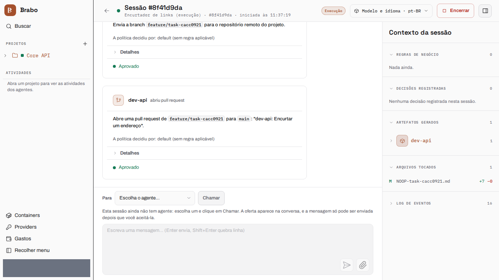
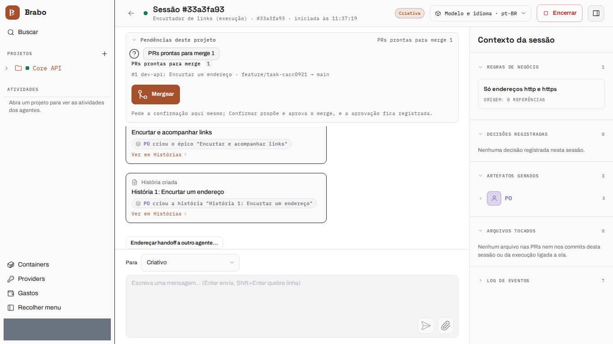
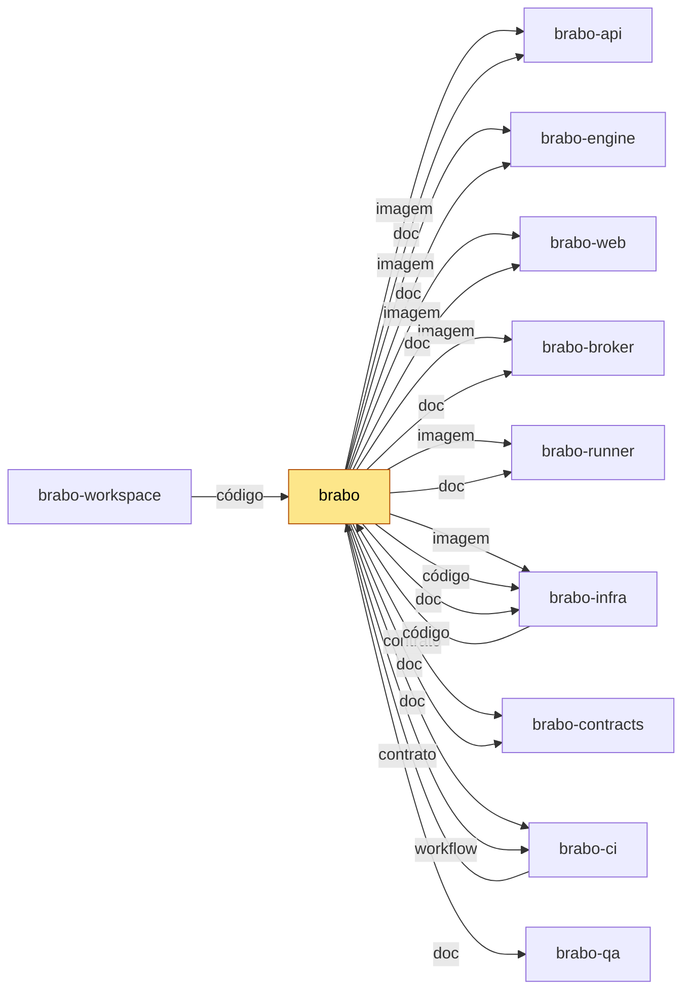

<div align="center">

[Português](README.md) · [English](README.en.md) · [Русский](README.ru.md) · **简体中文**

<picture>
  <source media="(prefers-color-scheme: dark)" srcset="docs/assets/logo.svg" />
  
</picture>

<h1>Brabo</h1>

**一支 AI 智能体团队把你的应用从需求简报带到部署。
最终决定权始终在你手里——靠设计保证，而不是靠约定。**

[](https://github.com/viralabs-dev/brabo/actions/workflows/docs-check.yml)
[](https://github.com/viralabs-dev/brabo/actions/workflows/ci.yml?query=branch%3Adev)
[](https://github.com/viralabs-dev/brabo/actions/workflows/ci.yml?query=branch%3Amain)
[](https://github.com/viralabs-dev/brabo/actions/workflows/release.yml)
[](LICENSE)
[](https://github.com/viralabs-dev/brabo/tags)
[](https://github.com/viralabs-dev/brabo/releases/latest)
[](https://viralabs-dev.github.io/brabo/prd/zh-Hans/)
[](https://ko-fi.com/daneiel)

[文档](https://viralabs-dev.github.io/brabo/prd/zh-Hans/) · [从零到交付物](https://viralabs-dev.github.io/brabo/prd/zh-Hans/tutorials/from-zero-to-deliverable) · [CHANGELOG](CHANGELOG.md) · [安全](SECURITY.md) · [参与贡献](CONTRIBUTING.md)

<picture>
  <source media="(prefers-color-scheme: dark)" srcset="docs/assets/capturas/perguntas-abertas-escuro.png" />
  
</picture>

<sub>想法变成规则，缺少的部分变成问题——创意智能体在聊天中把疑问交还给你。</sub>

[亮点](#亮点) · [功能](#功能) · [为什么存在](#为什么存在) · [如何使用](#如何使用) · [如何开发](#如何开发) · [文档](#文档) · [许可证](#许可证)

</div>

> 源文本和受校验的版本是葡萄牙语的 [README.md](README.md)：其中写有当前版本和业务规则的数量。本译文有意不写这些数字。

---

## 亮点

<table>
  <tr>
    <td width="25%" valign="top">🛑 <b>未经批准，什么都不会发生</b><br />每个外部效果都以 <code>proposed_action</code> 的形式产生，并经过项目策略；合并到受保护分支永远由你决定。</td>
    <td width="25%" valign="top">🧱 <b>智能体在设计上不被信任</b><br />迭代、修正和预算的上限都写在代码里。提示词不是保证，代码才是。</td>
    <td width="25%" valign="top">📜 <b>一切都被记录且不可变</b><br />只追加的事件日志，每个会话内编号连续：成本可审计，备份可验证。</td>
    <td width="25%" valign="top">👥 <b>一支团队，从简报到交付物</b><br />创意、PO、架构师、Dev Lead、按模块划分的开发者、Infra、QA 和 SecOps，工作在真实的 git 仓库上。</td>
  </tr>
</table>

## 功能

### 想法变成规则，缺少的部分变成问题

<picture>
  <source media="(prefers-color-scheme: dark)" srcset="docs/assets/capturas/perguntas-abertas-escuro.png" />
  
</picture>

创意智能体在聊天中交还疑问，附上建议答案以及每个问题影响的规则。你就在那里回答，答案会变成业务规则。

### 架构师以书面方式做决定

<picture>
  <source media="(prefers-color-scheme: dark)" srcset="docs/assets/capturas/arquitetura-escuro.png" />
  
</picture>

架构决策以 pull request 的形式产生，架构只有在你确认后才继续推进。

### 开发者在容器内工作

<picture>
  <source media="(prefers-color-scheme: dark)" srcset="docs/assets/capturas/dev-agent-escuro.png" />
  
</picture>

开发智能体的每一步（命令、提交、推送、pull request）都作为提案产生，并经过项目策略，决定连同理由留在会话记录中。

### 合并永远由你决定

<picture>
  <source media="(prefers-color-scheme: dark)" srcset="docs/assets/capturas/merges-no-chat-escuro.png" />
  
</picture>

通过各道关卡的 pull request 会出现在聊天中，点一下「批准」即可确认。

**从零到交付物，一次真实运行：** [带录屏的分步讲解](https://viralabs-dev.github.io/brabo/prd/zh-Hans/tutorials/from-zero-to-deliverable)——8/8 个任务，102/102 个测试，US$ 1.07。

---

<!-- vitrine:fim -->

## 为什么存在

用 AI 智能体构建软件，往往意味着信任提示词。Brabo 在真实的 git 仓库上编排一支智能体团队（创意、PO、架构师、Dev Lead、
模块开发、Infra、QA 和 SecOps），任何有外部影响的操作（命令、提交、PR、token 开销）都先作为提案产生，并经过项目策略。
合并到受保护分支和修改智能体的指令，连策略也无法放行：它们属于所有者。

本仓库是入口：存放文档、站点、安装器和发布。代码位于各兄弟仓库，按层划分（[原因](https://viralabs-dev.github.io/brabo/prd/zh-Hans/adr/0252-o-brabo-vira-um-conjunto-de-repositorios)）。

## 它在哪里

`brabo` 是文档的中心：站点把各兄弟仓库的 `docs/` 合并成一棵树。对产品而言，它在 `componentes.json` 中固定每个组件的版本。
它一变，安装和站点就跟着变。
技术栈：NestJS 与带 pgvector 的 PostgreSQL（api）、Elixir、Phoenix 与 Oban（engine）、React 19（web）、用户机器上的 `brabo-runner` CLI、
Docker Compose 与 Kubernetes（infra）；Ollama 和 Neo4j 为可选，没有 Redis（队列在 Postgres 中）。

<!-- mapa:inicio -->
<!-- Gerado do repos.yml do brabo por brabo-ci:scripts/ci/mapa-dos-repos.ts. Não edite à mão. -->

**brabo** — Porta de entrada do produto — documentação agregada, site, instalador e release. Quem instala usa o `install.sh` e as imagens e o binário das tags de `componentes.json`; o brabo-infra o clona nas aferições cruzadas.

| repo | propósito | como é usado | depende de | é usado por |
|---|---|---|---|---|
| **brabo** | Porta de entrada do produto — documentação agregada, site, instalador e release. | Quem instala usa o `install.sh` e as imagens e o binário das tags de `componentes.json`; o brabo-infra o clona nas aferições cruzadas. | brabo-api (imagem, doc), brabo-engine (imagem, doc), brabo-web (imagem, doc), brabo-broker (imagem, doc), brabo-runner (imagem, doc), brabo-infra (imagem, código, doc), brabo-contracts (contrato, doc), brabo-ci (doc, workflow), brabo-qa (doc) | brabo-ci (contrato), brabo-infra (código), brabo-workspace (código) |
| [brabo-api](https://github.com/viralabs-dev/brabo-api) | API do produto (NestJS, Drizzle, PostgreSQL/pgvector) — schema, RBAC, LLM, metering e gates. | Imagem publicada por tag e consumida pelo brabo e pelo brabo-infra; o brabo-web, o brabo-engine e o brabo-qa leem o código ou o `openapi.json` dele. | brabo-contracts (contrato), brabo-infra (código), brabo-qa (workflow), brabo-ci (workflow) | brabo (imagem, doc), brabo-engine (código), brabo-web (contrato), brabo-contracts (contrato), brabo-infra (código), brabo-qa (código), brabo-workspace (código) |
| [brabo-engine](https://github.com/viralabs-dev/brabo-engine) | Engine (Elixir/OTP, Phoenix, Oban) — agentes, sessões, gates e roteamento de runners. | Imagem publicada por tag, usada pelo brabo e pelo brabo-infra. | brabo-contracts (contrato), brabo-api (código), brabo-runner (código), brabo-qa (workflow), brabo-ci (workflow) | brabo (imagem, doc), brabo-infra (código), brabo-qa (código), brabo-workspace (código) |
| [brabo-web](https://github.com/viralabs-dev/brabo-web) | Interface web (React 19, Vite) — telas, i18n e design system. | Imagem publicada por tag, usada pelo brabo e pelo brabo-infra. | brabo-contracts (contrato), brabo-api (contrato), brabo-qa (workflow), brabo-ci (workflow) | brabo (imagem, doc), brabo-infra (código), brabo-qa (código), brabo-workspace (código) |
| [brabo-runner](https://github.com/viralabs-dev/brabo-runner) | CLI `brabo-runner` na máquina do usuário — PTY, container local e espelho. | Binário publicado por tag, instalado pelo brabo; o brabo-engine e o brabo-qa leem o código dele nos testes. | brabo-contracts (contrato), brabo-ci (workflow) | brabo (imagem, doc), brabo-engine (código), brabo-infra (código), brabo-qa (código), brabo-workspace (código) |
| [brabo-broker](https://github.com/viralabs-dev/brabo-broker) | Único processo com o socket do Docker do servidor. | Imagem publicada por tag, usada pelo brabo e pelo brabo-infra. | brabo-contracts (contrato), brabo-qa (workflow), brabo-ci (workflow) | brabo (imagem, doc), brabo-infra (código), brabo-qa (código), brabo-workspace (código) |
| [brabo-contracts](https://github.com/viralabs-dev/brabo-contracts) | Contratos compartilhados — os pacotes `shared` e `docker-port`, `areas.json` e `fluxo.yml`. | Consumido por TAG (pacote no GitHub Packages ou arquivo baixado por raw na mesma tag); uma tag nova pede bump em api, web, runner, broker, engine, qa e infra. | brabo-api (contrato), brabo-ci (workflow) | brabo (contrato, doc), brabo-api (contrato), brabo-engine (contrato), brabo-web (contrato), brabo-runner (contrato), brabo-broker (contrato), brabo-infra (código), brabo-qa (contrato), brabo-workspace (código) |
| [brabo-ci](https://github.com/viralabs-dev/brabo-ci) | Workflows reutilizáveis e a política de PR, escada de aprovação, promoção, tag e Dependabot. | Cada repo chama `uses: viralabs-dev/brabo-ci/...@<sha>`, fixado por SHA. | brabo-qa (contrato, workflow), brabo (contrato) | brabo (doc, workflow), brabo-api (workflow), brabo-engine (workflow), brabo-web (workflow), brabo-runner (workflow), brabo-broker (workflow), brabo-contracts (workflow), brabo-infra (workflow), brabo-qa (workflow), brabo-workspace (código, workflow) |
| [brabo-infra](https://github.com/viralabs-dev/brabo-infra) | Composes, Dockerfiles de integração, `deploy/k8s`, scripts de dev, release e cadeia de suprimentos. | O brabo clona o brabo-infra no ref de `componentes.json` para subir a instalação; o brabo-api e o brabo-qa o clonam no CI. | brabo-api (código), brabo-engine (código), brabo-web (código), brabo-broker (código), brabo-runner (código), brabo-contracts (código), brabo (código), brabo-qa (workflow), brabo-ci (workflow) | brabo (imagem, código, doc), brabo-api (código), brabo-qa (código), brabo-workspace (código) |
| [brabo-qa](https://github.com/viralabs-dev/brabo-qa) | E2E de navegador (Playwright), golden-sets e catálogo de funcionalidades — o portão da `main`. | O brabo-ci dispara o `e2e-pr` dele e lê o `funcionalidades.yml`; api, engine, web, broker e infra o chamam como portão. | brabo-api (código), brabo-engine (código), brabo-web (código), brabo-runner (código), brabo-broker (código), brabo-infra (código), brabo-contracts (contrato), brabo-ci (workflow) | brabo (doc), brabo-api (workflow), brabo-engine (workflow), brabo-web (workflow), brabo-broker (workflow), brabo-ci (contrato, workflow), brabo-infra (workflow), brabo-workspace (código) |
| [brabo-workspace](https://github.com/viralabs-dev/brabo-workspace) | Pasta-mãe `~/dev/brabo/` com os clones lado a lado e o `clonar-tudo.sh`. | Quem desenvolve roda `clonar-tudo.sh` uma vez; as sessões do Claude abrem nela. | brabo (código), brabo-api (código), brabo-engine (código), brabo-web (código), brabo-runner (código), brabo-broker (código), brabo-contracts (código), brabo-ci (código, workflow), brabo-infra (código), brabo-qa (código) | — |


<!-- mapa:fim -->

## 如何使用

安装发布版（安装器是 bash 脚本：下载后用 `bash` 运行，不要 `curl | sh`）。它会校验 `checksums.txt` 的签名，用按 digest 固定的镜像启动整套服务，
创建第一个账户并接入 runner：

```bash
curl -fsSLO https://github.com/viralabs-dev/brabo/releases/latest/download/install.sh && bash install.sh
```

`bash install.sh --print-plan` 只显示它将做什么，不执行任何操作。分步说明见[入门](https://viralabs-dev.github.io/brabo/prd/zh-Hans/getting-started)。

## 如何开发

代码位于兄弟仓库，由 [`brabo-workspace`](https://github.com/viralabs-dev/brabo-workspace) 并排克隆；开发环境由
[`brabo-infra`](https://github.com/viralabs-dev/brabo-infra) 启动：

```bash
git clone https://github.com/viralabs-dev/brabo-workspace.git ~/dev/brabo
cd ~/dev/brabo && ./clonar-tudo.sh && cd brabo-infra && make dev
```

修改本仓库文档：`pnpm install`、`bash scripts/docs/montar-layout.sh`（按 `irmaos.lock` 中的 SHA 取回兄弟仓库；`BRABO_REF=dev` 取当前的 `dev`）、
`pnpm docs:check` 和 `pnpm docs:build`。约定与流程：[CONTRIBUTING.md](CONTRIBUTING.md)。

## CI 保证什么

- **`docs-check`**：链接、计数（RN、ADR、版本）以及四种语言的一致性与兄弟仓库的代码相符。
- **`politica` 与 `escada`**（必需）：分支名、PR 正文和批准阶梯。
- **`ci`**（链）：actionlint 与 `brabo-ci` 的 pin。**`readme-esqueleto` 与 `mapa-alinhado`**：仅提示。
- **发布**（`release.yml`，由 `vX.Y.Z` 标签触发）：`componentes.json` 固定每个组件，Trivy 按 digest 扫描每个镜像，`checksums.txt` 用 cosign 签名。
  没有标签时只是演练。详见[产品发布](https://viralabs-dev.github.io/brabo/prd/zh-Hans/explanation/release-do-produto)。

## 文档

站点 **[viralabs-dev.github.io/brabo](https://viralabs-dev.github.io/brabo/prd/zh-Hans/)** 可搜索，有四种语言；`/prd/` 来自 `main`，[`/dev/`](https://viralabs-dev.github.io/brabo/dev/zh-Hans/) 来自 `dev`。
当前版本和业务规则数量见[葡萄牙语 README](README.md)。

| 文档 | 用途 |
|---|---|
| [入门](https://viralabs-dev.github.io/brabo/prd/zh-Hans/getting-started) | 从安装到智能体的第一轮 |
| [架构](https://viralabs-dev.github.io/brabo/prd/zh-Hans/architecture) | 代码地图、边界、不变量、技术债 |
| [业务规则](https://viralabs-dev.github.io/brabo/prd/zh-Hans/business-rules) | 各条 RN，每条带 `文件:行` 和覆盖它的测试 |
| [Runbook](https://viralabs-dev.github.io/brabo/prd/zh-Hans/runbook) | 部署、上线、恢复、密钥轮换、成本事件 |
| [配置](https://viralabs-dev.github.io/brabo/prd/zh-Hans/reference/configuration) | 所有环境变量 |
| [Git 提供方](https://viralabs-dev.github.io/brabo/prd/zh-Hans/reference/git-providers) | 操作契约与 capabilities |
| [产物](https://viralabs-dev.github.io/brabo/prd/zh-Hans/reference/artifacts) | 各种 schema 以及谁可以产出 |

更多：[安全](SECURITY.md) · [治理](GOVERNANCE.md) · [支持](SUPPORT.md) · [行为准则](CODE_OF_CONDUCT.md)。

## 如何在你的项目中复用

对其他产品有用的部分：已签名的 `install.sh`（bash 3.2，无需 Node）、带 `componentes.json` 和按 digest 的 `imagem.json` 的发布模式，
以及通过 `irmaos.lock` 固定、合并多个仓库 `docs/` 的站点生成器。要采用 PR 策略、批准阶梯和可复用工作流，请按指南
[`brabo-ci:scripts/ci/docs/tutorials/adotar.md`](https://github.com/viralabs-dev/brabo-ci/blob/dev/scripts/ci/docs/tutorials/adotar.md)。

## 支持

如果这个项目对你有帮助，可以[在 Ko-fi 请我喝杯咖啡](https://ko-fi.com/daneiel)。

## 许可证

[MIT](LICENSE) © 2026 Daniel Souza。engine 镜像捆绑了第三方工具（部分为 GPL），web 镜像捆绑了 OFL 1.1 字体：版本与许可证见
[THIRD_PARTY_NOTICES.md](THIRD_PARTY_NOTICES.md)。
