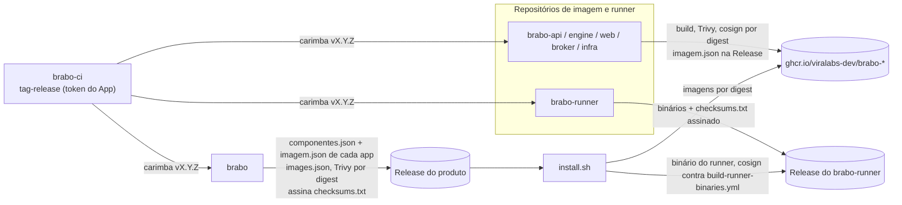

# Release do produto {#product-release}

> Como o Brabo, que vive em vários repositórios `viralabs-dev/brabo*`, publica **uma** versão do
> produto (AT-704, EP-033). Cada repositório tem a versão dele; o produto tem a dele, no `brabo`.
> Todos recomeçam em `1.0.0`. Esta página é a visão de conjunto; o detalhe das imagens e da
> assinatura está em [Cadeia de suprimentos do CI](cadeia-de-suprimentos-do-ci.md).

## As três etapas {#stages}

1. **Cada repositório carimba a própria tag.** A cada push em `dev` e `main`, o workflow
   `tag-release.yml` do repositório chama o `tag-release.yml` reutilizável do `brabo-ci`, pinado por
   SHA. O reutilizável calcula a versão pela função da branch (`breaking/` sobe o MAJOR, `feature/`
   o MINOR, o resto o PATCH) e empurra a tag com o token do GitHub App do bot (`BRABO_APP_ID` /
   `BRABO_APP_PRIVATE_KEY`, secrets da organização). É um token de App, e não o `GITHUB_TOKEN`,
   porque só ele faz a tag disparar o workflow de publicação.
2. **Os repositórios de imagem publicam.** Na tag final, `brabo-api`, `brabo-engine`, `brabo-web`,
   `brabo-broker` e `brabo-infra` (a imagem de backup) constroem a imagem, escaneiam com o Trivy
   **antes** de assinar, assinam por **digest** com o cosign keyless e verificam a assinatura no
   mesmo run. Anexam à Release deles o `imagem.json` (`{imagem, tag, digest}`), que é o contrato com
   o produto. O `brabo-runner` não publica imagem: anexa os binários e um `checksums.txt` assinado
   pelo `build-runner-binaries.yml` dele.
3. **O `brabo` monta a release do produto.** O `release.yml` lê o `componentes.json` (a tag de cada
   componente), baixa o `imagem.json` de cada Release, monta o `images.json` (`scripts/ci/montar-images.ts`),
   escaneia as imagens por digest com o Trivy, junta `install.sh` e os assets `brabo-install-*` e
   assina **um** `checksums.txt` (cosign keyless, identidade do `release.yml` do `brabo`). É esse
   manifesto que o `install.sh` confere. O binário do runner é conferido à parte, contra o
   `checksums.txt` assinado do `brabo-runner` na tag que o `componentes.json` fixa em `.runner.tag`.

## O portão {#gate}

A variável de repositório `PRODUTO_RELEASE_LIGADA=true` no `brabo` é a única chave que carimba a tag
e publica a Release do produto. Com ela desligada, `tag-release.yml` e o `release.yml` não rodam
(salvo o ensaio abaixo). Quem liga é o dono.

**Ensaio.** `workflow_dispatch` do `release.yml` num ramo, com o campo `tag` vazio, monta e confere
tudo o que for possível, mas **não** assina nem publica, e roda mesmo com o portão desligado. Sem a
Release de cada componente, as imagens não são montadas e o Trivy e a verificação das imagens ficam
para a primeira tag.

## O que `componentes.json` fixa {#components}

| Campo | Para quê |
|---|---|
| `infra` | repositório e ref de onde vêm o compose, o `.trivyignore.yaml` e o `trivy-do-release.ts` |
| `imagens.<alvo>` | repositório, tag e imagem de cada componente de imagem; o `imagem.json` precisa bater |
| `runner` | repositório e tag do `brabo-runner`; o `install.sh` baixa o binário dali (`RUNNER_TAG`, conferido por `scripts/dev/install-runner-release.spec.ts`) |

A pin **não anda sozinha no Git**, mas anda por um bot (AT-796, ADR 0282): a cada 6 h o `regenera-gerados.yml` lê a `releases/latest` de cada componente, confere o asset que o produto consome (`imagem.json`; `checksums.txt` e a assinatura no runner) e, se a Release for mais nova, troca só a tag na linha do `componentes.json`. Nunca desce a pin. O `infra` e a imagem de backup andam juntos, e o `RUNNER_TAG` do `install.sh` muda no mesmo commit. Tudo cai na PR fixa `chore/regenera-gerados`, que dispensa a escada; o merge é humano.

A trava (`scripts/ci/pins-dos-componentes.ts --conferir`) reprova quando uma pin está atrás da Latest, não tem Release final, falta o asset, `infra.ref` difere de `imagens.backup.tag` ou o `RUNNER_TAG` difere de `runner.tag`. Ela roda no check `Pins dos componentes` (PR para a `main`) e no `release.yml`: na tag reprova, no ensaio só avisa. Cinco de cinco imagens ou nenhuma: Release de produto com componente sem `imagem.json` é recusada.

## Decisões que ainda não estão tomadas {#open}

> **TODO(humano):** quem decide, e em que ordem, o momento de ligar `PRODUTO_RELEASE_LIGADA` e
> carimbar as primeiras tags `v1.0.0` dos repositórios (a ordem importa: o `brabo` precisa que as
> Releases dos componentes existam antes da dele).

> **TODO(humano):** tornar o check `Pins dos componentes` obrigatório no ruleset da `main`. Até lá ele aparece vermelho na PR de promoção, mas não a bloqueia.

## Hotfix de um componente {#hotfix}

O hotfix é PATCH pela escada normal (decisão do dono, AT-728); não se usa `hotfix/` direto na `main`.

1. O componente corrige pela própria `dev` → `main` e ganha `vX.Y.Z+1`.
2. O bot abre ou atualiza a PR `chore/regenera-gerados` com a pin nova (ou o dono dispara o `regenera-gerados`); mergeie-a na `dev`. A trava reprova a promoção enquanto a pin estiver atrás.
3. A promoção do `brabo` sai como patch do produto.

## Tag sem Release por pin atrás {#pin-atras}

Se um componente soltar Release entre o merge na `main` e o carimbo, a trava do `release.yml` reprova na tag e o produto fica com a tag sem Release (aconteceu na v2.1.0 e na v2.1.1). A saída: mergear a PR do bot na `dev`, promover e deixar sair um **patch** do produto. Exemplo: o web v1.2.1 virou Latest com a pin em v1.2.0; depois do merge da PR do bot, a promoção seguinte leva o web v1.2.1.
