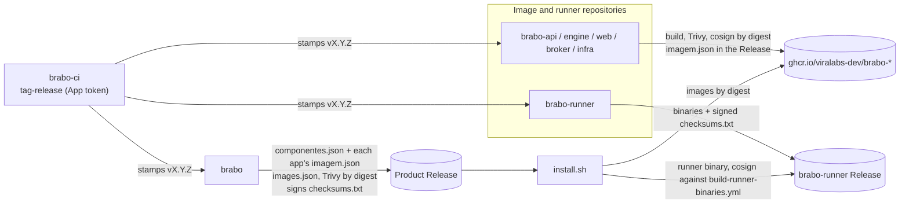

# Product release {#product-release}

> How Brabo, which lives in several `viralabs-dev/brabo*` repositories, publishes **one** product
> version (AT-704, EP-033). Each repository has its own version; the product has its own, in
> `brabo`. All restart at `1.0.0`. This page is the overview; the detail of the images and the
> signing is in [CI supply chain](cadeia-de-suprimentos-do-ci.md).

## The three stages {#stages}

1. **Each repository stamps its own tag.** On every push to `dev` and `main`, the repository's
   `tag-release.yml` workflow calls the reusable `tag-release.yml` of `brabo-ci`, pinned by SHA.
   The reusable one computes the version from the branch function (`breaking/` bumps the MAJOR,
   `feature/` the MINOR, the rest the PATCH) and pushes the tag with the bot's GitHub App token
   (`BRABO_APP_ID` / `BRABO_APP_PRIVATE_KEY`, organization secrets). It is an App token, and not
   the `GITHUB_TOKEN`, because only it makes the tag trigger the publishing workflow.
2. **The image repositories publish.** On the final tag, `brabo-api`, `brabo-engine`, `brabo-web`,
   `brabo-broker` and `brabo-infra` (the backup image) build the image, scan it with Trivy
   **before** signing, sign by **digest** with keyless cosign and verify the signature in the same
   run. They attach to their Release the `imagem.json` (`{imagem, tag, digest}`), which is the
   contract with the product. `brabo-runner` publishes no image: it attaches the binaries and a
   `checksums.txt` signed by its `build-runner-binaries.yml`.
3. **`brabo` assembles the product release.** The `release.yml` reads `componentes.json` (the tag
   of each component), downloads each Release's `imagem.json`, assembles the `images.json`
   (`scripts/ci/montar-images.ts`), scans the images by digest with Trivy, joins `install.sh` and
   the `brabo-install-*` assets and signs **one** `checksums.txt` (keyless cosign, identity of
   `brabo`'s `release.yml`). That manifest is what `install.sh` checks. The runner binary is
   checked separately, against `brabo-runner`'s signed `checksums.txt` at the tag that
   `componentes.json` pins in `.runner.tag`.

## The gate {#gate}

The repository variable `PRODUTO_RELEASE_LIGADA=true` in `brabo` is the only switch that stamps
the tag and publishes the product Release. With it off, `tag-release.yml` and `release.yml` do not
run (except for the rehearsal below). The owner turns it on.

**Rehearsal.** `workflow_dispatch` of `release.yml` on a branch, with the `tag` field empty,
assembles and checks everything possible, but does **not** sign or publish, and runs even with the
gate off. Without each component's Release, the images are not assembled and the Trivy scan and
the image verification are left for the first tag.

## What `componentes.json` pins {#components}

| Field | What for |
|---|---|
| `infra` | repository and ref where the compose, the `.trivyignore.yaml` and the `trivy-do-release.ts` come from |
| `imagens.<alvo>` | repository, tag and image of each image component; the `imagem.json` must match |
| `runner` | repository and tag of `brabo-runner`; `install.sh` downloads the binary from there (`RUNNER_TAG`, checked by `scripts/dev/install-runner-release.spec.ts`) |

Bumping a component means editing the tag here, in a PR, and the product ships with it on the next
tag. Five of five images or none: a product Release with a component without `imagem.json` is
refused.

## Decisions not yet made {#open}

> **TODO(humano):** who decides, and in what order, when to turn on `PRODUTO_RELEASE_LIGADA` and
> stamp the first `v1.0.0` tags of the repositories (the order matters: `brabo` needs the
> components' Releases to exist before its own).

> **TODO(humano):** `componentes.json` is edited by hand; it remains to decide whether a bot
> updates it when a component stamps a new tag or whether it stays a PR decision.

## Hotfix of a component {#hotfix}

The hotfix is a PATCH through the normal ladder (the owner's decision, AT-728); `hotfix/` is not used directly on `main`.

1. The component fixes it through its own `dev` → `main` and gets `vX.Y.Z+1`.
2. A PR in `brabo` bumps the component's tag in `componentes.json`.
3. The `brabo` promotion goes out as a product patch.
