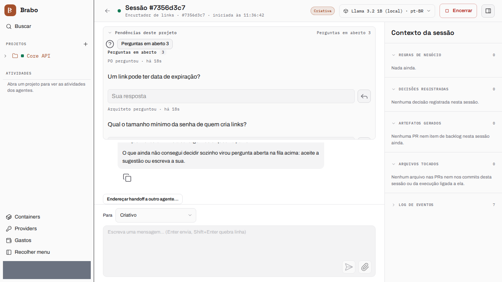
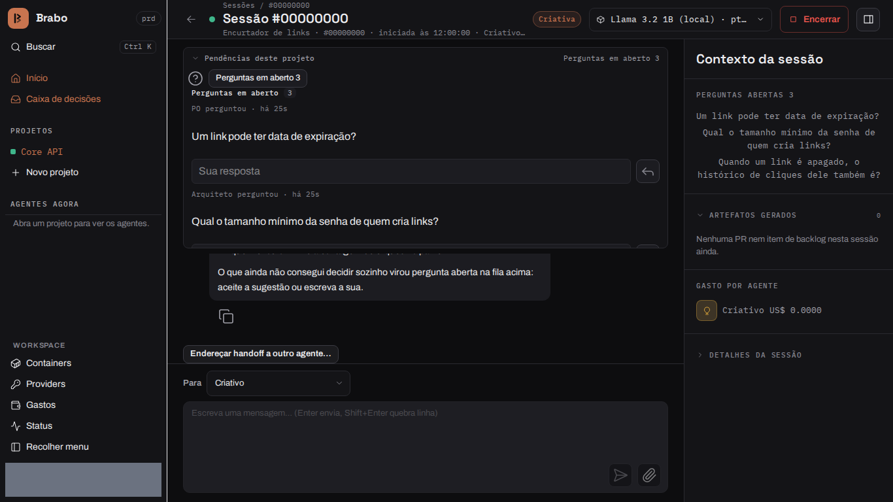

:::hero
# Brabo

A team of AI agents takes your application from brief to deploy; the merge is always yours.

 
:::

:::cartoes
- [Use Brabo](getting-started.md): install it, open your first project and follow a session.
- [Understand how it works](intro.md): the agents, the approval policy and the immutable record.
- [Replicate the method](tutorials/como-o-brabo-e-construido/index.md): organize several repositories for a team of agents.
:::

:::diferenciais
:::
