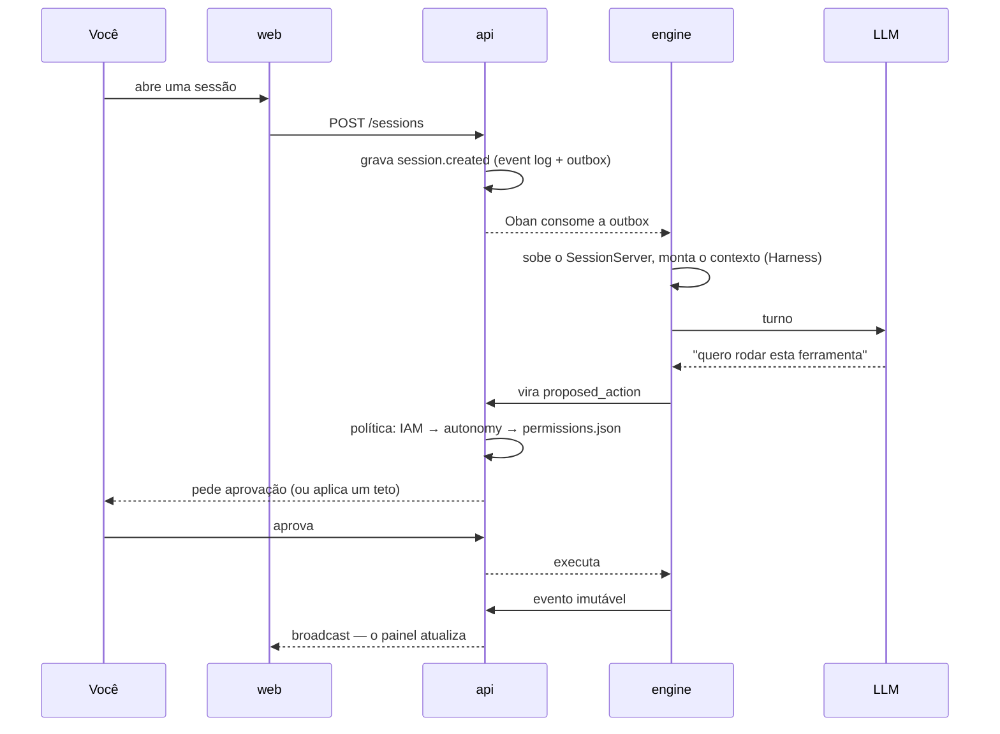

# What Brabo Is

Brabo runs the full lifecycle of an application, from brief to deploy, with a
team of AI agents working over a real git repository. **Final authority is
yours**, and that is a property of the architecture, not a slogan. Each agent
handles one role (Creative, PO, Architect, devs, QA, SecOps) and nothing with an
external effect happens without passing through the project's policy.

## What sets it apart from a code assistant

- **Nothing with an external effect happens on its own.** Command, commit, push, PR, merge
  and token spend are born as a `proposed_action` and pass through the policy, where
  `deny` always beats `allow`. Not even the policy unlocks a merge into a protected branch.
- **The agent is not trustworthy by construction.** The limits are structural: an iteration
  ceiling, a budget that refuses the call, a closed catalog of what each
  agent may do. A prompt is not a guarantee; code is.
- **Everything is recorded and immutable.** The event log is append-only, and it is what
  makes cost auditable and evidence traceable.
- **The team improves with you in the loop.** The Psychologist and Anamnesis propose
  adjustments to the agents' instructions, and each one only counts with your approval.

## One turn, start to finish

## Where to start

| you want to | go to |
|---|---|
| **use** Brabo: install it and run the first turn | [Getting Started](getting-started.md) |
| **understand** how it is put together and what it guarantees | [Architecture](architecture.md) and [Gates](explanation/gates.md) |
| **replicate** the idea in your own product, across several repositories | [Orchestrating repositories](tutorials/orquestrar-repositorios/index.md) |

Want to work on Brabo's code? See [Developing Brabo](how-to/desenvolver-o-brabo.md).

Current version: **v2.0.0** — [release notes](https://github.com/viralabs-dev/brabo/releases)
