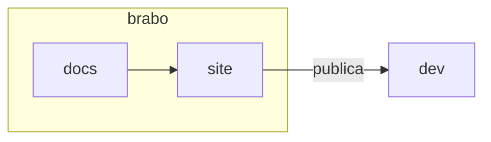

# Doc components

The site understands a few blocks beyond plain Markdown. All use the same form: a `:::name` line, the content in Markdown and a `:::` line that closes. Inside the block, a relative `.md` link, an image, code and bold work as anywhere else on the page.

This page is also the site's **visual test**: it has to render in both themes and in all four languages.

## Notices

Four types: `nota`, `dica`, `cuidado` and `perigo`. The default title is translated by the page's language; to change it, write it after the name. The English names (`note`, `tip`, `info`, `warning`, `caution`, `danger`) are still accepted.

```markdown
:::dica
Rode `pnpm docs:build` antes de abrir a PR.
:::

:::cuidado[Antes de apagar]
Confira o que depende deste arquivo.
:::
```

:::nota
Use for a clarification that does not change what the person does.
:::

:::dica
Use for a shortcut or a good practice.
:::

:::cuidado[Title chosen by the author]
Use when the mistake costs time, but can be undone. The notice text uses `--text-primary`, never the muted tone.
:::

:::perigo
Use when the mistake deletes data, exposes a secret or cannot be undone.
:::

## Historical record

`:::historico YYYY-MM-DD` marks a passage that describes Brabo **on a date**, and not as it is today. The date is required; without it, or if invalid, `docs:build` fails.

```markdown
:::historico 2026-10-31
Nesta data o fluxo tinha cinco fases.
:::
```

:::historico 2026-10-31
On this date the flow had five phases. The text, a table or an image go inside the band.
:::

## Steps

`:::passos` wraps a numbered list and draws it with the number in a circle and the vertical line.

```markdown
:::passos
1. Clone o repositório.
2. Rode `make dev`.
3. Abra o navegador.
:::
```

:::passos
1. Clone the repository.
2. Run `make dev`.
3. Open the browser at `http://localhost:3000`.
:::

## Cards

`:::cartoes` wraps a list `- [Title](page.md): one sentence`. The whole card is the link. Use it for "next step" and for indexes.

```markdown
:::cartoes
- [Do zero a um entregável](../tutorials/from-zero-to-deliverable.md): um projeto de ponta a ponta.
- [Glossário](../glossary.md): os termos do produto.
:::
```

:::cartoes
- [From zero to a deliverable](../tutorials/from-zero-to-deliverable.md): a project from end to end.
- [Glossary](../glossary.md): the product's terms.
- [Getting Started](../getting-started.md): install and open Brabo.
:::

## Tabs

`:::abas` separates the tabs with `=== Label` lines. The first one opens open; without JavaScript, all of them appear stacked.

````markdown
:::abas
=== Linux
```bash
sudo apt install docker.io
```
=== macOS
```bash
brew install --cask docker
```
:::
````

:::abas
=== Linux
```bash
sudo apt install docker.io
```
=== macOS
```bash
brew install --cask docker
```
:::

## Image with caption

An image alone in the paragraph, with a title in quotes, becomes a figure with a caption. The figure may exceed the reading width.

```markdown

```

## Reading width and diagrams

Running text stays at about 72 characters per line. Table, code, figure and diagram use the full width. Mermaid diagrams inherit the product's token colors in both themes:


