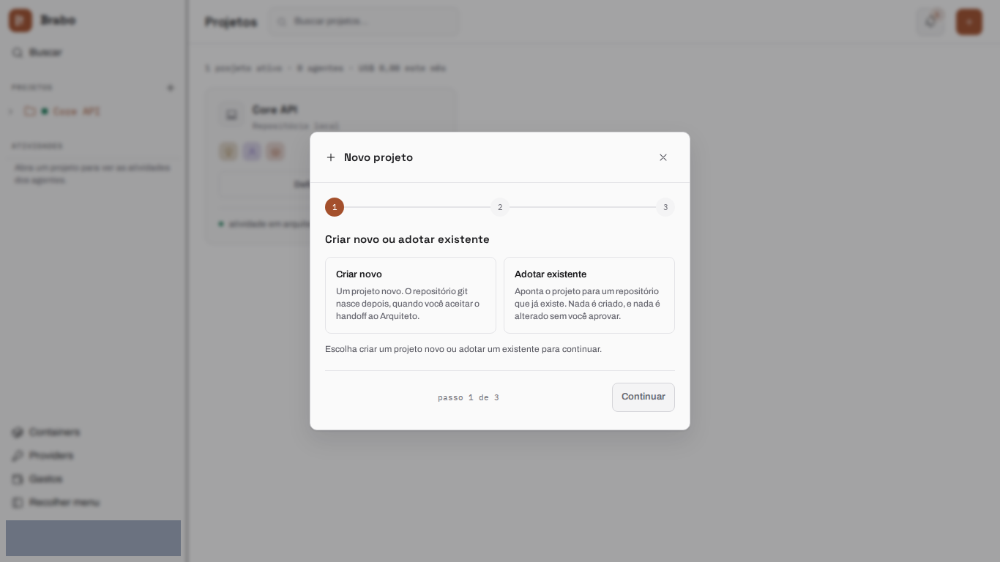
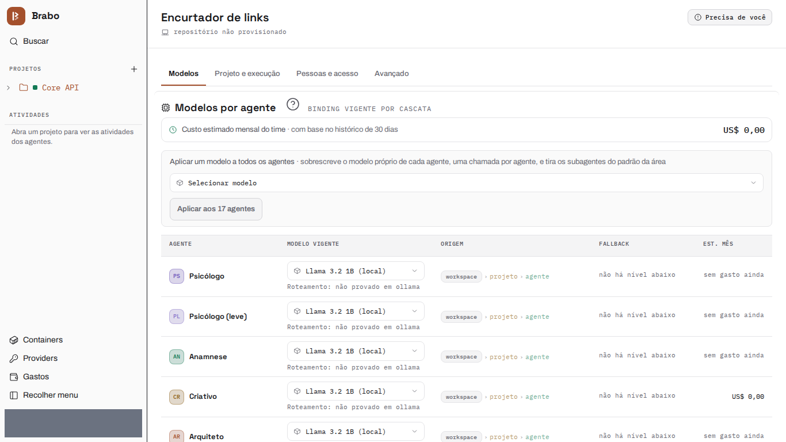
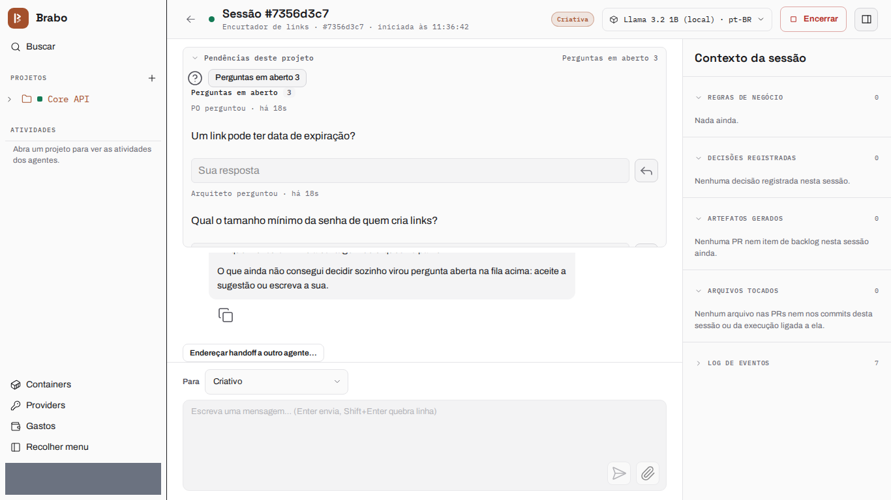

# From zero to a deliverable

This page follows a project end to end, from an empty workspace to a running deliverable: a link shortener (Node 22 + SQLite), with the whole team on the same model. The screens in steps 1 to 3 are captures of the current interface, generated by `brabo-qa` on each version with the test data hidden.

:::historico 2026-10-14
The example run was recorded live, and these numbers are from it. The project, `viralabs-app-2026-10-14b`, ran on **Claude Haiku 5.5** and cost **US$ 1.07**. From the idea to execution took **13 minutes**, and to the last merge about **57 minutes** of interaction. It produced **8 of 8 tasks**, plus the ADR and the infrastructure pull request, and a deliverable whose suite passes **102/102** in a clean clone. The screens in steps 4 to 6 come from that recording, which predates the shadcn migration.
:::

:::dica[Everything through the Creative's chat]
The whole run was driven from **one place, the Creative's session chat**:
open questions, the architecture confirmation and every merge were decided
there, without reloading the page or opening another tab.
:::

The path, in six steps:

:::passos
1. **Create the project** and choose where the code lives.
2. **Give the team a model**, in a single action.
3. **Describe the idea** and answer the agents' open questions.
4. **Check the PO, the Architect and the ADR**, and confirm the architecture.
5. **Approve the execution plan** and turn on automatic mode.
6. **Merge every pull request** that passes the gates, from the chat.
:::

Each step below says what you do and what the agents hand back. The screens in steps 1 to 3 are from the current version; those in steps 4 to 6 are historical (see the box above).

## 1. Create the project

You create the project in the wizard and choose where the code lives. Here it
is a **mounted folder**: the wizard suggests a path inside the installation's
projects base, and the folder only needs to exist when the Infra brings the
container up. Nothing is provisioned yet — the repository is born later, when
the Architect is brought in.

## 2. Give the team a model

In Settings you apply one model to every agent in one action. This run applied
Claude Haiku 5.5 to the whole team.

## 3. The idea, and the questions the agents ask back

You describe the product in the Creative's chat. In its first turn the
**Creative** records **7 business rules and 1 decision**, and turns what it
could not decide on its own into **open questions**, each with a suggested
answer and the rules it affects ("when a link is deleted, is its click history
deleted too?"). The questions sit in the "Open questions" queue at the top of
the chat: you accept the suggestion or type your own answer, and the answer is
recorded as a decision. The closing line of the turn says what was written
("Recorded this turn: 7 business rules, 1 decision, 2 open questions").
When you are done, **"I'm ready — the need is validated"** hands the work to
the PO.

## 4. PO, Architect and the ADR

The **PO** breaks the rules into a backlog — **4 epics, 8 stories and 8
tasks**, in about a minute and a half — and asks back too when a rule is
missing a value ("what is the minimum password length?"). With every rule
covered by a story, the handoff to the **Architect** is accepted
automatically. The Architect proposes the ADR as a pull request
(`arquiteto[bot]`, PR #1, "Single module with SQLite on a persistent volume")
and, once the architecture is defined, asks you to confirm it:
**"Confirm architecture ready"** is what brings the Infra in.

:::historico 2026-10-14
Screen from the Oct 14 recording, before the shadcn migration.

")
:::

## 5. Infra, the plan and automatic mode

The **Infra Lead** brings the project's container up on its own and opens the
infrastructure pull request (`infra[bot]`, PR #2). The **Dev Lead** reads the
backlog and the module map and proposes the execution plan; approving the
plan is what activates execution. The screen offers **automatic mode** for the
whole team in one click, saying what it does not release: merges into a
protected branch stay yours. From then on the dev agent works inside the
container (`/work`), and you can read each command it ran and its output in
the chat.

:::historico 2026-10-14
Screen from the Oct 14 recording, before the shadcn migration.

")
:::

## 6. Merges from the chat

Each task runs in the dev agent (90 s on average from picking the task to the
pull request, between 36 s and 144 s) and goes through the pipeline **Dev →
QA → SecOps → You**. A pull request that passes the gates lands in the
**"PRs ready to merge"** queue at the top of the Creative's chat: **Merge**
proposes the merge and **Approve**, in the same block, confirms it. In this
run the last seven pull requests (#4 to #10) were merged in about two minutes,
with no page reload.

:::historico 2026-10-14
Screen from the Oct 14 recording, before the shadcn migration.

")
:::

## The deliverable

:::historico 2026-10-14
The run recorded on Oct 14 ended like this.

The `dev` branch of the project repository, cloned clean and run in
`node:22` with `npm test`, passed **102/102** tests. `docker compose up`
brought the API up on port 8080, and every rule was checked over HTTP: a wrong
login and a request without a token get 401; an `ftp` URL or one longer than
2048 characters gets 400 `INVALID_URL`; the short code has 7 characters; the
public redirect is a 302 that records the click; an unknown code gets 404
`LINK_NOT_FOUND` and an expired link 410 `LINK_EXPIRED` without counting the
click; deleting a link returns 204 and removes its clicks; the panel shows the
count and the click history; `npm run user:create` refuses a password shorter
than 12 characters; and `/docs` serves the API reference. The CORS preflight
from `127.0.0.1:8080` and from `localhost:8080` gets each its own
`Access-Control-Allow-Origin`, and a foreign origin gets none.
:::

## Next step

:::cartoes
- [Orchestrate a product across several repositories](orquestrar-repositorios/index.md): the path for splitting a product the way Brabo was split.
:::
