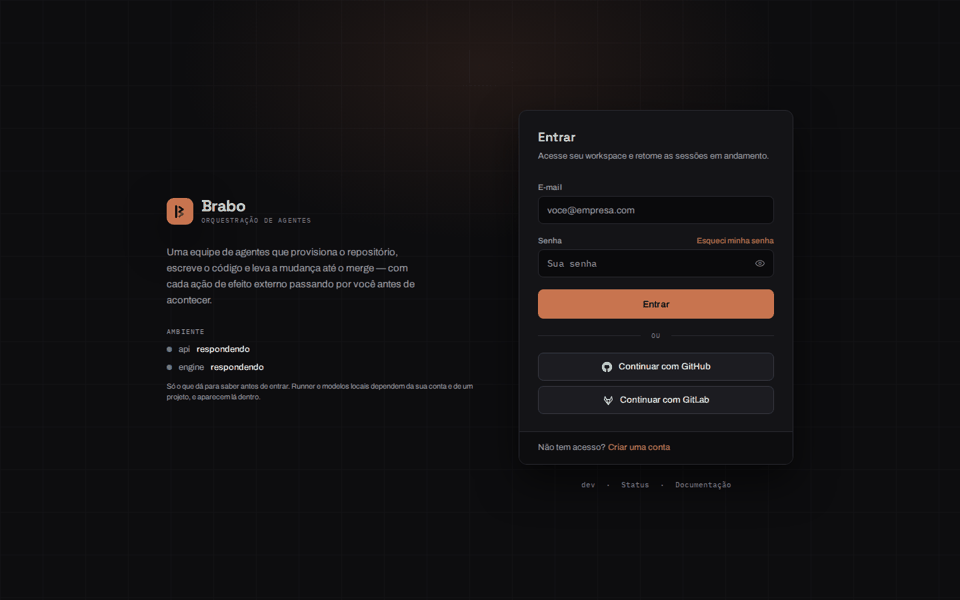
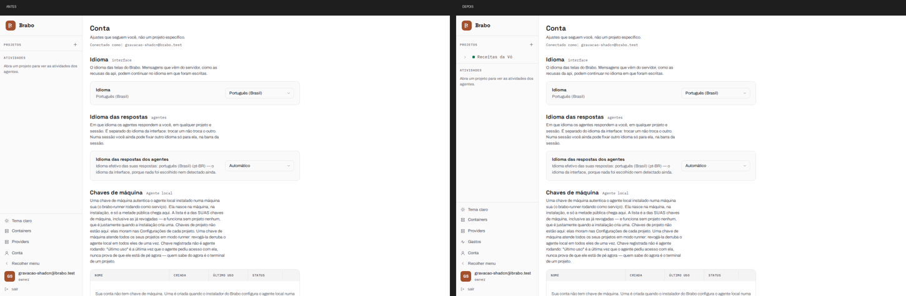
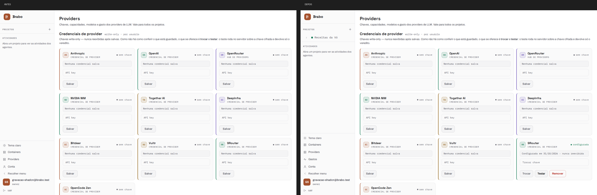
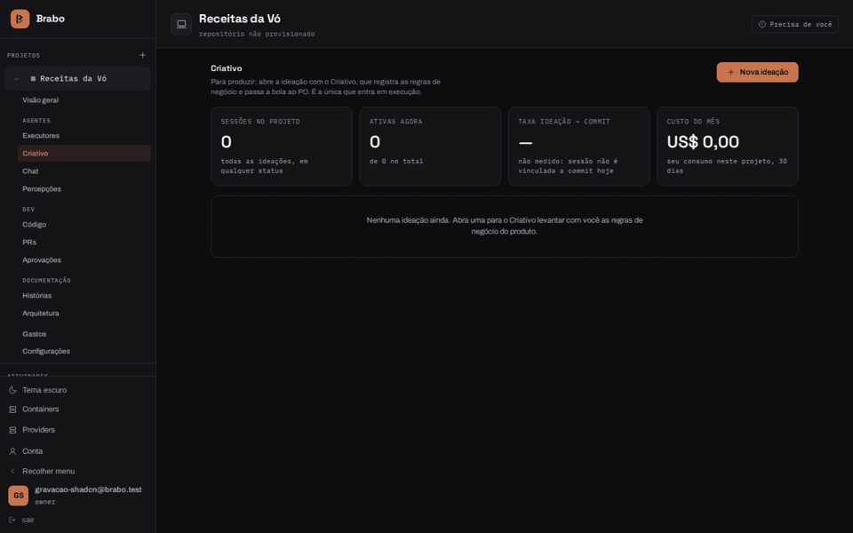
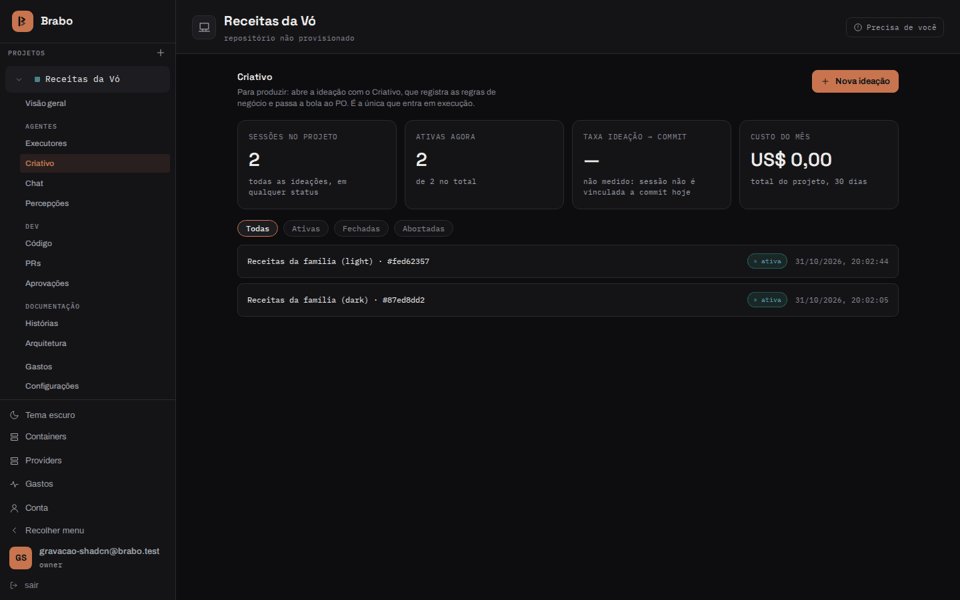
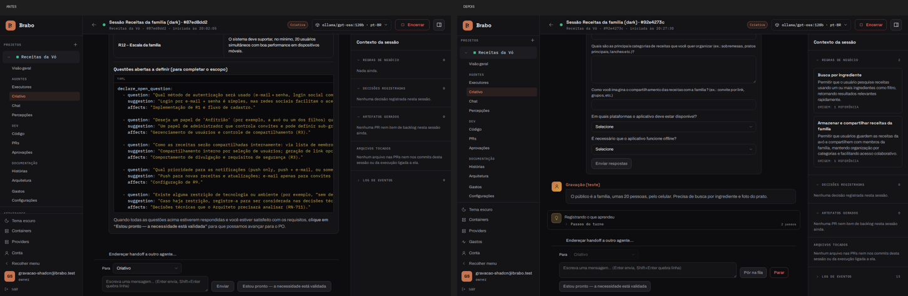
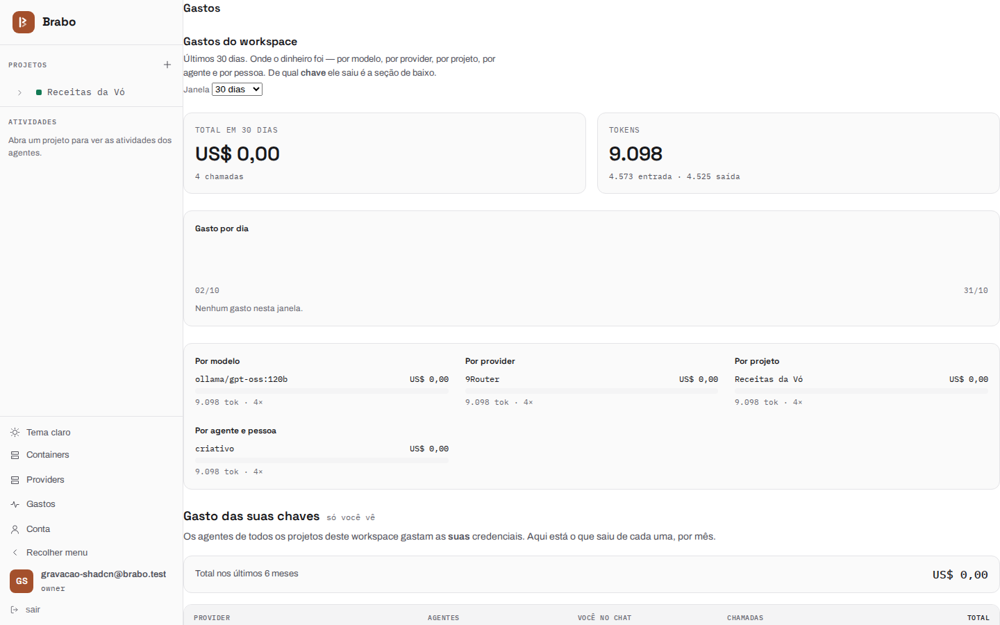

# Interface before and after shadcn (10/31/2026)

Visual record of the round that switched the front end's base to shadcn/ui with Base UI
([ADR 0232](../adr/0232-shadcn-com-base-ui-no-apps-web.md)) and that, on the same day,
made 9Router receive the agents' tools
([RN-950](../business-rules/api.md#rn-950)). The **before** is the installation with the 10/31
morning `dev`; the **after** is `dev` `5851354c7c`, with the house primitives
(`Button`, `Badge`, `Card`, `Alert`, `Table`, `Input`, `Select`, `Modal`,
`Disclosure`, tabs) already served by shadcn's components.

How it was recorded: headless browser (Playwright) against the local installation,
on a fresh test account, 1440×900 screens in both themes. The chat uses 9Router
with a free model (`ollama/gpt-oss:120b`), at no cost.

## The walk through the screens

Login, home, Containers, Providers, Account and Status, first in the dark theme and
then in the light one. The goal of the migration was **no screen changes**; what changes between
the two is data (the test project created between the recordings) and the new Spend page.

| Before | After |
|---|---|
|  |  |

## A Creative session

The same conversation on both installations: the Creative opens the session, receives the idea
("an app to keep my grandmother's recipes") and then the audience and the
requirements.

- **Before:** 9Router did not receive the tools, and the model wrote them out as
  text (the `declare_open_question` block in YAML on the thread). No business rule
  was recorded: the side panel stays at zero.
- **After:** the Creative calls the tools for real. The question becomes a
  structured form and the panel shows the recorded business rules.

| Before | After |
|---|---|
|  |  |

## New Spend page

The global `/spend` page ([RN-952](../business-rules/api.md#rn-952)) did not exist
in the before. In the after recording it appears without the page margin — the content
touches the sidebar; the defect was logged for fixing.

