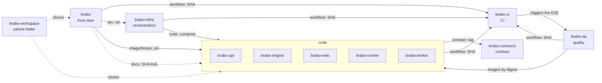

# The map

**Who it is for:** anyone who wants to see the whole set before getting into the details.

**After reading, you can:** say each repository's role, point out what it depends on and draw the map from memory.

## The seven roles

| Role | Repository | What it does |
|---|---|---|
| **Front door** | [`brabo`](https://github.com/viralabs-dev/brabo#readme) | Aggregated documentation, the site, `install.sh` and the product release. |
| **Code** | [`brabo-api`](https://github.com/viralabs-dev/brabo-api#readme), [`brabo-engine`](https://github.com/viralabs-dev/brabo-engine#readme), [`brabo-web`](https://github.com/viralabs-dev/brabo-web#readme), [`brabo-runner`](https://github.com/viralabs-dev/brabo-runner#readme), [`brabo-broker`](https://github.com/viralabs-dev/brabo-broker#readme) | The product's components. Four publish a container image; the runner publishes a binary. |
| **Contract** | [`brabo-contracts`](https://github.com/viralabs-dev/brabo-contracts#readme) | Packages and data files the others share. |
| **CI** | [`brabo-ci`](https://github.com/viralabs-dev/brabo-ci#readme) | Reusable workflows and the PR policy, the approval ladder, promotion and tagging. |
| **Orchestration** | [`brabo-infra`](https://github.com/viralabs-dev/brabo-infra#readme) | Composes, integration Dockerfiles, Kubernetes manifests, development scripts and the backup image. |
| **Quality** | [`brabo-qa`](https://github.com/viralabs-dev/brabo-qa#readme) | End-to-end browser tests, golden sets and the feature catalog. It is the gate of `main`. |
| **Parent folder** | [`brabo-workspace`](https://github.com/viralabs-dev/brabo-workspace#readme) | The folder where the clones sit side by side, and `clonar-tudo.sh`. It has no product code. |

## The diagram

The arrows say **who uses whom**, and the label says **through which channel** ([page 3](como-cada-repo-e-consumido.md) explains each channel). To keep it from becoming a tangle, the drawing shows the main edges; the full list, with the proof of each, is in `repos.yml`.



Two useful readings of the drawing:
- **`brabo-ci` is the base.** Every repository calls it; nobody imports anything from `brabo-ci` at the product's run time.
- **`brabo` is at the top.** It pins the versions that make up the product, reads the others' code to generate the documentation and publishes the product release. That is why its promotion is the last.

## One source for the map

This table and this drawing are not maintained by hand. The single source is the `repos.yml` file at the root of `brabo`: for each repository, the role, the purpose, how it is used and the `depende_de` list, in which **each edge** states the repository, the channel type and the **proof** (the file and line where the code uses the dependency).

```yaml
brabo-web:
  papel: código
  depende_de:
    - { repo: brabo-contracts, tipo: contrato, prova: "package.json:20" }
    - { repo: brabo-ci, tipo: workflow, prova: ".github/workflows/carimbo.yml:18" }
```

Each repository's README block "Onde se encaixa" is **generated** from that file by `brabo-ci`, and a check fails the README whose block diverged. So one repository's map never disagrees with another's. Whoever changes a dependency edits `repos.yml` and regenerates the blocks. To learn more: [ADR 0281](../../adr/0281-o-mapa-dos-repos-tem-uma-fonte-so.md) and the [architecture](../../architecture.md).

> **For your project:** start with the roles table. If you cannot state a repository's role in one sentence, it probably should not exist separately.

Next: [How each repository is consumed](como-cada-repo-e-consumido.md).
