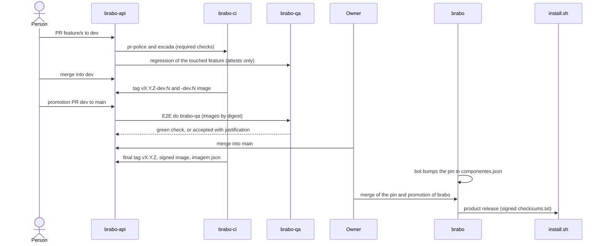

# The life of a change

**Who it is for:** anyone who wants to understand what happens between "I opened a PR" and "the user installed it".

**After reading, you can:** narrate the path of a change to the release, saying in which repository each step happens and what could block it.

We will follow a hypothetical change in `brabo-api` that the end user will receive through the installer.

## The diagram

## Step by step

### 1. The PR on `dev`
Work starts from `dev` on a `function/description` branch (for example `feature/sso-login`). The branch **function** decides the version that will ship: `breaking/` bumps MAJOR, `feature/` MINOR and the others PATCH. Two `brabo-ci` checks are required: `pr-police` (branch name, origin and target) and `escada` (approvals). See the [policy in 10 minutes](../../explanation/politica-em-10-minutos.md) and the [branch policy](../../explanation/branching-policy.md).

### 2. The regression per feature
`brabo-qa` has a catalog (`funcionalidades.yml`) that links **paths in each repository** to product features. The PR touches a path, `brabo-ci` works out which feature was touched and `brabo-qa` runs that feature's specs against the PR's own image. The result comes back as the `Regressivo do brabo-qa` check. On `dev` it **only attests and never blocks**. See [regression per feature](../../explanation/regressivo-por-funcionalidade.md).

### 3. Merge into `dev` and the `-dev.N` tag
On every merge into `dev`, `brabo-ci`'s `tag-release` stamps a `vX.Y.Z-dev.N` tag, and the image repositories publish that tag's image. It is not a release yet: it lets the other repositories test against the change.

### 4. The `dev` to `main` promotion
A **promotion** PR takes `dev` to `main`. Because a consumer's `main` uses the producer's **final** artifact, promotion has an order: first `brabo-ci`, then contracts, then the components, then infra, then QA and finally `brabo`. The `Dependências de merge` check applies that order by itself and says, for example, `esperando viralabs-dev/brabo-ci#45` (waiting for it) ([ADR 0284](../../adr/0284-a-promocao-infere-as-dependencias-pela-ordem-dos-repos.md)).

### 5. The `E2E do brabo-qa` gate on `main`
The PR to `main` triggers the browser E2E in `brabo-qa`, against the images **by digest**. The `E2E do brabo-qa` check is required on `main`. If it is red because of a spec or the environment, only the owner can accept it, with `/qa-aceitar <justification>` (at least 20 characters); red because of a digest or a signature is never accepted ([ADR 0267](../../adr/0267-o-e2e-do-brabo-qa-e-portao-da-main.md)).

### 6. Merge and final tag
**Merging into `main` is always the owner's.** No automation merges into a protected branch. After the merge, `brabo-ci` stamps the final tag `vX.Y.Z`; the repository builds the image, scans it with Trivy **before** signing, signs it by digest with cosign and attaches the `imagem.json` (`{imagem, tag, digest}`) to the Release.

### 7. The pin in `brabo`
The `regenera-gerados` bot notices the new Release and opens the `chore/regenera-gerados` PR, changing the tag in `componentes.json`. The merge is human. While the pin is behind, the `Pins dos componentes` lock fails `brabo`'s promotion.

### 8. The product release and `install.sh`
`brabo`'s promotion is the last. `release.yml` reads `componentes.json`, gathers each component's `imagem.json`, scans the images by digest, adds `install.sh` and signs **one** `checksums.txt`. `install.sh` checks that manifest and the runner's before installing. Details in [product release](../../explanation/release-do-produto.md).

> **TODO(humano):** `brabo` keeps publication of the product release off through the `PRODUTO_RELEASE_LIGADA` variable until the owner decides when to stamp the repositories' first `v1.0.0` tags. The path describes the expected route; the owner flips the switch.

## What about an emergency?
The policy provides the `hotfix/` function, which starts from `main`, targets `main` and ships as PATCH. After the merge, a **lock** blocks PRs on `dev` until the fix goes back to it (the back-merge), so that no production fix is lost. For Brabo's components, however, the owner's decision is to fix through the normal `dev` and `main` as PATCH, with no direct `hotfix/`; `brabo`'s pin is bumped by the bot and the promotion ships as a product patch.

Next: [Build your own](monte-o-seu.md).
