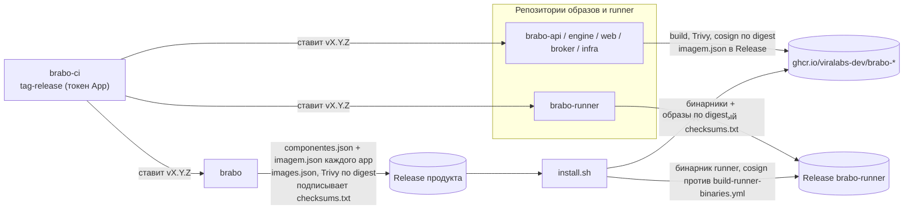

# Релиз продукта {#product-release}

> Как Brabo, который живёт в нескольких репозиториях `viralabs-dev/brabo*`, публикует **одну** версию
> продукта (AT-704, EP-033). У каждого репозитория своя версия; у продукта своя — в `brabo`.
> Все начинают заново с `1.0.0`. Эта страница — общий обзор; детали образов и подписи
> описаны в [Цепочка поставок CI](cadeia-de-suprimentos-do-ci.md).

## Три этапа {#stages}

1. **Каждый репозиторий ставит собственный тег.** При каждом push в `dev` и `main` workflow
   `tag-release.yml` репозитория вызывает переиспользуемый `tag-release.yml` из `brabo-ci`, закреплённый по
   SHA. Переиспользуемый workflow вычисляет версию по функции ветки (`breaking/` поднимает MAJOR, `feature/`
   — MINOR, остальное — PATCH) и пушит тег токеном GitHub App бота (`BRABO_APP_ID` /
   `BRABO_APP_PRIVATE_KEY`, секреты организации). Это токен App, а не `GITHUB_TOKEN`,
   потому что только он заставляет тег запускать workflow публикации.
2. **Репозитории образов публикуют.** По финальному тегу `brabo-api`, `brabo-engine`, `brabo-web`,
   `brabo-broker` и `brabo-infra` (образ бэкапа) собирают образ, сканируют его Trivy
   **до** подписи, подписывают по **digest** через cosign keyless и проверяют подпись в
   том же run. К своему Release они прикладывают `imagem.json` (`{imagem, tag, digest}`) — контракт с
   продуктом. `brabo-runner` не публикует образ: он прикладывает бинарники и `checksums.txt`, подписанный
   его `build-runner-binaries.yml`.
3. **`brabo` собирает релиз продукта.** `release.yml` читает `componentes.json` (тег каждого
   компонента), скачивает `imagem.json` из каждого Release, собирает `images.json` (`scripts/ci/montar-images.ts`),
   сканирует образы по digest через Trivy, объединяет `install.sh` и ассеты `brabo-install-*` и
   подписывает **один** `checksums.txt` (cosign keyless, идентичность `release.yml` из `brabo`). Именно этот
   манифест проверяет `install.sh`. Бинарник runner проверяется отдельно, по
   подписанному `checksums.txt` из `brabo-runner` на теге, который `componentes.json` фиксирует в `.runner.tag`.

## Шлюз {#gate}

Переменная репозитория `PRODUTO_RELEASE_LIGADA=true` в `brabo` — единственный ключ, который ставит тег
и публикует Release продукта. Когда она выключена, `tag-release.yml` и `release.yml` не запускаются
(кроме репетиции ниже). Включает её владелец.

**Репетиция.** `workflow_dispatch` для `release.yml` на ветке с пустым полем `tag` собирает и проверяет
всё, что возможно, но **не** подписывает и не публикует, и запускается даже при выключенном шлюзе. Без
Release каждого компонента образы не собираются, а Trivy и проверка образов остаются
до первого тега.

## Что фиксирует `componentes.json` {#components}

| Поле | Для чего |
|---|---|
| `infra` | репозиторий и ref, откуда берутся compose, `.trivyignore.yaml` и `trivy-do-release.ts` |
| `imagens.<alvo>` | репозиторий, тег и образ каждого компонента-образа; `imagem.json` должен совпадать |
| `runner` | репозиторий и тег `brabo-runner`; `install.sh` скачивает оттуда бинарник (`RUNNER_TAG`, проверяется `scripts/dev/install-runner-release.spec.ts`) |

Поднять компонент — значит поправить тег здесь, в PR, и продукт выйдет с ним на следующем теге. Пять из
пяти образов или ни одного: Release продукта с компонентом без `imagem.json` отклоняется.

## Решения, которые ещё не приняты {#open}

> **TODO(humano):** кто и в каком порядке решает, когда включать `PRODUTO_RELEASE_LIGADA` и
> ставить первые теги `v1.0.0` репозиториев (порядок важен: `brabo` нужно, чтобы
> Release компонентов существовали раньше его собственного).

> **TODO(humano):** `componentes.json` правится вручную; осталось решить, будет ли бот обновлять его, когда
> компонент ставит новый тег, или это останется решением через PR.

> **TODO(humano):** хотфикс компонента (создаётся от `main`) и тег продукта, который его несёт: процесс
> хотфикса продукта ещё не написан.
