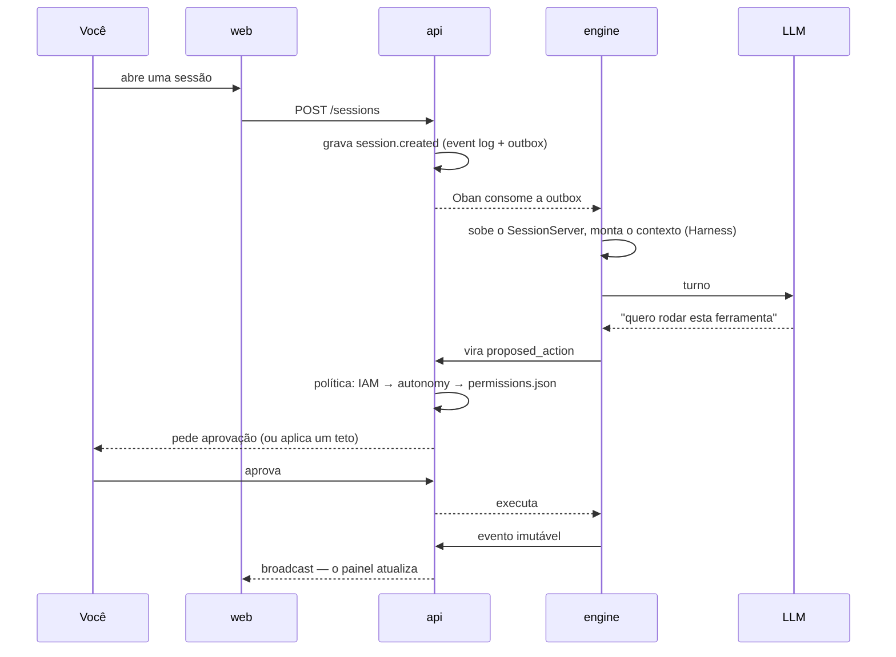

# Что такое Brabo {#o-que-é-o-brabo}

Brabo ведёт полный жизненный цикл приложения, от брифа до деплоя, с командой
ИИ-агентов, работающих над настоящим git-репозиторием. **Последнее слово за
вами**, и это свойство архитектуры, а не лозунг. Каждый агент отвечает за одну
роль (Criativo, PO, Arquiteto, разработчики, QA, SecOps), и ничто с внешним
эффектом не происходит в обход политики проекта.

## Чем он отличается от ассистента для кода

- **Ничто с внешним эффектом не происходит само.** Команда, commit, push, PR, merge
  и расход токенов рождаются как `proposed_action` и проходят через политику, где
  `deny` всегда сильнее `allow`. Merge в защищённую ветку не разрешает даже политика.
- **Агенту нельзя доверять по построению.** Ограничения структурные: потолок
  итераций, бюджет, который отказывает в вызове, закрытый каталог того, что
  может делать каждый агент. Промпт — не гарантия; код — гарантия.
- **Всё записывается и неизменяемо.** Event log работает только на добавление, и именно он
  делает стоимость проверяемой, а доказательства — прослеживаемыми.
- **Команда улучшается при вашем участии.** Psicólogo и Anamnese предлагают
  изменения в инструкциях агентов, и каждое действует только с вашего одобрения.

## Один ход, от начала до конца

## С чего начать

| вы хотите | перейдите к |
|---|---|
| **использовать** Brabo: установить и выполнить первый ход | [Первые шаги](getting-started.md) |
| **понять**, как он устроен и что гарантирует | [Архитектура](architecture.md) и [Гейты](explanation/gates.md) |
| **повторить** идею в собственном продукте, в нескольких репозиториях | [Оркестрация репозиториев](tutorials/orquestrar-repositorios/index.md) |

Хотите работать с кодом Brabo? См. [Разработка Brabo](how-to/desenvolver-o-brabo.md).

Текущая версия: **v2.0.0** — [заметки о релизе](https://github.com/viralabs-dev/brabo/releases)
