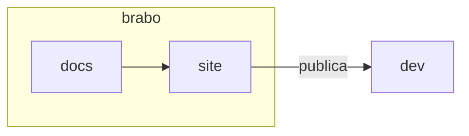

# Компоненты документации

Сайт понимает несколько блоков сверх обычного Markdown. Все они имеют одну форму: строка `:::имя`, содержимое в Markdown и строка `:::`, которая закрывает блок. Внутри блока работают относительная ссылка `.md`, изображение, код и жирный шрифт, как в любой части страницы.

Эта страница — ещё и **визуальный тест** сайта: она должна отображаться в обеих темах и на всех четырёх языках.

## Предупреждения

Четыре типа: `nota`, `dica`, `cuidado` и `perigo`. Заголовок по умолчанию переводится на язык страницы; чтобы заменить его, напишите свой после имени. Английские имена (`note`, `tip`, `info`, `warning`, `caution`, `danger`) по-прежнему принимаются.

```markdown
:::dica
Rode `pnpm docs:build` antes de abrir a PR.
:::

:::cuidado[Antes de apagar]
Confira o que depende deste arquivo.
:::
```

:::nota
Используйте для пояснения, которое не меняет того, что делает человек.
:::

:::dica
Используйте для короткого пути или хорошей практики.
:::

:::cuidado[Заголовок, выбранный автором]
Используйте, когда ошибка стоит времени, но её можно исправить. Текст предупреждения использует `--text-primary`, а не приглушённый тон.
:::

:::perigo
Используйте, когда ошибка стирает данные, раскрывает секрет или необратима.
:::

## Историческая запись

`:::historico ГГГГ-ММ-ДД` помечает фрагмент, описывающий Brabo **на определённую дату**, а не таким, каков он сегодня. Дата обязательна; без неё или с неверной датой `docs:build` проваливается.

```markdown
:::historico 2026-10-31
Nesta data o fluxo tinha cinco fases.
:::
```

:::historico 2026-10-31
На эту дату у потока было пять фаз. Текст, таблица или изображение идут внутри полосы.
:::

## Шаги

`:::passos` оборачивает нумерованный список и рисует его с номером в кружке и вертикальной линией.

```markdown
:::passos
1. Clone o repositório.
2. Rode `make dev`.
3. Abra o navegador.
:::
```

:::passos
1. Клонируйте репозиторий.
2. Выполните `make dev`.
3. Откройте браузер по адресу `http://localhost:3000`.
:::

## Карточки

`:::cartoes` оборачивает список `- [Заголовок](pagina.md): одна фраза`. Вся карточка — это ссылка. Подходит для «следующего шага» и для индексов.

```markdown
:::cartoes
- [Do zero a um entregável](../tutorials/from-zero-to-deliverable.md): um projeto de ponta a ponta.
- [Glossário](../glossary.md): os termos do produto.
:::
```

:::cartoes
- [С нуля до готового результата](../tutorials/from-zero-to-deliverable.md): проект от начала до конца.
- [Глоссарий](../glossary.md): термины продукта.
- [Первые шаги](../getting-started.md): установить и открыть Brabo.
:::

## Вкладки

`:::abas` разделяет вкладки строками `=== Метка`. Первая открывается раскрытой; без JavaScript все показываются друг под другом.

````markdown
:::abas
=== Linux
```bash
sudo apt install docker.io
```
=== macOS
```bash
brew install --cask docker
```
:::
````

:::abas
=== Linux
```bash
sudo apt install docker.io
```
=== macOS
```bash
brew install --cask docker
```
:::

## Изображение с подписью

Изображение одно в абзаце, с заголовком в кавычках, становится рисунком с подписью. Рисунок может выходить за ширину чтения.

```markdown

```

## Ширина чтения и диаграммы

Основной текст держится около 72 символов в строке. Таблица, код, рисунок и диаграмма используют всю ширину. Диаграммы Mermaid наследуют цвета токенов продукта в обеих темах:


