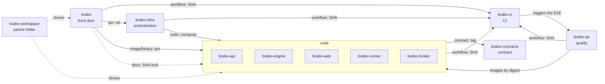

# Карта

**Для кого:** для тех, кто хочет увидеть весь набор, прежде чем вникать в детали.

**После прочтения вы сможете:** назвать роль каждого репозитория, указать, от чего он зависит, и нарисовать карту по памяти.

## Семь ролей

| Роль | Репозиторий | Что делает |
|---|---|---|
| **Входная дверь** | [`brabo`](https://github.com/viralabs-dev/brabo#readme) | Сводная документация, сайт, `install.sh` и релиз продукта. |
| **Код** | [`brabo-api`](https://github.com/viralabs-dev/brabo-api#readme), [`brabo-engine`](https://github.com/viralabs-dev/brabo-engine#readme), [`brabo-web`](https://github.com/viralabs-dev/brabo-web#readme), [`brabo-runner`](https://github.com/viralabs-dev/brabo-runner#readme), [`brabo-broker`](https://github.com/viralabs-dev/brabo-broker#readme) | Компоненты продукта. Четыре публикуют образ контейнера; runner публикует бинарный файл. |
| **Контракт** | [`brabo-contracts`](https://github.com/viralabs-dev/brabo-contracts#readme) | Пакеты и файлы данных, общие для остальных. |
| **CI** | [`brabo-ci`](https://github.com/viralabs-dev/brabo-ci#readme) | Переиспользуемые workflow и политика PR, лестница одобрений, продвижение и тег. |
| **Оркестрация** | [`brabo-infra`](https://github.com/viralabs-dev/brabo-infra#readme) | Compose, интеграционные Dockerfile, манифесты Kubernetes, скрипты разработки и образ резервного копирования. |
| **Качество** | [`brabo-qa`](https://github.com/viralabs-dev/brabo-qa#readme) | Сквозные тесты в браузере, golden-наборы и каталог функциональностей. Это ворота `main`. |
| **Родительская папка** | [`brabo-workspace`](https://github.com/viralabs-dev/brabo-workspace#readme) | Папка, где клоны лежат рядом, и `clonar-tudo.sh`. Кода продукта в ней нет. |

## Диаграмма

Стрелки показывают, **кто кого использует**, а подпись - **по какому каналу** (каждый канал объясняет [страница 3](como-cada-repo-e-consumido.md)). Чтобы рисунок не превратился в клубок, показаны основные рёбра; полный список с доказательством каждого есть в `repos.yml`.



Два полезных вывода из рисунка:
- **`brabo-ci` - основа.** Его вызывает каждый репозиторий; никто не импортирует ничего из `brabo-ci` во время работы продукта.
- **`brabo` - на вершине.** Он закрепляет версии, из которых состоит продукт, читает код остальных для генерации документации и публикует релиз продукта. Поэтому его продвижение - последнее.

## Единый источник карты

Эта таблица и этот рисунок не ведутся вручную. Единый источник - файл `repos.yml` в корне `brabo`: для каждого репозитория роль, назначение, способ использования и список `depende_de`, где **каждое ребро** называет репозиторий, тип канала и **доказательство** (файл и дословный фрагмент в одну строку, где код использует зависимость; номер строки не хранится, потому что меняется с каждым коммитом).

```yaml
brabo-web:
  papel: código
  depende_de:
    - { repo: brabo-contracts, tipo: contrato, prova: { arquivo: package.json, trecho: '"@brabo/shared": "npm:@viralabs-dev/brabo-shared@' } }
    - { repo: brabo-ci, tipo: workflow, prova: { arquivo: .github/workflows/carimbo.yml, trecho: "brabo-ci/.github/workflows/tag-release.yml@" } }
```

Блок «Onde se encaixa» в README каждого репозитория **генерируется** из этого файла в `brabo-ci`, а проверка отклоняет README, блок которого разошёлся. Так карта одного репозитория никогда не противоречит карте другого. Кто меняет зависимость, правит `repos.yml` и заново генерирует блоки. Подробнее: [ADR 0281](../../adr/0281-o-mapa-dos-repos-tem-uma-fonte-so.md) и [архитектура](../../architecture.md).

> **Для вашего проекта:** начните с таблицы ролей. Если вы не можете назвать роль репозитория одной фразой, ему, вероятно, не стоит существовать отдельно.

Далее: [Как потребляется каждый репозиторий](como-cada-repo-e-consumido.md).
