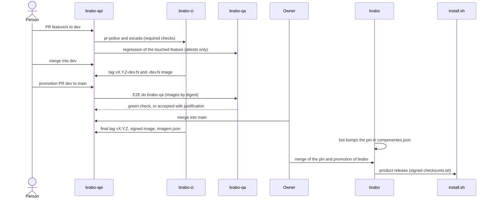

# Жизнь изменения

**Для кого:** для тех, кто хочет понять, что происходит между «я открыл PR» и «пользователь установил».

**После прочтения вы сможете:** рассказать путь изменения до релиза, указывая, в каком репозитории происходит каждый этап и что может его остановить.

Проследим за гипотетическим изменением в `brabo-api`, которое конечный пользователь получит через установщик.

## Диаграмма

## Шаг за шагом

### 1. PR в `dev`
Работа начинается от `dev` в ветке вида `функция/описание` (например, `feature/login-por-sso`). **Функция** ветки определяет версию: `breaking/` повышает MAJOR, `feature/` - MINOR, остальные - PATCH. Обязательны две проверки `brabo-ci`: `pr-police` (имя ветки, источник и цель) и `escada` (одобрения). См. [политику за 10 минут](../../explanation/politica-em-10-minutos.md) и [политику веток](../../explanation/branching-policy.md).

### 2. Регрессия по функциональности
В `brabo-qa` есть каталог (`funcionalidades.yml`), связывающий **пути в каждом репозитории** с функциональностями продукта. PR затрагивает путь, `brabo-ci` определяет, какая функциональность затронута, а `brabo-qa` запускает её спецификации на образе самого PR. Результат возвращается проверкой `Regressivo do brabo-qa`. В `dev` она **только удостоверяет и никогда не блокирует**. См. [регрессию по функциональности](../../explanation/regressivo-por-funcionalidade.md).

### 3. Слияние в `dev` и тег `-dev.N`
При каждом слиянии в `dev` `tag-release` из `brabo-ci` ставит тег `vX.Y.Z-dev.N`, а репозитории с образами публикуют образ этого тега. Это ещё не релиз: он нужен, чтобы остальные репозитории могли тестировать изменение.

### 4. Продвижение `dev` в `main`
**Продвигающий** PR переносит `dev` в `main`. Поскольку `main` потребителя использует **финальный** артефакт производителя, у продвижения есть порядок: сначала `brabo-ci`, затем контракты, затем компоненты, затем infra, затем QA и в конце `brabo`. Проверка `Dependências de merge` применяет этот порядок сама и сообщает, например, `esperando viralabs-dev/brabo-ci#45` (ожидание этого PR) ([ADR 0284](../../adr/0284-a-promocao-infere-as-dependencias-pela-ordem-dos-repos.md)).

### 5. Ворота `E2E do brabo-qa` в `main`
PR в `main` запускает E2E в браузере в `brabo-qa` на образах **по digest**. Проверка `E2E do brabo-qa` обязательна в `main`. Если она красная из-за спецификации или окружения, принять её может только владелец командой `/qa-aceitar <обоснование>` (не менее 20 символов); красное из-за digest или подписи не принимается никогда ([ADR 0267](../../adr/0267-o-e2e-do-brabo-qa-e-portao-da-main.md)).

### 6. Слияние и финальный тег
**Слияние в `main` всегда делает владелец.** Никакая автоматизация не сливает в защищённую ветку. После слияния `brabo-ci` ставит финальный тег `vX.Y.Z`; репозиторий собирает образ, проверяет его Trivy **до** подписи, подписывает по digest через cosign и прикладывает к релизу `imagem.json` (`{imagem, tag, digest}`).

### 7. Пин в `brabo`
Бот `regenera-gerados` замечает новый релиз и открывает PR `chore/regenera-gerados`, меняя тег в `componentes.json`. Слияние делает человек. Пока пин отстаёт, блокировка `Pins dos componentes` отклоняет продвижение `brabo`.

### 8. Релиз продукта и `install.sh`
Продвижение `brabo` - последнее. `release.yml` читает `componentes.json`, собирает `imagem.json` каждого компонента, проверяет образы по digest, добавляет `install.sh` и подписывает **один** `checksums.txt`. `install.sh` сверяет этот манифест и манифест runner перед установкой. Подробности - в [релизе продукта](../../explanation/release-do-produto.md).

> **TODO(humano):** `brabo` держит публикацию релиза продукта выключенной переменной `PRODUTO_RELEASE_LIGADA`, пока владелец не решит, когда ставить первые теги `v1.0.0` репозиториев. Путь описывает предполагаемый маршрут; включает его владелец.

## А если авария?
Политика предусматривает функцию `hotfix/`: она начинается от `main`, целится в `main` и выходит как PATCH. После слияния **блокировка** запрещает PR в `dev`, пока исправление не вернётся в неё (обратное слияние), чтобы ни одно исправление из продакшена не потерялось. Для компонентов Brabo, однако, решение владельца - исправлять через обычные `dev` и `main` как PATCH, без прямого `hotfix/`; пин `brabo` поднимает бот, а продвижение выходит как патч продукта.

Далее: [Соберите свой](monte-o-seu.md).
