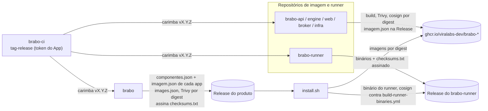

# 产品发布 {#product-release}

> Brabo 存在于多个 `viralabs-dev/brabo*` 仓库中，它如何发布**一个**产品版本（AT-704，EP-033）。每个仓库有自己的版本；产品的版本在 `brabo` 中。全部从 `1.0.0` 重新开始。本页是整体视图；镜像和签名的细节见 [CI 供应链](cadeia-de-suprimentos-do-ci.md)。

## 三个阶段 {#stages}

1. **每个仓库给自己盖 tag。** 每次推送到 `dev` 和 `main`，仓库的 workflow `tag-release.yml` 会调用 `brabo-ci` 中可复用的 `tag-release.yml`，以 SHA 固定。可复用的 workflow 按分支的功能计算版本（`breaking/` 提升 MAJOR，`feature/` 提升 MINOR，其余为 PATCH），并使用机器人 GitHub App 的 token（`BRABO_APP_ID` / `BRABO_APP_PRIVATE_KEY`，组织的 secrets）推送 tag。使用的是 App 的 token，而不是 `GITHUB_TOKEN`，因为只有它才能让 tag 触发发布 workflow。
2. **镜像仓库发布。** 在最终 tag 上，`brabo-api`、`brabo-engine`、`brabo-web`、`brabo-broker` 和 `brabo-infra`（备份镜像）构建镜像，在签名**之前**用 Trivy 扫描，按 **digest** 用 cosign keyless 签名，并在同一次运行中验证签名。它们把 `imagem.json`（`{imagem, tag, digest}`）附到各自的 Release 上，这就是与产品之间的契约。`brabo-runner` 不发布镜像：它由自己的 `build-runner-binaries.yml` 附上二进制文件和已签名的 `checksums.txt`。
3. **`brabo` 组装产品的 release。** `release.yml` 读取 `componentes.json`（每个组件的 tag），下载每个 Release 的 `imagem.json`，组装 `images.json`（`scripts/ci/montar-images.ts`），按 digest 用 Trivy 扫描镜像，汇集 `install.sh` 和 `brabo-install-*` 资产，并签署**一个** `checksums.txt`（cosign keyless，身份为 `brabo` 的 `release.yml`）。`install.sh` 核对的就是这份清单。runner 的二进制文件另行核对，对照 `brabo-runner` 的已签名 `checksums.txt`，其 tag 由 `componentes.json` 在 `.runner.tag` 中固定。

## 开关 {#gate}

`brabo` 中的仓库变量 `PRODUTO_RELEASE_LIGADA=true` 是唯一用来盖 tag 并发布产品 Release 的开关。关闭时，`tag-release.yml` 和 `release.yml` 不会运行（下面的演练除外）。由所有者来打开。

**演练。** 在某个分支上对 `release.yml` 执行 `workflow_dispatch`，`tag` 字段留空，会组装并核对所有可能核对的内容，但**不**签名也不发布，即使开关关闭也会运行。没有各组件的 Release 时，镜像不会被组装，Trivy 和镜像验证留到第一个 tag。

## `componentes.json` 固定了什么 {#components}

| 字段 | 用途 |
|---|---|
| `infra` | compose、`.trivyignore.yaml` 和 `trivy-do-release.ts` 所来自的仓库与 ref |
| `imagens.<alvo>` | 每个镜像组件的仓库、tag 和镜像；`imagem.json` 必须与之吻合 |
| `runner` | `brabo-runner` 的仓库和 tag；`install.sh` 从那里下载二进制文件（`RUNNER_TAG`，由 `scripts/dev/install-runner-release.spec.ts` 核对） |

pin **在 Git 中不会自己前进**，而是由机器人推进（AT-796，ADR 0282）：每 6 小时 `regenera-gerados.yml` 读取各组件的 `releases/latest`，核对产品所消费的资产（`imagem.json`；runner 则是 `checksums.txt` 与签名），若 Release 更新，就只替换 `componentes.json` 该行的 tag。pin 永远不会降低。`infra` 与备份镜像一起前进，`install.sh` 的 `RUNNER_TAG` 在同一个提交中更改。一切都进入固定的 PR `chore/regenera-gerados`，它免除阶梯；合并由人完成。

闸门（`scripts/ci/pins-dos-componentes.ts --conferir`）在以下情况失败：pin 落后于 Latest、没有最终 Release、缺少资产、`infra.ref` 与 `imagens.backup.tag` 不同，或 `RUNNER_TAG` 与 `runner.tag` 不同。它作为 `Pins dos componentes` 检查（面向 `main` 的 PR）以及在 `release.yml` 中运行：在 tag 上失败，在演练中只发出警告。五个镜像要么全部具备，要么都没有：有组件缺少 `imagem.json` 的产品 Release 会被拒绝。

## 尚未做出的决定 {#open}

> **TODO(humano):** 谁来决定、并按什么顺序决定何时打开 `PRODUTO_RELEASE_LIGADA` 并给各仓库盖上第一批 `v1.0.0` tag（顺序很重要：`brabo` 需要各组件的 Release 先于它自己的存在）。

> **TODO(humano):** 在 `main` 的 ruleset 中把 `Pins dos componentes` 检查设为必需。在此之前，它在晋升 PR 上显示红色，但不会阻止合并。

## 组件的 hotfix {#hotfix}

hotfix 通过正常阶梯作为 PATCH 处理（负责人的决定，AT-728）；不直接在 `main` 上使用 `hotfix/`。

1. 组件通过自己的 `dev` → `main` 修复，并获得 `vX.Y.Z+1`。
2. 机器人打开或更新带有新 pin 的 PR `chore/regenera-gerados`（或由负责人触发 `regenera-gerados`）；把它合并到 `dev`。pin 落后期间，闸门会使晋升失败。
3. `brabo` 的晋升作为产品的 patch 发布。

## 因 pin 落后而有 tag 无 Release {#pin-atras}

如果某组件在合并到 `main` 与盖章之间发布了 Release，`release.yml` 的闸门会在该 tag 上失败，产品就留下一个没有 Release 的 tag（v2.1.0 和 v2.1.1 就发生过）。出路：把机器人的 PR 合并到 `dev`，再晋升，让产品发出一个 **patch**。例如：pin 在 v1.2.0 时 web v1.2.1 成为 Latest；机器人的 PR 合并后，下一次晋升就带上 web v1.2.1。
