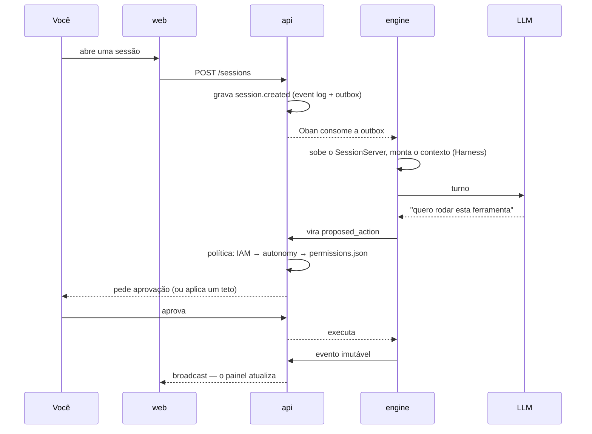

# Brabo 是什么 {#o-que-é-o-brabo}

Brabo 推进一个应用的完整生命周期，从需求简报到部署，由一支 AI 智能体团队在真实的 git
仓库上工作。**最终决定权在你手中**，这是架构的一项属性，而不是口号。每个智能体负责一个角色
（Criativo、PO、Arquiteto、开发、QA、SecOps），任何带有外部影响的操作都必须经过项目策略。

## 它与代码助手有何不同

- **任何带有外部影响的操作都不会自行发生。** 命令、commit、push、PR、merge 和 token 开销都以
  `proposed_action` 的形式产生并经过策略，其中 `deny` 始终胜过 `allow`。合并到受保护分支，连策略也不能放行。
- **按构造，智能体不可信。** 限制是结构性的：迭代上限、会拒绝调用的预算、对每个智能体
  可做之事的封闭目录。提示词不是保证；代码才是。
- **一切都被记录且不可变。** event log 只追加，正是它让成本可审计、证据可追溯。
- **团队在你的参与下改进。** Psicólogo 和 Anamnese 会对智能体的指令提出调整，每项调整都只有经你批准才生效。

## 一个回合，从头到尾

## 从哪里开始

| 你想要 | 前往 |
|---|---|
| **使用** Brabo：安装并运行第一个回合 | [快速开始](getting-started.md) |
| **理解**它如何构成以及保证什么 | [架构](architecture.md)和[闸门](explanation/gates.md) |
| 在你自己的产品中，跨多个仓库**复刻**这个思路 | [编排多个仓库](tutorials/orquestrar-repositorios/index.md) |

想改 Brabo 的代码？请看[开发 Brabo](how-to/desenvolver-o-brabo.md)。

当前版本：**v2.0.0** — [发布说明](https://github.com/viralabs-dev/brabo/releases)
