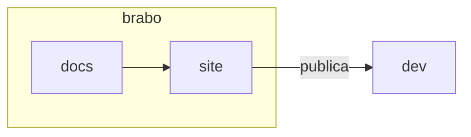

# 文档组件

除了普通 Markdown，站点还能理解一些块。它们的形式都一样：一行 `:::名称`，Markdown 内容，以及一行用来收尾的 `:::`。块内可以像页面其他位置一样使用相对的 `.md` 链接、图片、代码和粗体。

本页同时也是站点的**视觉测试**：它必须在两种主题和四种语言下都能正常渲染。

## 提示

共四种：`nota`、`dica`、`cuidado` 和 `perigo`。默认标题按页面语言翻译；要更改它，就在名称后面写上标题。英文名称（`note`、`tip`、`info`、`warning`、`caution`、`danger`）仍然可用。

```markdown
:::dica
Rode `pnpm docs:build` antes de abrir a PR.
:::

:::cuidado[Antes de apagar]
Confira o que depende deste arquivo.
:::
```

:::nota
用于不改变读者操作的补充说明。
:::

:::dica
用于捷径或良好实践。
:::

:::cuidado[由作者选择的标题]
用于出错会耗费时间但可以挽回的情形。提示文本使用 `--text-primary`，绝不使用暗淡的色调。
:::

:::perigo
用于出错会删除数据、泄露机密或无法挽回的情形。
:::

## 历史记录

`:::historico 年-月-日` 标记一段描述 Brabo **在某个日期**的样子、而不是它今天样子的内容。日期是必填的；缺失或无效时，`docs:build` 会失败。

```markdown
:::historico 2026-10-31
Nesta data o fluxo tinha cinco fases.
:::
```

:::historico 2026-10-31
在这个日期，流程有五个阶段。文字、表格或图片都放在色带内部。
:::

## 步骤

`:::passos` 包裹一个编号列表，并以圆圈中的数字和竖线来绘制它。

```markdown
:::passos
1. Clone o repositório.
2. Rode `make dev`.
3. Abra o navegador.
:::
```

:::passos
1. 克隆仓库。
2. 运行 `make dev`。
3. 在浏览器中打开 `http://localhost:3000`。
:::

## 卡片

`:::cartoes` 包裹一个形如 `- [标题](pagina.md): 一句话` 的列表。整张卡片就是链接。适用于“下一步”和索引。

```markdown
:::cartoes
- [Do zero a um entregável](../tutorials/from-zero-to-deliverable.md): um projeto de ponta a ponta.
- [Glossário](../glossary.md): os termos do produto.
:::
```

:::cartoes
- [从零到交付物](../tutorials/from-zero-to-deliverable.md): 一个项目从头到尾。
- [术语表](../glossary.md): 产品的术语。
- [快速开始](../getting-started.md): 安装并打开 Brabo。
:::

## 标签页

`:::abas` 用 `=== 标签` 行分隔各个标签页。第一个默认展开；没有 JavaScript 时，全部堆叠显示。

````markdown
:::abas
=== Linux
```bash
sudo apt install docker.io
```
=== macOS
```bash
brew install --cask docker
```
:::
````

:::abas
=== Linux
```bash
sudo apt install docker.io
```
=== macOS
```bash
brew install --cask docker
```
:::

## 带说明的图片

单独成段、带有引号标题的图片，会变成带说明文字的插图。插图可以超出阅读宽度。

```markdown

```

## 阅读宽度与图表

正文每行保持在约 72 个字符。表格、代码、插图和图表使用整个宽度。Mermaid 图表在两种主题下都继承产品的 token 颜色：


