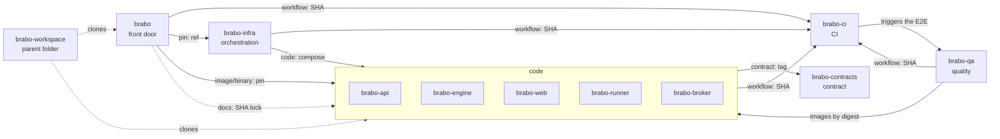

# 地图

**适合谁：** 想在深入细节之前先看清全貌的人。

**读完之后你可以：** 说出每个仓库的角色，指出它依赖什么，并凭记忆画出这张地图。

## 七种角色

| 角色 | 仓库 | 职责 |
|---|---|---|
| **入口** | [`brabo`](https://github.com/viralabs-dev/brabo#readme) | 汇总文档、站点、`install.sh` 和产品发布。 |
| **代码** | [`brabo-api`](https://github.com/viralabs-dev/brabo-api#readme)、[`brabo-engine`](https://github.com/viralabs-dev/brabo-engine#readme)、[`brabo-web`](https://github.com/viralabs-dev/brabo-web#readme)、[`brabo-runner`](https://github.com/viralabs-dev/brabo-runner#readme)、[`brabo-broker`](https://github.com/viralabs-dev/brabo-broker#readme) | 产品的各个组件。四个发布容器镜像；runner 发布二进制文件。 |
| **契约** | [`brabo-contracts`](https://github.com/viralabs-dev/brabo-contracts#readme) | 其他仓库共享的软件包和数据文件。 |
| **CI** | [`brabo-ci`](https://github.com/viralabs-dev/brabo-ci#readme) | 可复用的工作流，以及 PR 策略、审批阶梯、推进和打标签。 |
| **编排** | [`brabo-infra`](https://github.com/viralabs-dev/brabo-infra#readme) | Compose、集成用 Dockerfile、Kubernetes 清单、开发脚本和备份镜像。 |
| **质量** | [`brabo-qa`](https://github.com/viralabs-dev/brabo-qa#readme) | 浏览器端到端测试、golden 集和功能目录。它是 `main` 的关卡。 |
| **父目录** | [`brabo-workspace`](https://github.com/viralabs-dev/brabo-workspace#readme) | 各克隆并排存放的目录，以及 `clonar-tudo.sh`。不含产品代码。 |

## 示意图

箭头表示**谁使用谁**，标签表示**通过哪个渠道**（[第 3 页](como-cada-repo-e-consumido.md)解释每个渠道）。为避免图变成一团乱麻，这里只画主要的边；完整列表及每条边的证据在 `repos.yml` 中。



从图中可以得到两点：
- **`brabo-ci` 是基础。** 每个仓库都调用它；产品运行时没有任何东西导入 `brabo-ci`。
- **`brabo` 位于顶端。** 它固定构成产品的各个版本，读取其他仓库的代码来生成文档，并发布产品版本。因此它最后推进。

## 地图只有一个来源

这张表和这幅图不是手工维护的。唯一来源是 `brabo` 根目录下的 `repos.yml` 文件：对每个仓库记录角色、用途、使用方式和 `depende_de` 列表，其中**每条边**写明仓库、渠道类型和**证据**（代码使用该依赖的文件和一行原文片段；不记录行号，因为每次提交行号都会变）。

```yaml
brabo-web:
  papel: código
  depende_de:
    - { repo: brabo-contracts, tipo: contrato, prova: { arquivo: package.json, trecho: '"@brabo/shared": "npm:@viralabs-dev/brabo-shared@' } }
    - { repo: brabo-ci, tipo: workflow, prova: { arquivo: .github/workflows/carimbo.yml, trecho: "brabo-ci/.github/workflows/tag-release.yml@" } }
```

每个仓库 README 中的 "Onde se encaixa" 区块都由 `brabo-ci` 从该文件**生成**，检查会拒绝区块已经偏离的 README。这样，一个仓库的地图永远不会与另一个仓库的地图矛盾。修改依赖的人编辑 `repos.yml` 并重新生成各区块。延伸阅读：[ADR 0281](../../adr/0281-o-mapa-dos-repos-tem-uma-fonte-so.md) 和[架构](../../architecture.md)。

> **对你的项目：** 先从角色表开始。如果你无法用一句话说出某个仓库的角色，它大概不该单独存在。

下一页：[每个仓库如何被消费](como-cada-repo-e-consumido.md)。
