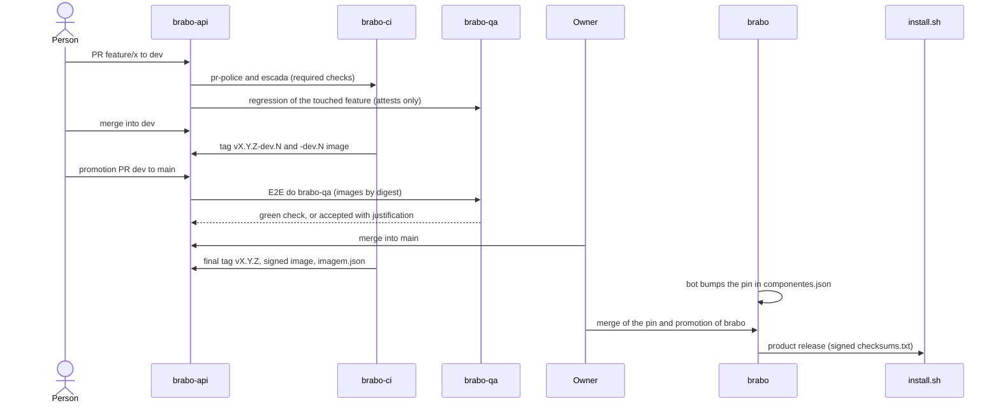

# 一次变更的生命周期

**适合谁：** 想了解从"我开了个 PR"到"用户装上了"之间发生了什么的人。

**读完之后你可以：** 讲清一次变更到发布的路径，说明每一步发生在哪个仓库，以及什么会拦住它。

我们跟踪 `brabo-api` 中一次假设的变更，最终用户将通过安装程序拿到它。

## 示意图

## 逐步说明

### 1. `dev` 上的 PR
工作从 `dev` 出发，分支命名为 `功能/描述`（例如 `feature/login-por-sso`）。分支的**功能前缀**决定将发布的版本：`breaking/` 升 MAJOR，`feature/` 升 MINOR，其余升 PATCH。`brabo-ci` 的两项检查是必需的：`pr-police`（分支名、来源和目标）和 `escada`（审批）。参见[10 分钟读懂策略](../../explanation/politica-em-10-minutos.md)和[分支策略](../../explanation/branching-policy.md)。

### 2. 按功能的回归
`brabo-qa` 有一个目录（`funcionalidades.yml`），把**各仓库中的路径**与产品功能关联起来。PR 触及某个路径，`brabo-ci` 判断触及了哪个功能，`brabo-qa` 就用 PR 自己的镜像运行该功能的规格。结果以 `Regressivo do brabo-qa` 检查返回。在 `dev` 上它**只作证明，从不阻塞**。参见[按功能的回归](../../explanation/regressivo-por-funcionalidade.md)。

### 3. 合并到 `dev` 与 `-dev.N` 标签
每次合并到 `dev`，`brabo-ci` 的 `tag-release` 都会打上 `vX.Y.Z-dev.N` 标签，镜像仓库则发布该标签的镜像。这还不是发布：它让其他仓库可以针对这次变更进行测试。

### 4. 从 `dev` 到 `main` 的推进
**推进** PR 把 `dev` 带到 `main`。由于消费方的 `main` 使用生产方的**正式**制品，推进有顺序：先是 `brabo-ci`，然后是契约，再是各组件，再是 infra，再是 QA，最后是 `brabo`。`Dependências de merge` 检查会自动应用这个顺序，并提示例如 `esperando viralabs-dev/brabo-ci#45`（等待该 PR）（[ADR 0284](../../adr/0284-a-promocao-infere-as-dependencias-pela-ordem-dos-repos.md)）。

### 5. `main` 上的 `E2E do brabo-qa` 关卡
到 `main` 的 PR 会在 `brabo-qa` 中触发浏览器 E2E，针对**按 digest** 的镜像。`E2E do brabo-qa` 检查在 `main` 上是必需的。如果因规格或环境而变红，只有负责人能用 `/qa-aceitar <理由>`（至少 20 个字符）接受；因 digest 或签名而变红则永远不能接受（[ADR 0267](../../adr/0267-o-e2e-do-brabo-qa-e-portao-da-main.md)）。

### 6. 合并与最终标签
**合并到 `main` 永远由负责人来做。** 没有任何自动化会合并到受保护的分支。合并后，`brabo-ci` 打上最终标签 `vX.Y.Z`；仓库构建镜像，在签名**之前**用 Trivy 扫描，用 cosign 按 digest 签名，并把 `imagem.json`（`{imagem, tag, digest}`）附加到 Release。

### 7. `brabo` 中的固定版本
机器人 `regenera-gerados` 发现新的 Release，开启 `chore/regenera-gerados` PR，修改 `componentes.json` 中的标签。合并由人完成。固定版本落后期间，`Pins dos componentes` 锁会拒绝 `brabo` 的推进。

### 8. 产品发布与 `install.sh`
`brabo` 的推进是最后一步。`release.yml` 读取 `componentes.json`，汇集每个组件的 `imagem.json`，按 digest 扫描镜像，加入 `install.sh`，并签署**一个** `checksums.txt`。`install.sh` 在安装前校验这份清单以及 runner 的清单。详情见[产品发布](../../explanation/release-do-produto.md)。

> **TODO(humano)：** `brabo` 通过变量 `PRODUTO_RELEASE_LIGADA` 保持产品发布关闭，直到负责人决定何时给各仓库打上第一批 `v1.0.0` 标签。路径描述的是预期的路线；开关由负责人来打开。

## 紧急情况呢？
策略提供 `hotfix/` 功能前缀，它从 `main` 出发、以 `main` 为目标，并作为 PATCH 发布。合并后，一个**锁**会阻止 `dev` 上的 PR，直到修复回到 `dev`（回合并），以免任何生产修复丢失。不过对于 Brabo 的组件，负责人的决定是通过常规的 `dev` 和 `main` 作为 PATCH 来修复，不直接使用 `hotfix/`；`brabo` 的固定版本由机器人升级，推进则作为产品的补丁发布。

下一页：[搭建你自己的](monte-o-seu.md)。
