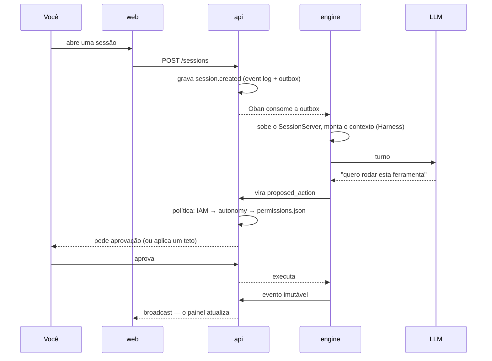

# O que é o Brabo

O Brabo conduz o ciclo completo de uma aplicação, do brief ao deploy, com um
time de agentes de IA trabalhando sobre um repositório git real. A **autoridade
final é sua**, e isso é uma propriedade da arquitetura, não um slogan. Cada
agente cuida de um papel (Criativo, PO, Arquiteto, devs, QA, SecOps) e nada com
efeito externo acontece sem passar pela política do projeto.

## O que o separa de um assistente de código

- **Nada com efeito externo acontece sozinho.** Comando, commit, push, PR, merge
  e gasto de token nascem como `proposed_action` e passam pela política, onde
  `deny` sempre vence `allow`. Merge em branch protegida nem a política libera.
- **O agente não é confiável por construção.** Os limites são estruturais: teto
  de iterações, orçamento que recusa a chamada, catálogo fechado do que cada
  agente pode fazer. Prompt não é garantia; código é.
- **Tudo fica registrado e é imutável.** O event log é append-only, e é ele que
  torna o custo auditável e a evidência rastreável.
- **O time melhora com você no circuito.** O Psicólogo e a Anamnese propõem
  ajustes nas instruções dos agentes, e cada um só vale com o seu aval.

## Um turno, do começo ao fim

## Por onde começar

| você quer | vá para |
|---|---|
| **usar** o Brabo: instalar e rodar o primeiro turno | [Primeiros passos](getting-started.md) |
| **entender** como está montado e o que ele garante | [Arquitetura](architecture.md) e [Gates](explanation/gates.md) |
| **replicar** a ideia num produto seu, em vários repositórios | [Orquestrar repositórios](tutorials/orquestrar-repositorios/index.md) |

Quer mexer no código do Brabo? Veja [Desenvolver o Brabo](how-to/desenvolver-o-brabo.md).

Versão atual: **v2.0.0** — [notas da release](https://github.com/viralabs-dev/brabo/releases)
