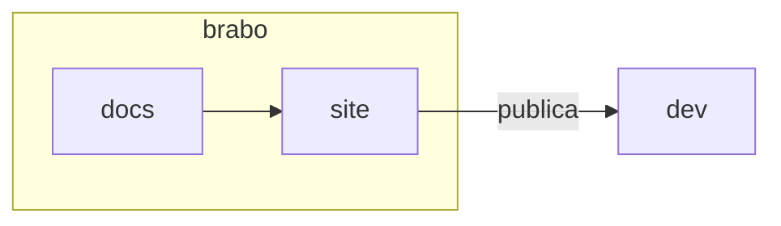

# Componentes da doc

O site entende alguns blocos além do Markdown comum. Todos usam a mesma forma: uma linha `:::nome`, o conteúdo em Markdown e uma linha `:::` que fecha. Dentro do bloco valem link `.md` relativo, imagem, código e negrito, como em qualquer parte da página.

Esta página é também o **teste visual** do site: ela precisa renderizar nos dois temas e nos quatro idiomas.

## Avisos

Quatro tipos: `nota`, `dica`, `cuidado` e `perigo`. O título padrão é traduzido pelo idioma da página; para trocá-lo, escreva-o depois do nome. Os nomes em inglês (`note`, `tip`, `info`, `warning`, `caution`, `danger`) continuam aceitos.

```markdown
:::dica
Rode `pnpm docs:build` antes de abrir a PR.
:::

:::cuidado[Antes de apagar]
Confira o que depende deste arquivo.
:::
```

:::nota
Use para um esclarecimento que não muda o que a pessoa faz.
:::

:::dica
Use para um atalho ou uma boa prática.
:::

:::cuidado[Título escolhido por quem escreve]
Use quando o erro custa tempo, mas tem volta. O texto do aviso usa `--text-primary`, nunca o tom mudo.
:::

:::perigo
Use quando o erro apaga dado, expõe segredo ou não tem volta.
:::

## Registro histórico

`:::historico AAAA-MM-DD` marca um trecho que descreve o Brabo **numa data**, e não como ele é hoje. A data é obrigatória; sem ela, ou inválida, o `docs:build` reprova.

```markdown
:::historico 2026-10-31
Nesta data o fluxo tinha cinco fases.
:::
```

:::historico 2026-10-31
Nesta data o fluxo tinha cinco fases. O texto, uma tabela ou uma imagem vêm dentro da faixa.
:::

## Passos

`:::passos` envolve uma lista numerada e a desenha com o número em círculo e a linha vertical.

```markdown
:::passos
1. Clone o repositório.
2. Rode `make dev`.
3. Abra o navegador.
:::
```

:::passos
1. Clone o repositório.
2. Rode `make dev`.
3. Abra o navegador em `http://localhost:3000`.
:::

## Cartões

`:::cartoes` envolve uma lista `- [Título](pagina.md): uma frase`. O cartão inteiro é o link. Serve para "próximo passo" e para índices.

```markdown
:::cartoes
- [Do zero a um entregável](../tutorials/from-zero-to-deliverable.md): um projeto de ponta a ponta.
- [Glossário](../glossary.md): os termos do produto.
:::
```

:::cartoes
- [Do zero a um entregável](../tutorials/from-zero-to-deliverable.md): um projeto de ponta a ponta.
- [Glossário](../glossary.md): os termos do produto.
- [Primeiros passos](../getting-started.md): instalar e abrir o Brabo.
:::

## Abas

`:::abas` separa as abas com linhas `=== Rótulo`. A primeira abre aberta; sem JavaScript, todas aparecem empilhadas.

````markdown
:::abas
=== Linux
```bash
sudo apt install docker.io
```
=== macOS
```bash
brew install --cask docker
```
:::
````

:::abas
=== Linux
```bash
sudo apt install docker.io
```
=== macOS
```bash
brew install --cask docker
```
:::

## Imagem com legenda

Uma imagem sozinha no parágrafo, com título entre aspas, vira figura com legenda. A figura pode passar da largura de leitura.

```markdown

```

## Largura de leitura e diagramas

O texto corrido fica em cerca de 72 caracteres por linha. Tabela, código, figura e diagrama usam a largura toda. Os diagramas Mermaid herdam as cores dos tokens do produto nos dois temas:


