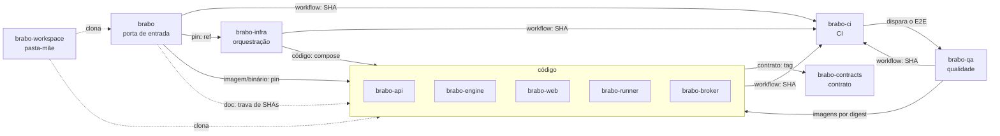

# O mapa

**Para quem é:** quem quer enxergar o conjunto antes de entrar nos detalhes.

**Depois de ler, você consegue:** dizer o papel de cada repositório, apontar de quem ele depende e desenhar o mapa de memória.

## Os sete papéis

| Papel | Repositório | O que faz |
|---|---|---|
| **Porta de entrada** | [`brabo`](https://github.com/viralabs-dev/brabo#readme) | Documentação agregada, site, `install.sh` e a release do produto. |
| **Código** | [`brabo-api`](https://github.com/viralabs-dev/brabo-api#readme), [`brabo-engine`](https://github.com/viralabs-dev/brabo-engine#readme), [`brabo-web`](https://github.com/viralabs-dev/brabo-web#readme), [`brabo-runner`](https://github.com/viralabs-dev/brabo-runner#readme), [`brabo-broker`](https://github.com/viralabs-dev/brabo-broker#readme) | Os componentes do produto. Quatro publicam imagem de contêiner; o runner publica um binário. |
| **Contrato** | [`brabo-contracts`](https://github.com/viralabs-dev/brabo-contracts#readme) | Pacotes e arquivos de dados que os outros compartilham. |
| **CI** | [`brabo-ci`](https://github.com/viralabs-dev/brabo-ci#readme) | Workflows reutilizáveis e a política de PR, a escada de aprovação, a promoção e a tag. |
| **Orquestração** | [`brabo-infra`](https://github.com/viralabs-dev/brabo-infra#readme) | Composes, Dockerfiles de integração, manifestos de Kubernetes, scripts de desenvolvimento e a imagem de backup. |
| **Qualidade** | [`brabo-qa`](https://github.com/viralabs-dev/brabo-qa#readme) | Testes de ponta a ponta no navegador, golden-sets e o catálogo de funcionalidades. É o portão da `main`. |
| **Pasta-mãe** | [`brabo-workspace`](https://github.com/viralabs-dev/brabo-workspace#readme) | A pasta onde os clones ficam lado a lado e o `clonar-tudo.sh`. Não tem código de produto. |

## O diagrama

As setas dizem **quem usa quem**, e o rótulo diz **por qual canal** (a [página 3](como-cada-repo-e-consumido.md) explica cada canal). Para não virar um novelo, o desenho mostra as arestas principais; a lista completa, com a prova de cada uma, está no `repos.yml`.



Duas leituras úteis do desenho:
- **O `brabo-ci` é a base.** Todo repositório o chama; ninguém importa nada do `brabo-ci` em tempo de execução do produto.
- **O `brabo` está no topo.** Ele pina as versões que formam o produto, lê o código dos outros para gerar a documentação e publica a release do produto. Por isso a promoção dele é a última.

## Uma fonte só para o mapa

Esta tabela e este desenho não são mantidos à mão. A fonte única é o arquivo `repos.yml`, na raiz do `brabo`: por repositório, o papel, o propósito, como é usado e a lista `depende_de`, em que **cada aresta** diz o repositório, o tipo de canal e a **prova** (arquivo e linha onde o código usa a dependência).

```yaml
brabo-web:
  papel: código
  depende_de:
    - { repo: brabo-contracts, tipo: contrato, prova: "package.json:20" }
    - { repo: brabo-ci, tipo: workflow, prova: ".github/workflows/carimbo.yml:18" }
```

O bloco "Onde se encaixa" do README de cada repositório é **gerado** desse arquivo pelo `brabo-ci`, e um check reprova o README cujo bloco divergiu. Assim o mapa de um repositório nunca discorda do de outro. Quem mexe numa dependência edita o `repos.yml` e regenera os blocos. Para saber mais: [ADR 0281](../../adr/0281-o-mapa-dos-repos-tem-uma-fonte-so.md) e a [arquitetura](../../architecture.md).

> **Para o seu projeto:** comece pela tabela de papéis. Se você não consegue dizer em uma frase o papel de um repositório, ele provavelmente não deveria existir separado.

Próxima: [Como cada repositório é consumido](como-cada-repo-e-consumido.md).
