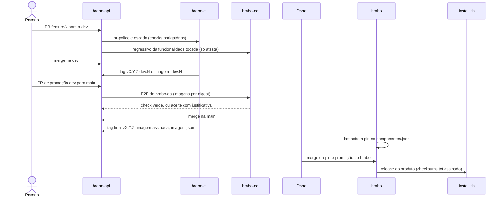

# A vida de uma mudança

**Para quem é:** quem quer entender o que acontece entre "abri um PR" e "o usuário instalou".

**Depois de ler, você consegue:** narrar o caminho de uma mudança até a release, dizendo em qual repositório cada etapa acontece e o que a poderia barrar.

Vamos seguir uma mudança hipotética na `brabo-api`, que o usuário final receberá pelo instalador.

## O diagrama

## Passo a passo

### 1. O PR na `dev`
O trabalho nasce de `dev` numa branch `funcao/descritivo` (por exemplo `feature/login-por-sso`). A **função** da branch decide a versão que sairá: `breaking/` sobe o MAJOR, `feature/` o MINOR e as demais o PATCH. Dois checks do `brabo-ci` são obrigatórios: o `pr-police` (nome da branch, origem e destino) e a `escada` (aprovações). Veja a [política em 10 minutos](../../explanation/politica-em-10-minutos.md) e a [política de branches](../../explanation/branching-policy.md).

### 2. O regressivo por funcionalidade
O `brabo-qa` tem um catálogo (`funcionalidades.yml`) que liga **caminhos de cada repositório** a funcionalidades do produto. O PR toca um caminho, o `brabo-ci` descobre qual funcionalidade foi tocada e o `brabo-qa` roda as specs dela contra a imagem do próprio PR. O resultado volta como o check `Regressivo do brabo-qa`. Na `dev` ele **só atesta e nunca bloqueia**. Veja [regressivo por funcionalidade](../../explanation/regressivo-por-funcionalidade.md).

### 3. Merge na `dev` e tag `-dev.N`
A cada merge na `dev`, o `tag-release` do `brabo-ci` carimba uma tag `vX.Y.Z-dev.N`, e os repositórios de imagem publicam a imagem dessa tag. Ainda não é release: serve para que os outros repositórios possam testar contra a mudança.

### 4. A promoção `dev` para `main`
Uma PR de **promoção** leva a `dev` para a `main`. Como a `main` do consumidor usa o artefato **final** do produtor, a promoção tem ordem: primeiro o `brabo-ci`, depois contratos, depois os componentes, depois a infra, depois o QA e por fim o `brabo`. O check `Dependências de merge` aplica essa ordem sozinho e diz, por exemplo, `esperando viralabs-dev/brabo-ci#45` ([ADR 0284](../../adr/0284-a-promocao-infere-as-dependencias-pela-ordem-dos-repos.md)).

### 5. O portão `E2E do brabo-qa` na `main`
A PR para a `main` dispara o E2E de navegador no `brabo-qa`, contra as imagens **por digest**. O check `E2E do brabo-qa` é obrigatório na `main`. Se estiver vermelho por spec ou ambiente, só o dono pode aceitá-lo, com `/qa-aceitar <justificativa>` (mínimo de 20 caracteres); vermelho por digest ou assinatura nunca é aceito ([ADR 0267](../../adr/0267-o-e2e-do-brabo-qa-e-portao-da-main.md)).

### 6. Merge e tag final
**O merge na `main` é sempre do dono.** Nenhuma automação mergeia em branch protegida. Com o merge, o `brabo-ci` carimba a tag final `vX.Y.Z`; o repositório constrói a imagem, escaneia com o Trivy **antes** de assinar, assina por digest com o cosign e anexa à Release o `imagem.json` (`{imagem, tag, digest}`).

### 7. O pin no `brabo`
O bot `regenera-gerados` percebe a Release nova e abre a PR `chore/regenera-gerados`, trocando a tag no `componentes.json`. O merge é humano. Enquanto a pin estiver atrás, a trava `Pins dos componentes` reprova a promoção do `brabo`.

### 8. A release do produto e o `install.sh`
A promoção do `brabo` é a última. O `release.yml` lê o `componentes.json`, junta o `imagem.json` de cada componente, escaneia as imagens por digest, junta o `install.sh` e assina **um** `checksums.txt`. O `install.sh` confere esse manifesto e o do runner antes de instalar. Detalhes em [release do produto](../../explanation/release-do-produto.md).

> **TODO(humano):** o `brabo` mantém a publicação da release do produto desligada pela variável `PRODUTO_RELEASE_LIGADA` até o dono decidir quando carimbar as primeiras tags `v1.0.0` dos repositórios. A trilha descreve o caminho previsto; quem liga é o dono.

## E se for uma emergência?
A política prevê a função `hotfix/`, que nasce da `main`, mira a `main` e sobe como PATCH. Depois do merge, uma **trava** impede PRs na `dev` até a correção voltar para ela (a retropropagação), para que nenhuma correção em produção se perca. Para os componentes do Brabo, porém, a decisão do dono é corrigir pela própria `dev` e `main` como PATCH, sem `hotfix/` direto; a pin do `brabo` sobe pelo bot e a promoção sai como patch do produto.

Próxima: [Monte o seu](monte-o-seu.md).
